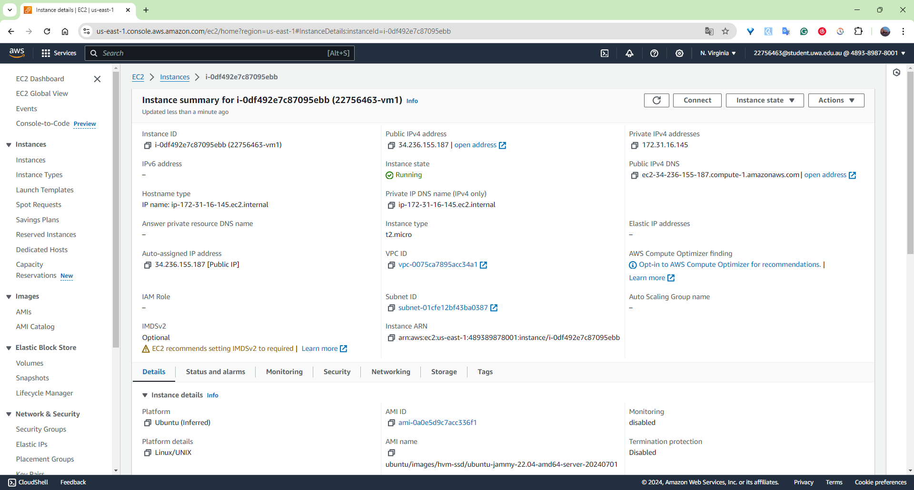
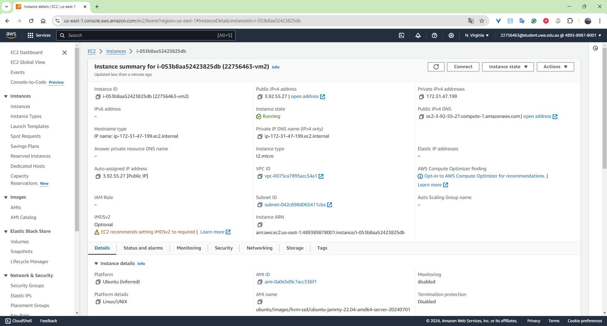
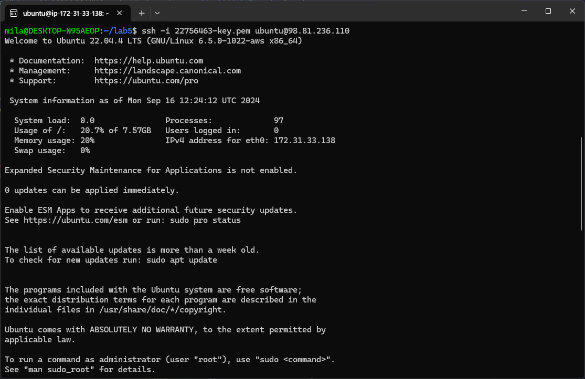
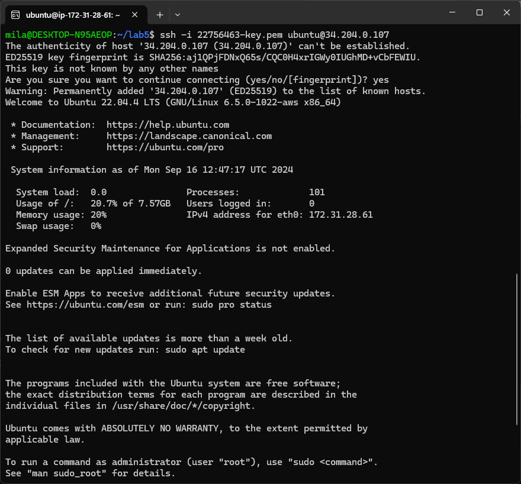
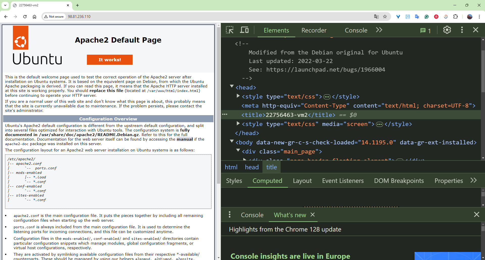

# Lab 3

## [1] Preparation
I prepared items for the program as follows:
1. I downloaded the Python code `cloudstorage.py` from the directory of [src](https://github.com/zhangzhics/CITS5503_Sem2/blob/master/Labs/src/cloudstorage.py).
2. I created a directory called `rootdir` by using command `mkdir rootdir`.
3. Then I changed into the directory `rootdir` by using command `cd rootdir` and write content "1\n2\n3\n4\n5\n" in a file called `rootfile.txt` by using command `nano rootfile.txt`.
4. I created a directory in "rootdir" called `subdir` by using command `mkdir subdir` and changed into `subdir` by using command `cd subdir`. Then I created a file named `subfile.txt`with the same content by using command `nano subfile.txt`. 

## [2] Save to S3 by updating cloudstorage.py
I uploaded those files prepared in Step 1 to the newly created S3 bucket by changing the provide Python code to the following.

### Python script: `cloudstorage.py`
```python
import os
import boto3
import base64

# Define the local root directory to start the file walk
ROOT_DIR = '.'

# Define the root S3 directory (bucket name) to upload files to
ROOT_S3_DIR = '22756463-cloudstorage'

# Initialize the S3 client using Boto3 to interact with AWS S3 service
s3 = boto3.client("s3")

# Define the AWS region for the S3 bucket
bucket_region = 'us-east-1'

# Set the bucket configuration, with the region being the LocationConstraint
bucket_config = {'LocationConstraint': bucket_region} 


# Function to upload a file to S3
def upload_file(folder_name, file, file_name):
    print("Uploading %s" % file)  # Print message showing the file being uploaded

    try:
        # Upload the file to the S3 bucket, placing it under the appropriate folder
        s3.upload_file(file, ROOT_S3_DIR, folder_name+file_name)
    except Exception as error:
        # Catch and print any errors that occur during the file upload
        print(error)
        pass  # Ignore the error, allowing the script to continue


# Check if the S3 bucket already exists
try:
    # Use head_bucket to check for the existence of the bucket
    s3.head_bucket(Bucket=ROOT_S3_DIR)
    print(f"Bucket {ROOT_S3_DIR} already exists.")  # Inform user if the bucket already exists
except Exception as error:
    # If the bucket does not exist, create it
    print(f"Creating bucket {ROOT_S3_DIR}...")  # Inform user that the bucket is being created
    try:
        # Special case: if the region is 'us-east-1', no LocationConstraint is needed
        if bucket_region == 'us-east-1':
            # Create the bucket without LocationConstraint for the N. Virginia region
            s3.create_bucket(Bucket=ROOT_S3_DIR)
        else:
            # Create the bucket with LocationConstraint for regions other than 'us-east-1'
            response = s3.create_bucket(
                Bucket=ROOT_S3_DIR,
                CreateBucketConfiguration=bucket_config
            )
            print(f"Bucket {ROOT_S3_DIR} created successfully.")  # Print success message
    except Exception as error:
        # If an error occurs during bucket creation, print the error message
        print(f"Error creating bucket: {str(error)}")
        raise  # Re-raise the error to terminate the script if bucket creation fails


# Parse the local directory and upload files to S3
for dir_name, subdir_list, file_list in os.walk(ROOT_DIR, topdown=True):
    # Ignore the root directory itself and start from its subdirectories
    if dir_name != ROOT_DIR:
        # Loop over each file in the directory
        for fname in file_list:
            # Upload each file to S3 using the folder structure from the local directory
            upload_file("%s/" % dir_name[2:], "%s/%s" % (dir_name, fname), fname)

# Print done message after all files have been uploaded
print("done")
```
A detailed breakdown is provided as comments above.

### Results
Files uploaded to the S3 bucket with the same file structure as shown in Step 1.


## [3] Restore from S3
I downloaded the files and directories from the S3 bucket by running the following Python script.

### Python script: `restorefromcloud.py`
```python
import os  # Import the os module for interacting with the file system
import boto3  # Import the boto3 module for working with AWS services, including S3

# Initialise the S3 client to interact with AWS S3 service
s3 = boto3.client('s3')

# Define the S3 bucket name from which the files will be restored
BUCKET_NAME = '22756463-cloudstorage'  

# Define the root directory where the restored files will be saved locally
LOCAL_ROOT_DIR = './restored_files'  

# Loop through each object (file) in the specified S3 bucket
for object in s3.list_objects(Bucket = BUCKET_NAME)['Contents']:
    object_key = object['Key']  # Get the key (path) of the object in the S3 bucket
    print("Downloading %s" % object_key)  # Print the name of the object being downloaded

    # Get the directory path of the object in the S3 bucket (excluding the file name)
    cloud_dir_path = os.path.dirname(object_key)

    # Create the corresponding local directory path to save the file
    local_dir_path = os.path.join(LOCAL_ROOT_DIR, cloud_dir_path)
    
    # Check if the local directory exists, if not, create it
    if not os.path.exists(local_dir_path):
        os.makedirs(local_dir_path)
    
    # Define the full local file path to save the downloaded file
    local_file_path = os.path.join(LOCAL_ROOT_DIR, object_key)

    # Download the object from the S3 bucket and save it to the specified local path
    s3.download_file(BUCKET_NAME, object_key, local_file_path)
```
A detailed breakdown is provided as comments above.

### Results
The files and directories from the S3 bucket were downloaded into the local Linux environment.


## [4] Write information about files to DynamoDB

### 1. Install DynamoDB and jre
I created a direcotry named `dynamodb` and changed into that directory by using commands `mkdir dynamodb` and `cd dynamodb`. Then I installed jre (Java Runtime Environment) using command `sudo apt-get install default-jre` and downloaded DynamoDB compressed file using `wget https://s3-ap-northeast-1.amazonaws.com/dynamodb-local-tokyo/dynamodb_local_latest.tar.gz`. I extracted files from the downloaded DynamoDB compressed archive format by using command `tar -zxvf dynamodb_local_latest.tar.gz`.

Note for myself: Amazon DynamoDB is a fully managed, scalable NoSQL database service offering fast, low-latency data access for high-performance applications.

#### Commands
- `mkdir`: create a directory.
- `cd`: change into another directory.
- `sudo`: Runs the command with superuser (root) privileges.
- `apt-get`: The package manager used to install, update, and manage software packages.
- `install`: The command to install a package.
- `wget`: A command-line tool used to download files from the web. In this case, it’s downloading a file named `dynamodb_local_latest.tar.gz` from an Amazon S3 bucket.
- `tar`: Used to create and extract archive files in Linux. In this case, it is used to extract the files from a compressed archive (.tar.gz).
- `-zxvf`: The options following tar specify how the archive should be handled.
    -z: Tells tar to decompress the file using gzip (since .tar.gz is a gzipped tar archive).
    -x: Stands for extract. This option tells tar to extract the contents of the archive.
    -v: Stands for verbose. This option makes tar list the files being extracted as they are processed, so you can see what is happening.
    -f: Stands for file. This option specifies the name of the archive file that tar should operate on. In this case, it’s dynamodb_local_latest.tar.gz.

#### Results
DynamoDB and jre were installed in the local Linux environment.


### 2. Run DynamoDB local
I started DynamoDB Local on my machine with a single shared database for all users and regions, using the native libraries stored in the DynamoDBLocal_lib directory. *It allows me to test DynamoDB operations without connecting to the actual AWS cloud.*

#### Commands
- `java`: This is the Java runtime command. It is used to execute Java applications (i.e., run .jar files). The DynamoDB Local application is provided as a .jar file.
- `-Djava.library.path=./DynamoDBLocal_lib`: This is a Java option that sets the library path to a specific directory.
    - `-D`: Specifies a system property in Java.
    - `java.library.path`: This property defines where Java looks for native libraries (such as .so files on Linux, .dll files on Windows, or .dylib files on macOS).
    - `=./DynamoDBLocal_lib`: This sets the path to the directory where the native libraries needed for DynamoDB Local are located. The `.` indicates the current directory, and `DynamoDBLocal_lib` is a subdirectory containing the necessary libraries.
- `-jar DynamoDBLocal.jar`: This part tells Java to run a Java Archive (JAR) file. `-jar`: Indicates that the following file is a JAR file to be executed.
`DynamoDBLocal.jar`: This is the JAR file containing the DynamoDB Local application, which simulates the DynamoDB service locally.
- `–sharedDb`: This option tells DynamoDB Local to use a single shared database instance instead of creating separate databases for each user account and region.

#### Results
The DynamoDB local was running.
```bash
Initializing DynamoDB Local with the following configuration:
Port:   8000
InMemory:       false
Version:        1.25.0
DbPath: null
SharedDb:       false
shouldDelayTransientStatuses:   false
CorsParams:     null
```
### 3. Write a DynamoDB table
I created a DynamoDB table, extracted attributes of files of the S3 bucket I created in previous steps, and saved those information into the DynamoDB table using the following Python script. 

#### Python script `fileinfo.py`
```python
import boto3  # Import the boto3 module for interacting with AWS services
from botocore.exceptions import ClientError  # Import ClientError to handle exceptions from AWS services
import os  # Import os module to interact with the file system

# Initialise DynamoDB resource and S3 client
dynamodb = boto3.resource('dynamodb', endpoint_url="http://localhost:8000")  # Local DynamoDB for testing
s3 = boto3.client('s3')  # S3 client to interact with S3 bucket

# Define the S3 bucket name from which files will be read
BUCKET_NAME = '22756463-cloudstorage'

# Define the DynamoDB table name where file information will be stored
TABLE_NAME = 'CloudFiles'

# Function to create a DynamoDB table
def create_cloudfiles_table():
    # Creating a DynamoDB table with partition key 'userId' and sort key 'fileName'
    # Using ProvisionedThroughput to set read/write capacity units
    try:
        table = dynamodb.create_table(
            TableName=TABLE_NAME,  # Table name
            KeySchema=[  # Defines the primary key structure
                {'AttributeName': 'userId', 'KeyType': 'HASH'},  # Partition key (userId)
                {'AttributeName': 'fileName', 'KeyType': 'RANGE'},  # Sort key (fileName)
            ],
            AttributeDefinitions=[  # Attribute definitions for the key schema
                {'AttributeName': 'userId', 'AttributeType': 'S'},  # String type for userId
                {'AttributeName': 'fileName', 'AttributeType': 'S'},  # String type for fileName
            ],
            ProvisionedThroughput={'ReadCapacityUnits': 10, 'WriteCapacityUnits': 10}  # Read and write capacity settings
        )
        # Wait until the table is created successfully
        table.meta.client.get_waiter('table_exists').wait(TableName=TABLE_NAME)
        print(f"Table {TABLE_NAME} created successfully.")
        return table  # Return the created table
    except ClientError as e:
        # Handle the case where the table already exists
        if e.response['Error']['Code'] == 'ResourceInUseException':
            print(f"Table {TABLE_NAME} already exists.")
        else:
            raise  # Raise other errors

# Function to get the file attributes for each file in the S3 bucket
def get_s3_file_attributes(bucket_name):
    try:
        # List all objects (files) in the specified S3 bucket
        response = s3.list_objects_v2(Bucket=bucket_name)

        # Check if there are no files in the bucket
        if 'Contents' not in response:
            print(f"No files found in bucket {bucket_name}.")
            return []

        files = []  # List to hold file attribute dictionaries
        # Iterate through each file in the bucket
        for object in response['Contents']:
            s3_key = object['Key']  # Get the key (file path) of the object

            # Get the Access Control List (ACL) for the object to retrieve file ownership and permission details
            acl_response = s3.get_object_acl(Bucket=bucket_name, Key=s3_key)
            userId = acl_response['Owner']['ID']  # Get the user ID of the owner
            owner = acl_response['Owner']['DisplayName']  # Get the owner's display name
            permission = acl_response['Grants'][0]['Permission']  # Get the permission (e.g., FULL_CONTROL)

            # Create a dictionary of file attributes
            file_info = {
                'userId': userId,  # Owner's user ID
                'fileName': s3_key.split('/')[-1],  # File name (last part of the S3 key)
                'path': s3_key,  # Full path of the file in the S3 bucket
                'lastUpdated': object['LastModified'].isoformat(),  # Last modified date (in ISO format)
                'owner': owner,  # Owner's display name
                'permissions': permission  # File permissions
            }
            files.append(file_info)  # Append file info to the list
        return files  # Return the list of file attributes

    except ClientError as e:
        # Handle any errors encountered when accessing the S3 bucket
        print(f"Error accessing S3 bucket: {e}")
        return []

# Function to write file attributes to DynamoDB
def write_to_dynamodb(table_name, files):
    table = dynamodb.Table(table_name)  # Access the DynamoDB table

    # Iterate through each file's attributes and insert them into the table
    for file_info in files:
        try:
            # Insert the file info as a new item in the DynamoDB table
            table.put_item(Item=file_info)
            print(f"Successfully inserted: {file_info['fileName']}")  # Print success message
        except ClientError as e:
            # Handle errors encountered when inserting data into the table
            print(f"Error inserting {file_info['fileName']} into DynamoDB: {e.response['Error']['Message']}")

# Main function to orchestrate the process
if __name__ == "__main__":
    # Step 1: Create the DynamoDB table
    create_cloudfiles_table()

    # Step 2: Get the file attributes from the S3 bucket
    files = get_s3_file_attributes(BUCKET_NAME)

    # Step 3: If there are files, write their attributes to the DynamoDB table
    if files:
        write_to_dynamodb(TABLE_NAME, files)
        print("Done.")  # Print a final success message
    else:
        print("No files to insert.")  # Print message if there are no files
```
A detailed explanation is provided as comments above.

#### Results
Successfully inserted information about `rootfile.txt` and `subfile.txt`.

## [5] Scan the table
I scanned and output the table in the command line interface by using command `aws dynamodb scan --table-name CloudFiles --endpoint-url http://localhost:8000`.

### Commands
- `aws dynamodb scan`: This scans the entire CloudFiles table and returns all items.
- `--table-name CloudFiles`: Specifies the DynamoDB table I created (CloudFiles).
- `--endpoint-url http://localhost:8000`: This flag is used only if running DynamoDB locally. It specifies the local endpoint.

### Results
```bash
{
    "Items": [
        {
            "owner": {
                "S": "zhi.zhang"
            },
            "path": {
                "S": "rootdir/rootfile.txt"
            },
            "lastUpdated": {
                "S": "2024-09-07T13:00:00+00:00"
            },
            "fileName": {
                "S": "rootfile.txt"
            },
            "userId": {
                "S": "2a5fac7aada1ad2caa48c9ab08cc4e2428d4eb596108daa3b59f1204ae96482e"
            },
            "permissions": {
                "S": "FULL_CONTROL"
            }
        },
        {
            "owner": {
                "S": "zhi.zhang"
            },
            "path": {
                "S": "rootdir/subdir/subfile.txt"
            },
            "lastUpdated": {
                "S": "2024-09-07T13:00:00+00:00"
            },
            "fileName": {
                "S": "subfile.txt"
            },
            "userId": {
                "S": "2a5fac7aada1ad2caa48c9ab08cc4e2428d4eb596108daa3b59f1204ae96482e"
            },
            "permissions": {
                "S": "FULL_CONTROL"
            }
        }
    ],
    "Count": 2,
    "ScannedCount": 2,
    "ConsumedCapacity": null
}
```

## [6] Delete the table
I deleted the created DynamoDB table using command `aws dynamodb delete-table --table-name CloudFiles --endpoint-url http://localhost:8000
`, and deleted the created S3 bucket from AWS console.

### Commands
- `aws dynamodb delete-table`: This command deletes a DynamoDB table.
- `--table-name CloudFiles`: Specifies the name of the table I want to delete (in this case, CloudFiles).
- `-endpoint-url http://localhost:8000`: If using DynamoDB Local, I need to specify the endpoint URL.

### Results
The DynamoDB table is deleted.


<div style="page-break-after: always;"></div>


## Application Load Balancer

### [1] Create 2 EC2 instances
I created 2 EC2 instances in two different availability zones in my allocated region(us-east-1) using the Python script below. I also created a security group to authorise inbound traffic for HTTP and SSH before creating the instances.

#### Python script `create_instances.py`
```python
import boto3
from botocore.exceptions import ClientError

# Create a Boto3 EC2 client
ec2 = boto3.client('ec2')

# Step 1: Create a security group
def create_security_group(group_name, description):
    try:
        # https://boto3.amazonaws.com/v1/documentation/api/latest/reference/services/ec2/client/create_security_group.html
        response = ec2.create_security_group(
            GroupName=group_name,
            Description=description,
        )
        security_group_id = response['GroupId']
        print(f'Security Group {group_name} created with ID: {security_group_id}')
        return security_group_id
    except ClientError as e:
        print(f"Error creating security group: {e}")
        return None

# Step 2: Authorise inbound traffic for SSH and HTTP
def authorize_security_group_ingress(group_name):
    try:
        # https://boto3.amazonaws.com/v1/documentation/api/latest/reference/services/ec2/client/authorize_security_group_ingress.html
        ec2.authorize_security_group_ingress(
            GroupName= group_name,
            IpPermissions=[
                {
                    'IpProtocol': 'tcp',
                    'FromPort': 22, # SSH
                    'ToPort': 22,
                    'IpRanges': [{'CidrIp': '0.0.0.0/0'}]
                },
                {
                    'IpProtocol': 'tcp',
                    'FromPort': 80,  # HTTP
                    'ToPort': 80,
                    'IpRanges': [{'CidrIp': '0.0.0.0/0'}]
                }
            ]
        )
        print(f"SSH and HTTP rule added to Security Group: {group_name}")
    except ClientError as e:
        print(f"Error adding SSH rule to security group: {e}")

# Step 3: Get the available zones in your region
def get_availability_zones():
    availability_zones = ec2.describe_availability_zones()['AvailabilityZones']

    # Make sure there are at least 2 zones available
    if len(availability_zones) < 2:
        raise Exception('Less than 2 availability zones available in this region.')
    
    return availability_zones

# Step 4: Create a key pair
def create_key_pair(key_name):
    try:
        # https://boto3.amazonaws.com/v1/documentation/api/latest/reference/services/ec2/client/create_key_pair.html
        key_pair = ec2.create_key_pair(KeyName=key_name)
        private_key = key_pair['KeyMaterial']
        
        # Save the private key to a .pem file
        with open(f"{key_name}.pem", "w") as key_file:
            key_file.write(private_key)
        
        print(f"Key pair {key_name} created and saved as {key_name}.pem")

    except ClientError as e:
        print(f"Error creating key pair: {e}")

# Step 5: Create two instances in different availability zones
def create_instances(key_name, security_group_name, ami_id, availability_zones, student_number):
    for i in range(2):
        try:
            # https://boto3.amazonaws.com/v1/documentation/api/latest/reference/services/ec2/client/run_instances.html
            instances = ec2.run_instances(
                ImageId= ami_id,
                MinCount=1,
                MaxCount=1,
                InstanceType='t2.micro',
                KeyName=key_name,
                SecurityGroups=[security_group_name],
                Placement={
                    'AvailabilityZone': availability_zones[i]['ZoneName']
                },
                TagSpecifications=[
                    {
                        'ResourceType': 'instance',
                        'Tags': [
                            {'Key': 'Name', 'Value': f'{student_number}-vm{i+1}'}
                        ]
                    }
                ]
            )
            instance_id = instances['Instances'][0]['InstanceId']
            print(f"EC2 instance created with Instance ID: {instance_id}")
        except ClientError as e:
            print(f"Error creating EC2 instance: {e}")

def main():
    sg_name = "22756463-sg"
    sg_description = "security group for development environment"
    student_number = '22756463'
    ami_id = 'ami-0a0e5d9c7acc336f1'
    key_name = "22756463-key"

    # Step 1: Create a security group
    create_security_group(sg_name, sg_description)

    # Step 2: Authorise inbound traffic for SSH
    authorize_security_group_ingress(sg_name)

    # Step 3: Get the available zones in your region
    availability_zones = get_availability_zones()

    # Step 4: Create a key pair
    create_key_pair(key_name)

    # Step 5: Create two instances in different availability zones
    create_instances(key_name, sg_name, ami_id, availability_zones, student_number)

if __name__ == "__main__":
    main()
```
A detailed description of each function can be found in Step 2 Create an Application Load Balancer below.


#### Results
Two instances created with instance ID: `i-0df492e7c87095ebb` and `i-053b8aa52423825dbas` as follows.



### [2] Create an Application Load Balancer

#### Python script `create_alb.py`
```python
import boto3
from botocore.exceptions import ClientError

# Create a Boto3 EC2 and ELBv2 client
ec2 = boto3.client('ec2')
elbv2 = boto3.client('elbv2')

# Step 1: Create a security group
def create_security_group(group_name, description):
    try:
        response = ec2.create_security_group(
            GroupName=group_name,
            Description=description,
        )
        security_group_id = response['GroupId']
        print(f'Security Group {group_name} created with ID: {security_group_id}')
        return security_group_id
    except ClientError as e:
        print(f"Error creating security group: {e}")
        return None

# Step 2: Authorise inbound traffic for SSH and HTTP
def authorize_security_group_ingress(group_name):
    try:
        ec2.authorize_security_group_ingress(
            GroupName= group_name,
            IpPermissions=[
                {
                    'IpProtocol': 'tcp',
                    'FromPort': 22, # SSH
                    'ToPort': 22,
                    'IpRanges': [{'CidrIp': '0.0.0.0/0'}]
                },
                {
                    'IpProtocol': 'tcp',
                    'FromPort': 80,  # HTTP
                    'ToPort': 80,
                    'IpRanges': [{'CidrIp': '0.0.0.0/0'}]
                }
            ]
        )
        print(f"SSH and HTTP rule added to Security Group: {group_name}")
    except ClientError as e:
        print(f"Error adding rules to security group: {e}")

# Step 3: Get the available zones in your region
def get_availability_zones():
    availability_zones = ec2.describe_availability_zones()['AvailabilityZones']

    if len(availability_zones) < 2:
        raise Exception('Less than 2 availability zones available in this region.')
    
    return availability_zones

# Step 4: Create a key pair
def create_key_pair(key_name):
    try:
        key_pair = ec2.create_key_pair(KeyName=key_name)
        private_key = key_pair['KeyMaterial']
        with open(f"{key_name}.pem", "w") as key_file:
            key_file.write(private_key)
        print(f"Key pair {key_name} created and saved as {key_name}.pem")
    except ClientError as e:
        print(f"Error creating key pair: {e}")

# Step 5: Create two instances in different availability zones
def create_instances(key_name, security_group_name, ami_id, availability_zones, student_number):
    instance_ids = []
    for i in range(2):
        try:
            instances = ec2.run_instances(
                ImageId= ami_id,
                MinCount=1,
                MaxCount=1,
                InstanceType='t2.micro',
                KeyName=key_name,
                SecurityGroups=[security_group_name],
                Placement={
                    'AvailabilityZone': availability_zones[i]['ZoneName']
                },
                TagSpecifications=[
                    {
                        'ResourceType': 'instance',
                        'Tags': [
                            {'Key': 'Name', 'Value': f'{student_number}-vm{i+1}'}
                        ]
                    }
                ]
            )
            instance_id = instances['Instances'][0]['InstanceId']
            instance_ids.append(instance_id)
            print(f"EC2 instance created with Instance ID: {instance_id}")
        except ClientError as e:
            print(f"Error creating EC2 instance: {e}")
    return instance_ids

# Step 6: Get the available subnets in your region
def get_subnets():
    subnets_response = ec2.describe_subnets()
    subnets = subnets_response['Subnets']
    
    # Filter subnets to only include those that are in available state
    available_subnets = [subnet for subnet in subnets if subnet['State'] == 'available']
    
    if len(available_subnets) < 2:
        raise Exception('Less than 2 available subnets in this region.')
    
    return available_subnets

# Step 7: Create the network load balancer
def create_load_balancer(sg_id, subnets):
    try:
        response = elbv2.create_load_balancer(
            Name='22756463-load-balancer',
            Subnets=subnets,
            SecurityGroups=[sg_id],
            Scheme='internet-facing',
            Type='application',
            IpAddressType='ipv4'
        )
        lb_arn = response['LoadBalancers'][0]['LoadBalancerArn']
        print(f"Load Balancer created with ARN: {lb_arn}")
        return lb_arn
    except ClientError as e:
        print(f"Error creating load balancer: {e}")
        return None

# Step 8: Create a target group
def create_target_group(vpc_id):
    try:
        response = elbv2.create_target_group(
            Name='22756463-target-group',
            Protocol='HTTP',
            Port=80,
            VpcId=vpc_id,
            HealthCheckProtocol='HTTP',
            HealthCheckPort='80',
            TargetType='instance'
        )
        target_group_arn = response['TargetGroups'][0]['TargetGroupArn']
        print(f"Target group created with ARN: {target_group_arn}")
        return target_group_arn
    except ClientError as e:
        print(f"Error creating target group: {e}")
        return None

# Step 9: Register targets (EC2 instances) to the target group
def register_targets(target_group_arn, instance_ids):
    try:
        targets = [{'Id': instance_id} for instance_id in instance_ids]
        elbv2.register_targets(
            TargetGroupArn=target_group_arn,
            Targets=targets
        )
        print(f"Registered instances {instance_ids} to the target group.")
    except ClientError as e:
        print(f"Error registering targets: {e}")

# Step 10: Create a listener to forward traffic to the target group
def create_listener(lb_arn, target_group_arn):
    try:
        elbv2.create_listener(
            LoadBalancerArn=lb_arn,
            Protocol='HTTP',
            Port=80,
            DefaultActions=[{
                'Type': 'forward',
                'TargetGroupArn': target_group_arn
            }]
        )
        print(f"Listener created for Load Balancer {lb_arn}")
    except ClientError as e:
        print(f"Error creating listener: {e}")

def main():
    sg_name = "22756463-sg"
    sg_description = "security group for development environment"
    student_number = '22756463'
    ami_id = 'ami-0a0e5d9c7acc336f1'
    key_name = "22756463-key"

    # Step 1: Create a security group
    sg_id = create_security_group(sg_name, sg_description)

    # Step 2: Authorise inbound traffic for SSH and HTTP
    authorize_security_group_ingress(sg_name)

    # Step 3: Get the available zones in your region
    availability_zones = get_availability_zones()

    # Step 4: Create a key pair
    create_key_pair(key_name)

    # Step 5: Create two instances in different availability zones
    instance_ids = create_instances(key_name, sg_name, ami_id, availability_zones, student_number)

    # Step 6: Get VPC ID
    vpcs = ec2.describe_vpcs()
    vpc_id = vpcs['Vpcs'][0]['VpcId']
    
    # Step 7: Create an Application Load Balancer (ALB)
    subnets = get_subnets()
    subnet_ids = [subnets[0]['SubnetId'], subnets[1]['SubnetId']]
    lb_arn = create_load_balancer(sg_id, subnet_ids)

    # Step 8: Create a target group in the same VPC
    target_group_arn = create_target_group(vpc_id)

    # Step 9: Register EC2 instances as targets
    register_targets(target_group_arn, instance_ids)

    # Step 10: Create a listener to forward HTTP requests
    create_listener(lb_arn, target_group_arn)

if __name__ == "__main__":
    main()
```
- `elbv2.create_load_balancer()`: Creates a new Network Load Balancer, which distributes traffic across multiple targets (EC2 instances and IP addresses).
- `elbv2.create_target_group()`: Creates a target group, which is a logical grouping of EC2 instances or IP addresses to which the load balancer directs traffic.
- `ec2.create_security_group()`: Creates a security group that acts as a virtual firewall for the instances, controlling inbound and outbound traffic.
- `ec2.authorize_security_group_ingress()`: Adds inbound rules to the security group, allowing traffic for SSH (port 22) and HTTP (port 80) from all IP addresses (0.0.0.0/0).
- `ec2.describe_availability_zones()`: Retrieves a list of available availability zones in the region, ensuring that instances are created in different zones for fault tolerance.
- `ec2.create_key_pair()`: Creates a key pair for SSH access to the EC2 instances. The private key is saved locally, and the public key is associated with the instances.
- `ec2.run_instances()`: Launches EC2 instances in different availability zones, assigning them to the previously created security group and key pair.
- `elbv2.register_targets()`: Registers the EC2 instances to the target group so that the load balancer can send traffic to them.
- `elbv2.create_listener()`: Creates a listener for the load balancer that listens for HTTP traffic on port 80 and forwards the requests to the target group.

#### Results
Created a security group, authorised inbound traffic (SSH and HTTP), retrieved availability zones, created a key pair for SSH access, launched two EC2 instances with ID `i-0d275177fc9f9ac28` and `i-04cdb45522154b089`, retrieved available subnets, created an ALB with the retrieved subnets, created a target group, registered the EC2 instances with the target group, and set up a listener on the ALB to forward HTTP traffic.

### [3] Test the Application Load Balancer
#### 3.1 SSH to each of the two instances
I obtained the public IP address of each EC2 instances from the AWS console. They are `98.81.236.110` and `34.204.0.107`. Then I ssh to each of the two instances using commands `ssh -i 22756463-key.pem ubuntu@98.81.236.110` and `ssh -i 22756463-key.pem ubuntu@34.204.0.107`.

##### Commands
- `ssh`: This is the command to initiate an SSH (Secure Shell) connection, which allows you to remotely connect to another machine securely over the internet.
- `-i`: The -i option specifies the identity file (in this case, 22756463-key.pem). This is the private key file that corresponds to the public key stored on my EC2 instance.
- `ubuntu`: This is the username for my EC2 instance. Since my instance is running Ubuntu, the default username is ubuntu.

##### Results
I sshed to EC2 instances:



#### 3.2 Update each instance
I updated each instance using command `sudo apt-get update`. After running this command, the system is prepared to install or upgrade packages based on the latest information from the repositories. 

##### Commands
- `sudo`: Run the command with elevated (root) permissions. Installing software or making changes to system-wide configurations requires superuser privileges, so sudo is necessary for this command.
- `apt-get`: It is the Advanced Package Tool command-line interface for managing packages on Linux. It performs low-level operations, including installing, upgrading, and removing software packages, as well as updating the local package index. Note: `apt` (without `-get`) is a slightly newer version of the command with more user-friendly output but performs the same operations.
- `update`: The update option instructs apt-get to update the package index.
It retrieves the latest list of available packages, versions, and their dependencies from the package repositories configured in the system.

`sudo apt-get update` updates the local list of available software packages and their versions from the repositories but does not install or upgrade any software.

##### Results
Updated each instance:
```
Hit:1 http://us-east-1.ec2.archive.ubuntu.com/ubuntu jammy InRelease
Get:2 http://us-east-1.ec2.archive.ubuntu.com/ubuntu jammy-updates InRelease [128 kB]
Get:3 http://us-east-1.ec2.archive.ubuntu.com/ubuntu jammy-backports InRelease [127 kB]
Get:4 http://security.ubuntu.com/ubuntu jammy-security InRelease [129 kB]
Get:5 http://us-east-1.ec2.archive.ubuntu.com/ubuntu jammy/universe amd64 Packages [14.1 MB]
Get:6 http://us-east-1.ec2.archive.ubuntu.com/ubuntu jammy/universe Translation-en [5652 kB]
Get:7 http://us-east-1.ec2.archive.ubuntu.com/ubuntu jammy/universe amd64 c-n-f Metadata [286 kB]
Get:8 http://us-east-1.ec2.archive.ubuntu.com/ubuntu jammy/multiverse amd64 Packages [217 kB]
Get:9 http://us-east-1.ec2.archive.ubuntu.com/ubuntu jammy/multiverse Translation-en [112 kB]
Get:10 http://us-east-1.ec2.archive.ubuntu.com/ubuntu jammy/multiverse amd64 c-n-f Metadata [8372 B]
Get:11 http://us-east-1.ec2.archive.ubuntu.com/ubuntu jammy-updates/main amd64 Packages [2023 kB]
Get:12 http://us-east-1.ec2.archive.ubuntu.com/ubuntu jammy-updates/main Translation-en [352 kB]
Get:13 http://us-east-1.ec2.archive.ubuntu.com/ubuntu jammy-updates/main amd64 c-n-f Metadata [17.8 kB]
Get:14 http://us-east-1.ec2.archive.ubuntu.com/ubuntu jammy-updates/restricted amd64 Packages [2437 kB]
Get:15 http://us-east-1.ec2.archive.ubuntu.com/ubuntu jammy-updates/restricted Translation-en [419 kB]
Get:16 http://us-east-1.ec2.archive.ubuntu.com/ubuntu jammy-updates/restricted amd64 c-n-f Metadata [616 B]
Get:17 http://us-east-1.ec2.archive.ubuntu.com/ubuntu jammy-updates/universe amd64 Packages [1124 kB]
Get:18 http://us-east-1.ec2.archive.ubuntu.com/ubuntu jammy-updates/universe Translation-en [261 kB]
Get:19 http://us-east-1.ec2.archive.ubuntu.com/ubuntu jammy-updates/universe amd64 c-n-f Metadata [26.1 kB]
Get:20 http://us-east-1.ec2.archive.ubuntu.com/ubuntu jammy-updates/multiverse amd64 Packages [43.3 kB]
Get:21 http://us-east-1.ec2.archive.ubuntu.com/ubuntu jammy-updates/multiverse Translation-en [10.8 kB]
Get:22 http://us-east-1.ec2.archive.ubuntu.com/ubuntu jammy-updates/multiverse amd64 c-n-f Metadata [444 B]
Get:23 http://us-east-1.ec2.archive.ubuntu.com/ubuntu jammy-backports/main amd64 Packages [67.8 kB]
Get:24 http://us-east-1.ec2.archive.ubuntu.com/ubuntu jammy-backports/main Translation-en [11.1 kB]
Get:25 http://us-east-1.ec2.archive.ubuntu.com/ubuntu jammy-backports/main amd64 c-n-f Metadata [388 B]
Get:26 http://us-east-1.ec2.archive.ubuntu.com/ubuntu jammy-backports/restricted amd64 c-n-f Metadata [116 B]
Get:27 http://us-east-1.ec2.archive.ubuntu.com/ubuntu jammy-backports/universe amd64 Packages [28.8 kB]
Get:28 http://us-east-1.ec2.archive.ubuntu.com/ubuntu jammy-backports/universe Translation-en [16.5 kB]
Get:29 http://us-east-1.ec2.archive.ubuntu.com/ubuntu jammy-backports/universe amd64 c-n-f Metadata [672 B]
Get:30 http://us-east-1.ec2.archive.ubuntu.com/ubuntu jammy-backports/multiverse amd64 c-n-f Metadata [116 B]
Get:31 http://security.ubuntu.com/ubuntu jammy-security/main amd64 Packages [1806 kB]
Get:32 http://security.ubuntu.com/ubuntu jammy-security/main Translation-en [295 kB]
Get:33 http://security.ubuntu.com/ubuntu jammy-security/main amd64 c-n-f Metadata [13.3 kB]
Get:34 http://security.ubuntu.com/ubuntu jammy-security/restricted amd64 Packages [2377 kB]
Get:35 http://security.ubuntu.com/ubuntu jammy-security/restricted Translation-en [409 kB]
Get:36 http://security.ubuntu.com/ubuntu jammy-security/restricted amd64 c-n-f Metadata [584 B]
Get:37 http://security.ubuntu.com/ubuntu jammy-security/universe amd64 Packages [902 kB]
Get:38 http://security.ubuntu.com/ubuntu jammy-security/universe Translation-en [176 kB]
Get:39 http://security.ubuntu.com/ubuntu jammy-security/universe amd64 c-n-f Metadata [19.2 kB]
Get:40 http://security.ubuntu.com/ubuntu jammy-security/multiverse amd64 Packages [37.2 kB]
Get:41 http://security.ubuntu.com/ubuntu jammy-security/multiverse Translation-en [7588 B]
Get:42 http://security.ubuntu.com/ubuntu jammy-security/multiverse amd64 c-n-f Metadata [228 B]
Fetched 33.6 MB in 6s (5438 kB/s)
Reading package lists... Done
```

#### 3.3 Install apache2 in each instance
I installed apache2 by using command `sudo apt install apache2`.

##### Commands
- `sudo`: Run the command with elevated (root) permissions. Installing software or making changes to system-wide configurations requires superuser privileges, so sudo is necessary for this command.
- `apt`: The Advanced Package Tool, which is the package manager for Ubuntu. It retrieves the software packages from the distribution's software repositories.
- `install`: The operation to install the specified package.
- `apache2`: This is the name of the package I want to install. Apache 2 is a popular web server software. Apache 2 is used to host websites and serve webpages over the HTTP/HTTPS protocols.

##### Results
Installed apache2:
```
Created symlink /etc/systemd/system/multi-user.target.wants/apache2.service → /lib/systemd/system/apache2.service.
Created symlink /etc/systemd/system/multi-user.target.wants/apache-htcacheclean.service → /lib/systemd/system/apache-htcacheclean.service.
Processing triggers for ufw (0.36.1-4ubuntu0.1) ...
Processing triggers for man-db (2.10.2-1) ...
Processing triggers for libc-bin (2.35-0ubuntu3.8) ...
Scanning processes...
Scanning linux images...
Running kernel seems to be up-to-date.
No services need to be restarted.
No containers need to be restarted.
No user sessions are running outdated binaries.
No VM guests are running outdated hypervisor (qemu) binaries on this host.
```

#### 3.4 Edit HTML tags
I edited the `<title>` and `</title>` tags by using command `sudo nano /var/www/html/index.html`. 

##### Commands
- `sudo`: Run the command with elevated (root) permissions.
- `nano`: Open, edit and save text tiles directly from the terminal.
- `/var/www/html/index.html`: The file path to the `index.html` file I want to edit. `/var/www/html/` is the default directory where Apache web server stores website files. The `index.html` file is typically the default web page served when someone accesses the website hosted on the server.

##### Results
Replaced content between the `<title>` and `</title>` tags with the instance names.

#### 3.5 Access instances by IP addresses
I accessed each instance by their IP addresses in the Chrome browser. Their instance names were shown as the webpage title in the top left corner. I also inspected the `<title>` tags to see the instance names.

##### Results
Instance name: `22756463-vm1`, public IP address: `34.204.0.107`.


Instance name: `22756463-vm2`, public IP address: `98.81.236.110`.
