<div style="display: flex; flex-direction: column; justify-content: center; align-items: center; height: 100vh;">

  <h2>Labs 1-5</h2>
  
  <p>Student ID: 22756463</p>
  <p>Student Name: Mila (Yue) Zhang</p>

</div>

# Lab 1

## AWS Account and Log in

### [1] Log into an IAM user account
After opening the [login page](https://489389878001.signin.aws.amazon.com/console), I entered my IAM user name "22756463@student.uwa.edu.au" and the initial password provided by the Unit Coordinator. Then I changed my password after login.


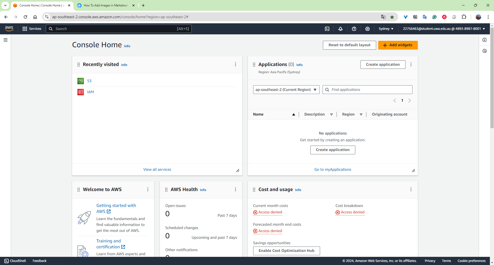

### [2] Search and open Identity Access Management
After clicking my user account and selecting the Security Credentials tab, I created an access key and noted the Access Key ID and the secret access key down.

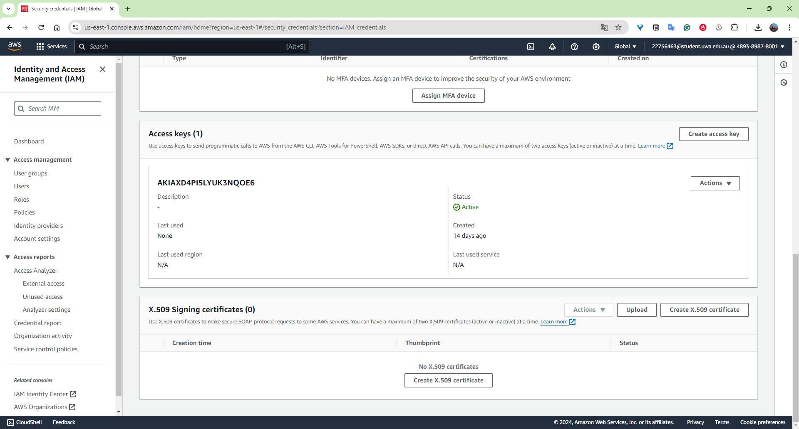

## Set up recent Linux OSes
### [1] Download Ubuntu OS 22.04.3
I downloaded Ubuntu OS 22.04.3 from the Microsoft Store as recommended by a lab facilitator.

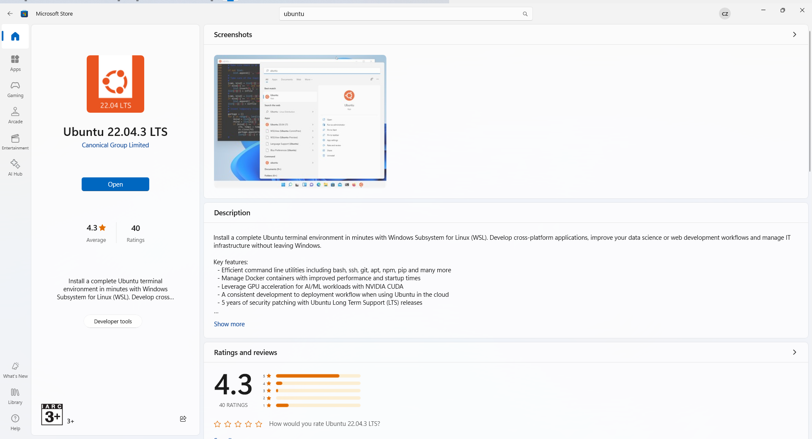

### [2] Update WSL
Since there was an old version of WSL installed on my laptop, I used command `wsl --update` to update the WSL.
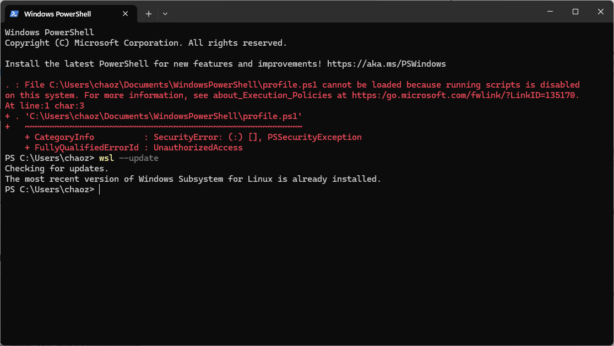

## Install Linux packages

### [1] Install Python 3.8.x and above
Since the recent Ubuntu versions such as 22.04.3 LTS have Python 3.8.x installed, I updated the packages to obtain the latest version through commands `sudo apt update` and `sudo apt -y upgrade`. After checking the latest version through command `python3 -V`, now we can see I have version `Python 3.10.12` installed. Then I installed pip3 through command `sudo apt install -y python3-pip` for future Python library management.

#### Commands:
- `sudo`: allows us to run the command with elevated (root) privileges.
- `apt`: the command-line tool used to interact with the Advanced Package Tool (APT), the package management system used by Debian-based distributions. APT manages the installation, upgrade, and removal of software packages.
- `-y`: automatically answers "yes" to any prompts that might come up during the upgrade process.

### [2] Install awscli
`awscli` stands for Amazon Web Services Command Line Interface. It's a unified tool that provides a consistent interface for interacting with all of Amazon Web Services (AWS). I installed and updated awscli through commands `sudo apt install awscli` and `pip3 install awscli --upgrade`.

#### Commands:
- `sudo`: allows us to run the command with elevated (root) privileges.
- `apt`: the command-line tool used to interact with the Advanced Package Tool (APT), the package management system used by Debian-based distributions. APT manages the installation, upgrade, and removal of software packages.
- `pip3`: package installer for Python 3 which allows us to install and manage Python packages.

#### Results:
```bash
mila@DESKTOP-N95AEOP:~$ sudo apt install awscli
[sudo] password for mila:
Reading package lists... Done
Building dependency tree... Done
Reading state information... Done
awscli is already the newest version (1.22.34-1).
0 upgraded, 0 newly installed, 0 to remove and 2 not upgraded.
------------------------------------------------------------------------------
mila@DESKTOP-N95AEOP:~$ pip3 install awscli --upgrade
Successfully installed awscli-1.34.2 botocore-1.35.2
```

### [3] Configure AWS
I set up and managed my AWS credentials and configuration settings for the AWS Command Line Interface by using command `aws configure`. I entered information of my AWS Access Key ID, AWS Secret Access Key, default region name according to my student number in the table (my student number 22756463 was allocated to region with name "us-east-1"), and the default output format.


### [4] Install boto3
I installed the "boto3" library which is the official AWS SDK (software development kit) for Python through command `pip3 install boto3`. "boto3" allows Python developers to write software that use Amazon services like S3, EC2 and so on. After installation, we can import the library in Python scripts and interact with AWS services.


## Test the installed environment

### [1] Test the AWS environment
I tested the AWS environment by retrieving a list of all available AWS regions for EC2 and display the information in a table format.

#### Commands
- `aws`: the AWS Command Line Interface. It is the tool we use to interact with AWS services directly from the command line or terminal.
- `ec2`: EC2 stands for the AWS Elastic Compute Cloud. By specifying `ec2` in this command, we tell the AWS CLI we want to perform an action associated with the EC2 service.
- `describe-regions`: the action we want to perform within the EC2 service. It lists all available AWS regions (geographical areas that have various data centres) for the EC2 service.
- `--output`: controls the format of the command's output. Some typical formats are "json", "table", "text", "yaml" and so on.
- `--output table`: this part specifies that the output should be formatted as a table.

#### Results
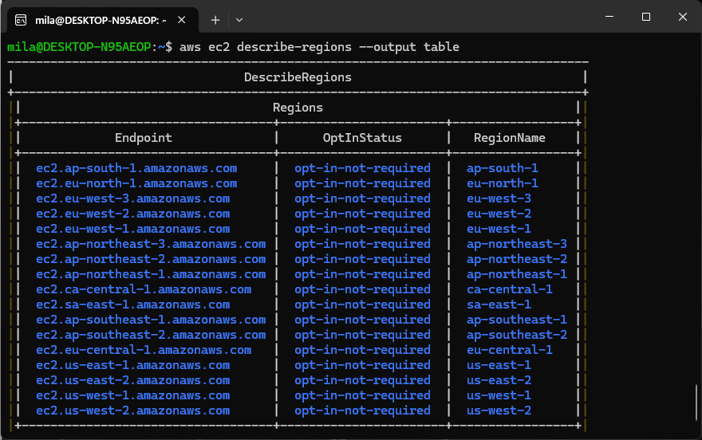
### [2] Test the Python environment
I tested the Python3 environment by activating the Python3 interactive shell and entered some Python code.

#### Commands
```python
python3
>>> import boto3
>>> ec2 = boto3.client('ec2')
>>> response = ec2.describe_regions()
>>> print(response)
```
- `import boto3`: imports the "boto3" library which is the AWS Software Development Kit for Python. After importing the package, our Python scripts can interact with AWS services.
- `ec2 = boto3.client('ec2)`: creates a client object for the EC2 service so we can make specific requests to the EC2 service.
- `response = ec2.describe_regions()`: calls the "describe_regions()" method of the EC2 client object and saves the returned information into a variable called "response".
- `print(response)`: prints out the variable "response" which is a dictionary containing information about the regions.

#### Results
```
{'Regions': [{'Endpoint': 'ec2.ap-south-1.amazonaws.com', 'RegionName': 'ap-south-1', 'OptInStatus': 'opt-in-not-required'}, {'Endpoint': 'ec2.eu-north-1.amazonaws.com', 'RegionName': 'eu-north-1', 'OptInStatus': 'opt-in-not-required'}, {'Endpoint': 'ec2.eu-west-3.amazonaws.com', 'RegionName': 'eu-west-3', 'OptInStatus': 'opt-in-not-required'}, {'Endpoint': 'ec2.eu-west-2.amazonaws.com', 'RegionName': 'eu-west-2', 'OptInStatus': 'opt-in-not-required'}, {'Endpoint': 'ec2.eu-west-1.amazonaws.com', 'RegionName': 'eu-west-1', 'OptInStatus': 'opt-in-not-required'}, {'Endpoint': 'ec2.ap-northeast-3.amazonaws.com', 'RegionName': 'ap-northeast-3', 'OptInStatus': 'opt-in-not-required'}, {'Endpoint': 'ec2.ap-northeast-2.amazonaws.com', 'RegionName': 'ap-northeast-2', 'OptInStatus': 'opt-in-not-required'}, {'Endpoint': 'ec2.ap-northeast-1.amazonaws.com', 'RegionName': 'ap-northeast-1', 'OptInStatus': 'opt-in-not-required'}, {'Endpoint': 'ec2.ca-central-1.amazonaws.com', 'RegionName': 'ca-central-1', 'OptInStatus': 'opt-in-not-required'}, {'Endpoint': 'ec2.sa-east-1.amazonaws.com', 'RegionName': 'sa-east-1', 'OptInStatus': 'opt-in-not-required'}, {'Endpoint': 'ec2.ap-southeast-1.amazonaws.com', 'RegionName': 'ap-southeast-1', 'OptInStatus': 'opt-in-not-required'}, {'Endpoint': 'ec2.ap-southeast-2.amazonaws.com', 'RegionName': 'ap-southeast-2', 'OptInStatus': 'opt-in-not-required'}, {'Endpoint': 'ec2.eu-central-1.amazonaws.com', 'RegionName': 'eu-central-1', 'OptInStatus': 'opt-in-not-required'}, {'Endpoint': 'ec2.us-east-1.amazonaws.com', 'RegionName': 'us-east-1', 'OptInStatus': 'opt-in-not-required'}, {'Endpoint': 'ec2.us-east-2.amazonaws.com', 'RegionName': 'us-east-2', 'OptInStatus': 'opt-in-not-required'}, {'Endpoint': 'ec2.us-west-1.amazonaws.com', 'RegionName': 'us-west-1', 'OptInStatus': 'opt-in-not-required'}, {'Endpoint': 'ec2.us-west-2.amazonaws.com', 'RegionName': 'us-west-2', 'OptInStatus': 'opt-in-not-required'}], 'ResponseMetadata': {'RequestId': '4a4ee39e-9960-4855-855f-1d1d31c7d4ed', 'HTTPStatusCode': 200, 'HTTPHeaders': {'x-amzn-requestid': '4a4ee39e-9960-4855-855f-1d1d31c7d4ed', 'cache-control': 'no-cache, no-store', 'strict-transport-security': 'max-age=31536000; includeSubDomains', 'vary': 'accept-encoding', 'content-type': 'text/xml;charset=UTF-8', 'content-length': '2890', 'date': 'Wed, 21 Aug 2024 12:57:45 GMT', 'server': 'AmazonEC2'}, 'RetryAttempts': 0}}
```

### [3] Write a Python script
To tabulate the above returned response, I used the Python code below.

#### Commands
- `pip3 install tabulate`: Since the package "tabulate" was not installed before, I install the library first, so we can easily format tabular data by using functions of this library.

```python
import boto3
from tabulate import tabulate

# Create an EC2 client object
ec2 = boto3.client('ec2')

# Call the describe_regions method and store in the variable response
response = ec2.describe_regions()

# This list comprehension iterates over each dictionary in "response['Regions']". Then it extracts the Endpoint and RegionName from each dictionary and stores them as a list of tuples
content = [(region['Endpoint'], region['RegionName']) for region in response['Regions']]

# Define the column names for the table
col_names = ["Endpoint", "RegionName"]

# Print the table using tabulate
print(tabulate(content, col_names, tablefmt="pretty"))
```

#### Results
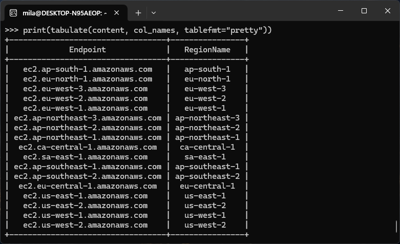


<div style="page-break-after: always;"></div>

# Lab 2

## Create an EC2 instance using awscli

### [1] Create a security group
I created a new security group in Amazon EC2 through the command `aws ec2 create-security-group --group-name 22756463-sg --description "security group for development environment"`. This security group will act as virtual firewalls to control inbound and outbound traffic (traffic coming into the instances and traffic going out from the instances) to the EC2 instances.

#### Commands
- `aws ec2`: refers to the AWS EC2 service. By specifying this, we are using the AWS EC2 service through the command line.
- `create-security-group`: the action we are doing given this command line. It creates a new security group in the default VPC (Virtual Private Cloud) given VPC is not specified in this case.
- `--group-name`: this flag is used to specify the name of the security group. 
- `-sg`: "sg" stands for security group. This suffix is a common convention to specify that this is a security group.
- `--description`: this flag is used to set the description for the security group, so we can identify the purpose of this security group later.
  
#### Results
Created a security group named "22756463-sg".
```
{
    "GroupId": "sg-0ae5c80f51af3b210"
}
```

### [2] Authorise inbound traffic for ssh
I authorised inbound traffic by using command `aws ec2 authorize-security-group-ingress --group-name 22756463-sg --protocol tcp --port 22 --cidr 0.0.0.0/0`. This command allowed inbound SSH (port 22) traffic to reach my EC2 instance from any IP address (by specifying "0.0.0.0/0"), as long as the instance is associated with the security group "22756463-sg". This rule is applied using the TCP protocol.

#### Commands
- `aws ec2 authorize-security-group-ingress`: This is used to add a rule to an existing security group to allow inbound traffic to the security group.
- `--group-name 22756463-sg`: Specifies the name of the security group we are modifying.
- `--protocol tcp`: Defines the protocol that is allowed. In this case, tcp is the Transmission Control Protocol, which is the protocol used for reliable communication over the internet (commonly used for SSH, HTTP, HTTPS, etc.).
- `--port 22`: `--port` Specifies the port number to allow inbound traffic on.
In this case, port 22 is used for SSH (Secure Shell), which is commonly used for remote access to Linux servers.
- `--cidr 0.0.0.0/0`: The CIDR (Classless Inter-Domain Routing) block represents the range of IP addresses that are allowed to connect. "0.0.0.0/0" represents all IP addresses, meaning this rule will allow SSH traffic from anywhere in the world. (This is generally not secure and should be restricted to a specific IP range or address whenever possible.)
- SSH (Secure Shell): A *network protocol* used to securely *access and manage remote servers* over an unsecured network. It allows us to establish a secure, encrypted connection between our local machine and a remote server, enabling us to execute commands, transfer files, and perform administrative tasks on that server.

#### Results
```
{
    "Return": true,
    "SecurityGroupRules": [
        {
            "SecurityGroupRuleId": "sgr-093d071b1a0fd2236",
            "GroupId": "sg-0ae5c80f51af3b210",
            "GroupOwnerId": "489389878001",
            "IsEgress": false,
            "IpProtocol": "tcp",
            "FromPort": 22,
            "ToPort": 22,
            "CidrIpv4": "0.0.0.0/0"
        }
    ]
}
```

### [3] Create a key pair
I generated a new key pair, extracted the private key and saved it to a file in the file format ".pem" which is mainly used for SSH access to EC2 instances. This private key file will be required when I SSH into my EC2 instance.

#### Commands
- `aws ec2 create-key-pair`: Used to create an SSH key pair for securely connecting to an Amazon EC2 instance. A key pair consists of a public key (stored by AWS) and a private key (saved by me), which are used to securely connect to an EC2 instance via SSH.
- `--key-name`: Specifies the name of the key pair. The key name must be unique within my AWS account for that region.
- `--query 'KeyMaterial'`: The `--query` option filters the output of the command. 'KeyMaterial' is the part of the *returned data* that contains the actual *private key* in plain text format, which I need to connect to EC2 instances via SSH. This ensures that only the private key (KeyMaterial) is retrieved from the full response that AWS returns.
- `--output text`: This option specifies that the output should be in plain text format, rather than JSON or any other format. This ensures that the private key is displayed in a simple, readable text format, which can then be saved to a file.
- `> 22756463-key.pem`: The `>` operator redirects the output of the command to a file named `22756463-key.pem`. This file will contain the private key (in .pem format), which I will later use to connect to my EC2 instance via SSH.
- ".pem" file: A ".pem" file (Privacy Enhanced Mail) is a file format that typically contains a private key and/or a public key. It is used in various security and encryption contexts, most commonly for establishing secure communication over the internet (such as SSH and HTTPS). In AWS, .pem files are primarily used for SSH access to EC2 instances.
- `chmod 400 22756463-key.pem`: This command sets the file permissions such that only the file owner can read the 22756463-key.pem file, and no one else (group or others) can read, write, or execute the file. `chmod` is the change mode command in Unix/Linux systems. It is used to change the permissions of a file or directory. Permissions control who can read, write, or execute a file. `400` is the permission code that specifies what permissions are being applied to the file. The first digit represents the owner permission, the second digit represents the group permission, and the last digit represent the permission of others. "4" represents read permission while "0" means no permission. `22756463-key.pem` specifies the name of the file for which the permissions are being changed.

#### Results
Generated a new key pair, extracted the private key and saved it into "22756463-key.pem". Then changed the file permission to be read only by the owner.

### [4] Create the instance
I created an instance located in the region "US East (N. Virginia)" according to my student number and the allocation table. I used the command ``aws ec2 run-instances --image-id ami-0a0e5d9c7acc336f1 --security-group-ids 22756463-sg --count 1 --instance-type t2.micro --key-name 22756463-key --query 'Instances[0].InstanceId'.

#### Commands
- `aws ec2 run-instances`: This command is used to launch (run) one or more EC2 instances in the AWS cloud.
- `--image-id`: Specifies the Amazon Machine Image (AMI) that will be used to launch the instance.
- `--security-group-ids`: This specifies the security group(s) that will be associated with the instance. The security group acts as a *virtual firewall* that controls inbound and outbound traffic.
- `--count`: Specifies the number of EC2 instances to launch.
- `--instance-type`: Specifies the type of EC2 instance to launch. `t2.micro` is a small, general-purpose instance type with 1 vCPU and 1 GB of RAM. It is suitable for low-traffic applications or testing and is often eligible for the AWS Free Tier.
- `--key-name`: Specifies the name of the SSH key pair that will be used to access the instance.
- `--query 'Instances[0].InstanceId'`: `--query` is used to filter the output of the command. This queries the result to return only the Instance ID of the first launched instance.

#### Results
The Instance ID of the newly launched instance was returned:
```
"i-04c3576556495a2d1"
```

### [5] Add a tag to your Instance
I added a tag to my EC2 instance created in step 4 by using the command `aws ec2 create-tags --resources i-04c3576556495a2d1 --tags Key=Name,Value=22756463`. The tag is useful for identifying and organising the instance.

#### Commands
- `aws ec2 create-tags`: This command is used to assign metadata, called tags, to an AWS resource such as an EC2 instance, volume, or other AWS resources. Tags are *key-value pairs* that allow me to organise, identify, and manage my resources more easily.
- `--resources`: Specifies which AWS resources (like EC2 instances, volumes, etc.) I want to tag.
- `--tags Key=Name,Value=22756463`: `--tags` defines the tag(s) I want to apply to the resource. `Key=Name` specifies the key for the tag. In AWS, "Name" is commonly used as a tag key to give the resource a human-readable name. `Value=22756463` specifies the value for the "Name" tag.

#### Results
Applied a tag to my EC2 instance with the ID "i-04c3576556495a2d1". The tag has a key of "Name" and a value of "22756463".

### [6] Get the public IP address
I retrieved the public IP address of the EC2 instance I created in step 4 by using command `aws ec2 describe-instances --instance-ids i-04c3576556495a2d1 --query 'Reservations[0].Instances[0].PublicIpAddress'`.

#### Commands
- `aws ec2 describe-instances`: The command is used to retrieve details about specific EC2 instances.
- `--instance-ids`: This flag specifies the ID(s) of the EC2 instances I want to describe.
- `--query 'Reservations[0].Instances[0].PublicIpAddress'`: `--query` filters the output to retrieve only the information I need. This query navigates the JSON structure returned by the `describe-instances` command to extract the public IP address of the first instance in the first reservation.

#### Results
Public IP address of the specified EC2 instance was returned:
```
"54.175.111.6"
```

### [7] Connect to the instance via ssh
I connected to an Ubuntu EC2 instance located at public address "54.175.111.6" using SSH by the command `ssh -i 22756463-key.pem ubuntu@54.175.111.6`.

#### Commands
- `ssh`: This is the command for Secure Shell (SSH), a protocol used to securely connect to remote servers. SSH enables encrypted communication between the client (my machine) and the server (in this case, an EC2 instance).
- `-i 22756463-key.pem`: `-i` specifies the identity file. In this case is the private key that I use to authenticate with the remote server.
- `ubuntu`: This is the AMI (Amazon Machine Image) *username* that I am using to log into the remote server.
- `@54.175.111.6`: `@` separates the username (ubuntu) from the server's IP address or hostname. `54.175.111.6` is the public IP address of the EC2 instance I am connecting to.

#### Results
```
Welcome to Ubuntu 22.04.4 LTS (GNU/Linux 6.5.0-1022-aws x86_64)

 * Documentation:  https://help.ubuntu.com
 * Management:     https://landscape.canonical.com
 * Support:        https://ubuntu.com/pro

 System information as of Fri Sep  6 13:40:19 UTC 2024

  System load:  0.08              Processes:             97
  Usage of /:   20.7% of 7.57GB   Users logged in:       0
  Memory usage: 21%               IPv4 address for eth0: 172.31.95.57
  Swap usage:   0%
```

### [8] List the created instance using the AWS console
I logged into AWS Console and navigated to the EC2 Dashboard to view the information about the instance I created.

#### Results
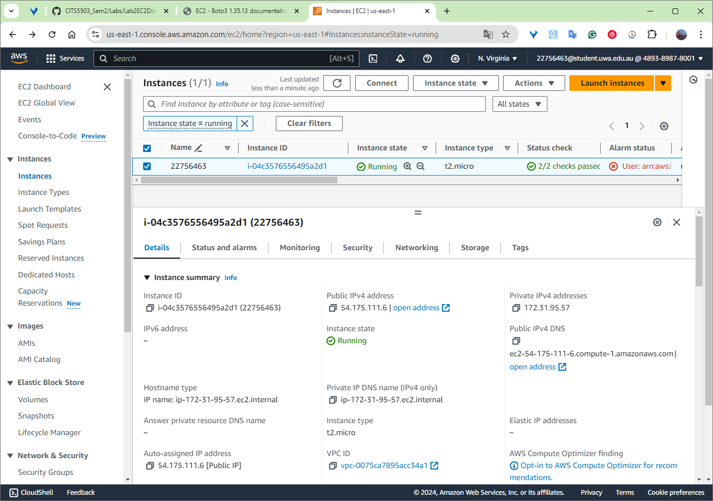

## Create an EC2 instance with Python Boto3
I wrote the following Python script into a file in my current directory in the Ubuntu system. And then run the Python script to create an EC2 instance.

### Python Script
```python
import boto3
from botocore.exceptions import ClientError

# Initialize EC2 client
ec2 = boto3.client('ec2')

# Step 1: Create a security group
def create_security_group(group_name, description):
    try:
        # https://boto3.amazonaws.com/v1/documentation/api/latest/reference/services/ec2/client/create_security_group.html
        response = ec2.create_security_group(
            GroupName=group_name,
            Description=description,
        )
        security_group_id = response['GroupId']
        print(f'Security Group {group_name} created with ID: {security_group_id}')
        return security_group_id
    except ClientError as e:
        print(f"Error creating security group: {e}")
        return None

# Step 2: Authorise inbound traffic for SSH
def authorize_security_group_ingress(group_name):
    try:
        # https://boto3.amazonaws.com/v1/documentation/api/latest/reference/services/ec2/client/authorize_security_group_ingress.html
        ec2.authorize_security_group_ingress(
            GroupName= group_name,
            # CidrIp='0.0.0.0/0',
            # GroupId=group_id,
            IpPermissions=[
                {
                    'IpProtocol': 'tcp',
                    'FromPort': 22,
                    'ToPort': 22,
                    'IpRanges': [{'CidrIp': '0.0.0.0/0'}]
                }
            ]
        )
        print(f"SSH rule added to Security Group: {group_name}")
    except ClientError as e:
        print(f"Error adding SSH rule to security group: {e}")

# Step 3: Create a key pair
def create_key_pair(key_name):
    try:
        # https://boto3.amazonaws.com/v1/documentation/api/latest/reference/services/ec2/client/create_key_pair.html
        key_pair = ec2.create_key_pair(KeyName=key_name)
        private_key = key_pair['KeyMaterial']
        
        # Save the private key to a .pem file
        with open(f"{key_name}.pem", "w") as key_file:
            key_file.write(private_key)
        
        print(f"Key pair {key_name} created and saved as {key_name}.pem")

    except ClientError as e:
        print(f"Error creating key pair: {e}")

# Step 4: Create the EC2 instance
def create_instance(key_name, security_group_name, ami_id):
    try:
        # https://boto3.amazonaws.com/v1/documentation/api/latest/reference/services/ec2/client/run_instances.html
        instances = ec2.run_instances(
            ImageId= ami_id,
            MinCount=1,
            MaxCount=1,
            InstanceType='t2.micro',
            KeyName=key_name,
            SecurityGroups=[security_group_name],
            # SecurityGroupIds=[security_group_id],
        )
        instance_id = instances['Instances'][0]['InstanceId']
        print(f"EC2 instance created with Instance ID: {instance_id}")
        return instance_id
    except ClientError as e:
        print(f"Error creating EC2 instance: {e}")
        return None

# Step 5: Add a tag to the instance
def add_tag(instance_id, tag_key, tag_value):
    try:
        # https://boto3.amazonaws.com/v1/documentation/api/latest/reference/services/ec2/client/create_tags.html
        ec2.create_tags(
            Resources=[instance_id],
            Tags=[
                {'Key': tag_key, 'Value': tag_value}
            ]
        )
        print(f"Tag '{tag_key}: {tag_value}' added to instance {instance_id}")
    except ClientError as e:
        print(f"Error tagging instance: {e}")

# Step 6: Get the public IP address of the instance
def get_public_ip(instance_id):
    try:
        # https://boto3.amazonaws.com/v1/documentation/api/latest/reference/services/ec2/client/describe_instances.html
        reservations = ec2.describe_instances(InstanceIds=[instance_id])
        public_ip = reservations['Reservations'][0]['Instances'][0]['PublicIpAddress']
        print(f"Public IP address of the instance: {public_ip}")
        return public_ip
    except ClientError as e:
        print(f"Error retrieving public IP: {e}")
        return None

# Main function to run the script
def main():
    sg_name = "22756463-sg3"
    sg_description = "security group for development environment"
    key_name = "22756463-key3"
    tag_key = "Name"
    tag_value = "22756463-3"
    ami_id = "ami-0a0e5d9c7acc336f1"
    
    # 1. Create a security group
    security_group_id = create_security_group(sg_name, sg_description)

    if security_group_id:
        # 2. Authorize inbound traffic for SSH
        authorize_security_group_ingress(sg_name)

        # 3. Create a key pair
        create_key_pair(key_name)

        # 4. Create the EC2 instance
        instance_id = create_instance(key_name, sg_name, ami_id)

        if instance_id:
            # 5. Add a tag to the instance
            add_tag(instance_id, tag_key, tag_value)

            # 6. Get the public IP address
            get_public_ip(instance_id)

if __name__ == "__main__":
    main()
```

### Results
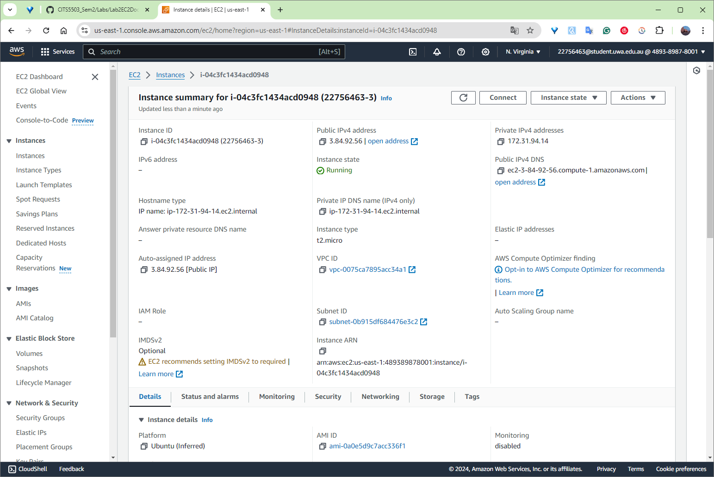

## Use Docker inside a Linux OS

### [1] Install Docker
I installed the Docker Engine (docker.io) on the Ubuntu system by using command `sudo apt install docker.io -y`.

#### Commands
- `sudo`: Run the command with elevated (root) privileges.
- `apt install docker.io`: Use the "apt" package manager to install a package names "docker.io".
- `-y`: This option automatically answers "yes" to any prompts that might come up during the installation process.

#### Results
The Docker package was installed.

### [2] Start Docker
I started the Docker service on a Linux system that uses systemd as its init system by the command `sudo systemctl start docker`.

#### Commands
- `sudo`: Run the command with elevated (root) privileges.
- `systemctl`: Used to control system services, including starting, stopping, restarting, enabling, and disabling services.
- `start`: This is the subcommand that tells systemctl to start the specified service. In this case, we are starting the Docker service.

#### Results
The Docker service was started.

### [3] Enable Docker
I configured my system so that the Docker service automatically starts every time the system boots by using command `sudo systemctl enable docker`.

#### Commands
- `sudo`: Run the command with elevated (root) privileges.
- `systemctl`: The command-line utility used to interact with `systemd`, the service manager on many Linux distributions.`systemctl` is used to manage services, including enabling, disabling, starting, and stopping services.
- `enable`: This subcommand tells systemctl to enable the specified service. In this case, enable Docker.

#### Results
Enabled the Docker service to start at boot.

### [4] Check the version
I checked the Docker package version by command `docker --version`. 

#### Results
The Docker version information is returned:
```
Docker version 24.0.7, build 24.0.7-0ubuntu2~22.04.1
```

### [5] Build and run an httpd container
#### 1. Prepare HTML file and the Dockerfile
I created a directory called html by using command `mkdir html`. Then I navigated to the "html" directory by using command `cd html`. I then used command `nano index.html` and copied the html content into the the file. After saving the file, I changed back to the parent directory by using command `cd ..`. Then I created a file called Dockerfile by using command `nano Dockerfile`.

#### 2. Build a docker image
I built a Docker image from a Dockerfile in the current directory and tagged it with a name by using command `sudo docker build -t my-apache2 .`. 

##### Commands
- - `sudo`: Run the command with elevated (root) privileges.
- `docker build`: This command tells Docker to build an image. It reads the instructions in the Dockerfile to build the image.
- `-t my-apache2`: The `-t` option stands for "tag". It allows me to name the image with a custom tag. `my-apache2` is the name (or tag) we are assigning to the image. This makes it easier to reference the image later when running or managing containers.
- `.`: Refers to the current directory.
##### Results
```bash
Sending build context to Docker daemon  77.13MB
Step 1/2 : FROM httpd:2.4
2.4: Pulling from library/httpd
a2318d6c47ec: Pull complete
62dd86107c65: Pull complete
4f4fb700ef54: Pull complete
22871f73faed: Pull complete
ca061a523d1f: Pull complete
509789394c2a: Pull complete
Digest: sha256:ae1124b8d23ee3fc35d49da35d5c748a2fce318d1f55ce59ccab889d612f8be8
Status: Downloaded newer image for httpd:2.4
 ---> 9cb0a2315602
Step 2/2 : COPY ./html/ /usr/local/apache2/htdocs/
 ---> 6f9ac4719994
Successfully built 6f9ac4719994
Successfully tagged my-apache2:latest
```

#### 3. Run the image
I run the Docker image by using command `sudo docker run -p 80:80 -dit --name my-app my-apache2`. And then open it in the browser through address "http://127.0.0.1".

##### Commands
- docker run: The command is used to run a container from a Docker image.
It creates a new container, starts it, and runs the application or service defined in the image.
- `-p 80:80`: The -p option maps a port from the host to the container. In this case, it maps port 80 of the host to port 80of the container. This allows the container to serve web traffic via the host's port 80.
- `-dit`: This is a combination of three flags:
    - `-d`: Runs the container in detached mode, meaning it runs in the background and doesn’t block your terminal. The container continues running until you stop it.
    - `-i`: Runs the container in interactive mode, allowing you to interact with the container. This is useful if you want to keep STDIN open for input (though combined with -d, it will allow the container to keep running).
    - `-t`: Allocates a pseudo-TTY (a terminal interface), which allows you to interact with the container through a terminal if needed. This is useful for containers that require terminal interaction.

##### Results
```
4bd9b9e14d0e26f1b725190c3a2589130fe43359f9b47b7b061c72ef678c5f62
```
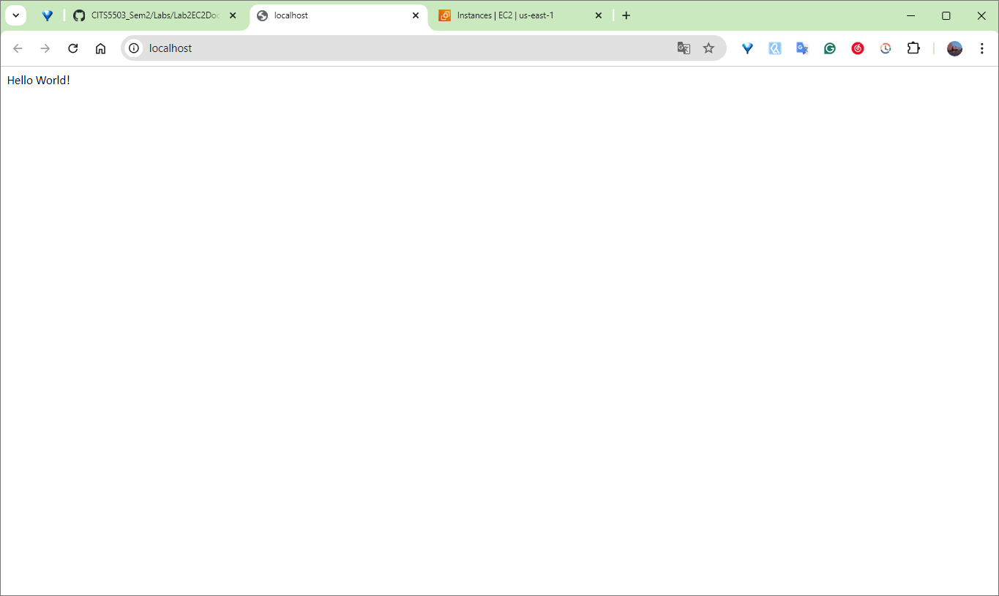

### [6] Other docker commands
#### Check what is running
##### Commands 
- `ps`: This is the "process status" command in Docker. It shows information about Docker containers. Without any options, docker `ps` will only show running containers.
- `-a`: The -a (or --all) option modifies the docker ps command to show all containers.

##### Results
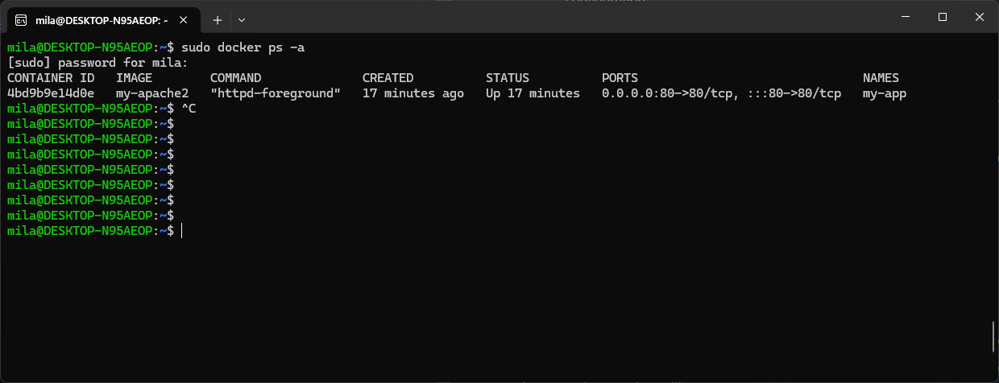

#### Stop and remove the container
I stopped and removed the container by using commands `sudo docker stop my-app` and `sudo docker rm my-app`.

<div style="page-break-after: always;"></div>

# Lab 3

## [1] Preparation
I prepared items for the program as follows:
1. I downloaded the Python code `cloudstorage.py` from the directory of [src](https://github.com/zhangzhics/CITS5503_Sem2/blob/master/Labs/src/cloudstorage.py).
2. I created a directory called `rootdir` by using command `mkdir rootdir`.
3. Then I changed into the directory `rootdir` by using command `cd rootdir` and write content "1\n2\n3\n4\n5\n" in a file called `rootfile.txt` by using command `nano rootfile.txt`.
4. I created a directory in "rootdir" called `subdir` by using command `mkdir subdir` and changed into `subdir` by using command `cd subdir`. Then I created a file named `subfile.txt`with the same content by using command `nano subfile.txt`. 

## [2] Save to S3 by updating cloudstorage.py
I uploaded those files prepared in Step 1 to the newly created S3 bucket by changing the provide Python code to the following.

### Python script: `cloudstorage.py`
```python
import os
import boto3
import base64

# ------------------------------
# CITS5503
#
# cloudstorage.py
#
# skeleton application to copy local files to S3
#
# Given a root local directory, will return files in each level and
# copy to same path on S3
#
# ------------------------------ 

ROOT_DIR = '.'
ROOT_S3_DIR = '22756463-cloudstorage'

s3 = boto3.client("s3")

bucket_region = 'us-east-1'

bucket_config = {'LocationConstraint': bucket_region} 


def upload_file(folder_name, file, file_name):
    print("Uploading %s" % file)

    try:
        s3.upload_file(file, ROOT_S3_DIR, folder_name+file_name)
    except Exception as error:
        print(error)
        pass

try:
    # Check if bucket exists
    s3.head_bucket(Bucket=ROOT_S3_DIR)
    print(f"Bucket {ROOT_S3_DIR} already exists.")
except Exception as error:
    # If bucket does not exist, create it
    print(f"Creating bucket {ROOT_S3_DIR}...")
    try:
        if bucket_region == 'us-east-1':
            # us-east-1 (N. Virginia) does not require LocationConstraint
            s3.create_bucket(Bucket=ROOT_S3_DIR)
        else:
            response = s3.create_bucket(
                Bucket=ROOT_S3_DIR,
                CreateBucketConfiguration=bucket_config
            )
            print(f"Bucket {ROOT_S3_DIR} created successfully.")
    except Exception as error:
        print(f"Error creating bucket: {str(error)}")
        raise


# parse directory and upload files
for dir_name, subdir_list, file_list in os.walk(ROOT_DIR, topdown=True):
    if dir_name != ROOT_DIR:
        for fname in file_list:
            upload_file("%s/" % dir_name[2:], "%s/%s" % (dir_name, fname), fname)

print("done")
```

### Results
Files uploaded to the S3 bucket with the same file structure as shown in Step 1.

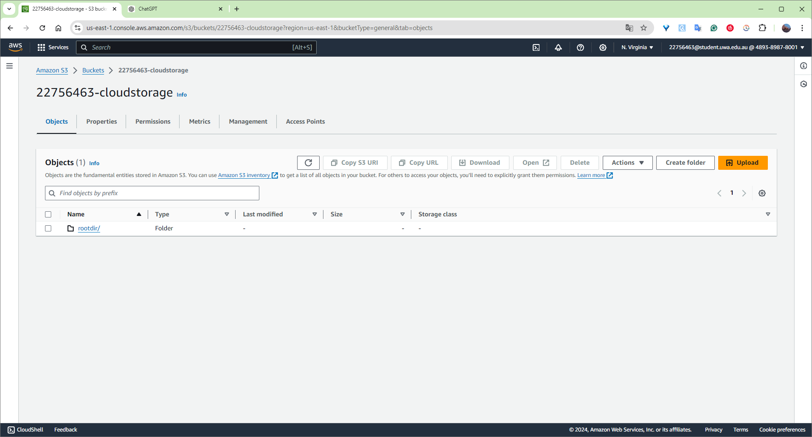

## [3] Restore from S3
I downloaded the files and directories from the S3 bucket by running the following Python script.

### Python script: `restorefromcloud.py`
```python
import os
import boto3

# Initialise the S3 client
s3 = boto3.client('s3')

# Define the S3 bucket name
BUCKET_NAME = '22756463-cloudstorage'  
LOCAL_ROOT_DIR = './restored_files'  


for object in s3.list_objects(Bucket = BUCKET_NAME)['Contents']:
    object_key = object['Key']
    print("Downloading %s" % object_key)
    cloud_dir_path = os.path.dirname(object_key)
    local_dir_path = os.path.join(LOCAL_ROOT_DIR, cloud_dir_path)
    if not os.path.exists(local_dir_path):
        os.makedirs(local_dir_path)
    local_file_path = os.path.join(LOCAL_ROOT_DIR, object_key)
    s3.download_file(BUCKET_NAME, object_key, local_file_path)
```

### Results
The files and directories from the S3 bucket were downloaded into the local Linux environment.


## [4] Write information about files to DynamoDB

### 1. Install DynamoDB and jre
I created a direcotry named `dynamodb` and changed into that directory by using commands `mkdir dynamodb` and `cd dynamodb`. Then I installed jre (Java Runtime Environment) using command `sudo apt-get install default-jre` and downloaded DynamoDB compressed file using `wget https://s3-ap-northeast-1.amazonaws.com/dynamodb-local-tokyo/dynamodb_local_latest.tar.gz`. I extracted files from the downloaded DynamoDB compressed archive format by using command `tar -zxvf dynamodb_local_latest.tar.gz`.

Note for myself: Amazon DynamoDB is a fully managed, scalable NoSQL database service offering fast, low-latency data access for high-performance applications.

#### Commands
- `mkdir`: create a directory.
- `cd`: change into another directory.
- `sudo`: Runs the command with superuser (root) privileges.
- `apt-get`: The package manager used to install, update, and manage software packages.
- `install`: The command to install a package.
- `wget`: A command-line tool used to download files from the web. In this case, it’s downloading a file named `dynamodb_local_latest.tar.gz` from an Amazon S3 bucket.
- `tar`: Used to create and extract archive files in Linux. In this case, it is used to extract the files from a compressed archive (.tar.gz).
- `-zxvf`: The options following tar specify how the archive should be handled.
    -z: Tells tar to decompress the file using gzip (since .tar.gz is a gzipped tar archive).
    -x: Stands for extract. This option tells tar to extract the contents of the archive.
    -v: Stands for verbose. This option makes tar list the files being extracted as they are processed, so you can see what is happening.
    -f: Stands for file. This option specifies the name of the archive file that tar should operate on. In this case, it’s dynamodb_local_latest.tar.gz.

#### Results
DynamoDB and jre were installed in the local Linux environment.
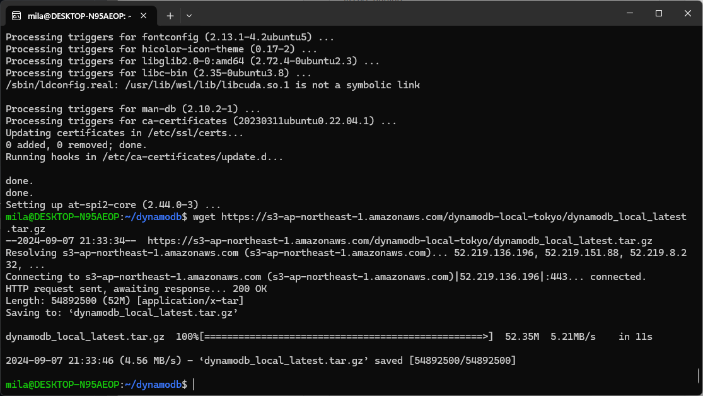

### 2. Run DynamoDB local
I started DynamoDB Local on my machine with a single shared database for all users and regions, using the native libraries stored in the DynamoDBLocal_lib directory. *It allows me to test DynamoDB operations without connecting to the actual AWS cloud.*

#### Commands
- `java`: This is the Java runtime command. It is used to execute Java applications (i.e., run .jar files). The DynamoDB Local application is provided as a .jar file.
- `-Djava.library.path=./DynamoDBLocal_lib`: This is a Java option that sets the library path to a specific directory.
    - `-D`: Specifies a system property in Java.
    - `java.library.path`: This property defines where Java looks for native libraries (such as .so files on Linux, .dll files on Windows, or .dylib files on macOS).
    - `=./DynamoDBLocal_lib`: This sets the path to the directory where the native libraries needed for DynamoDB Local are located. The `.` indicates the current directory, and `DynamoDBLocal_lib` is a subdirectory containing the necessary libraries.
- `-jar DynamoDBLocal.jar`: This part tells Java to run a Java Archive (JAR) file. `-jar`: Indicates that the following file is a JAR file to be executed.
`DynamoDBLocal.jar`: This is the JAR file containing the DynamoDB Local application, which simulates the DynamoDB service locally.
- `–sharedDb`: This option tells DynamoDB Local to use a single shared database instance instead of creating separate databases for each user account and region.

#### Results
The DynamoDB local was running.
```bash
Initializing DynamoDB Local with the following configuration:
Port:   8000
InMemory:       false
Version:        1.25.0
DbPath: null
SharedDb:       false
shouldDelayTransientStatuses:   false
CorsParams:     null
```
### 3. Write a DynamoDB table
I created a DynamoDB table, extracted attributes of files of the S3 bucket I created in previous steps, and saved those information into the DynamoDB table using the following Python script. 

#### Python script `fileinfo.py`
```python
import boto3
from botocore.exceptions import ClientError
import os

# Initialise clients for DynamoDB and S3
dynamodb = boto3.resource('dynamodb', endpoint_url="http://localhost:8000")
s3 = boto3.client('s3')

# Define the S3 bucket name
BUCKET_NAME = '22756463-cloudstorage'
# Define the DynamoDB table name
TABLE_NAME = 'CloudFiles'

# Create the DynamoDB table
def create_cloudfiles_table():
    # https://boto3.amazonaws.com/v1/documentation/api/latest/reference/services/dynamodb/client/create_table.html
    try:
        table = dynamodb.create_table(
            TableName=TABLE_NAME,
            KeySchema=[
                {'AttributeName': 'userId', 'KeyType': 'HASH'},  # Partition key
                {'AttributeName': 'fileName', 'KeyType': 'RANGE'},  # Sort key
            ],
            AttributeDefinitions=[
                {'AttributeName': 'userId', 'AttributeType': 'S'},  # String type
                {'AttributeName': 'fileName', 'AttributeType': 'S'},  # String type
            ],
            ProvisionedThroughput={'ReadCapacityUnits': 10, 'WriteCapacityUnits': 10}
        )
        table.meta.client.get_waiter('table_exists').wait(TableName=TABLE_NAME)
        print(f"Table {TABLE_NAME} created successfully.")
        return table
    except ClientError as e:
        if e.response['Error']['Code'] == 'ResourceInUseException':
            print(f"Table {TABLE_NAME} already exists.")
        else:
            raise

# Get the attributes for each file in the S3 bucket
def get_s3_file_attributes(bucket_name):
    try:
        # List all files in the S3 bucket
        response = s3.list_objects_v2(Bucket=bucket_name)

        if 'Contents' not in response:
            print(f"No files found in bucket {bucket_name}.")
            return []

        files = []
        # Iterate through each file in the bucket
        for object in response['Contents']:
            s3_key = object['Key']

            # Get the ACL (Access Control List) for the file
            acl_response = s3.get_object_acl(Bucket=bucket_name, Key=s3_key)
            userId = acl_response['Owner']['ID']
            owner = acl_response['Owner']['DisplayName']
            permission = acl_response['Grants'][0]['Permission']

            # Construct the file attributes
            file_info = {
                'userId': userId, 
                'fileName': s3_key.split('/')[-1],
                'path': s3_key,
                'lastUpdated': object['LastModified'].isoformat(),
                'owner': owner,  
                'permissions': permission  
            }
            files.append(file_info)
        return files

    except ClientError as e:
        print(f"Error accessing S3 bucket: {e}")
        return []

# Write file attributes to DynamoDB
def write_to_dynamodb(table_name, files):
    table = dynamodb.Table(table_name)

    for file_info in files:
        try:
            # Insert the file attributes as a new item in the DynamoDB table
            table.put_item(Item=file_info)
            print(f"Successfully inserted: {file_info['fileName']}")
        except ClientError as e:
            print(f"Error inserting {file_info['fileName']} into DynamoDB: {e.response['Error']['Message']}")

# Main function
if __name__ == "__main__":
    # Step 1: Create the table
    create_cloudfiles_table()

    # Step 2: Get file attributes from S3
    files = get_s3_file_attributes(BUCKET_NAME)

    # Step 3: Write the attributes to DynamoDB
    if files:
        write_to_dynamodb(TABLE_NAME, files)
        print("Done.")
    else:
        print("No files to insert.")
```

#### Results
Successfully inserted information about `rootfile.txt` and `subfile.txt`.

## [5] Scan the table
I scanned and output the table in the command line interface by using command `aws dynamodb scan --table-name CloudFiles --endpoint-url http://localhost:8000`.

### Commands
- `aws dynamodb scan`: This scans the entire CloudFiles table and returns all items.
- `--table-name CloudFiles`: Specifies the DynamoDB table I created (CloudFiles).
- `--endpoint-url http://localhost:8000`: This flag is used only if running DynamoDB locally. It specifies the local endpoint.

### Results
```bash
{
    "Items": [
        {
            "owner": {
                "S": "zhi.zhang"
            },
            "path": {
                "S": "rootdir/rootfile.txt"
            },
            "lastUpdated": {
                "S": "2024-09-07T13:00:00+00:00"
            },
            "fileName": {
                "S": "rootfile.txt"
            },
            "userId": {
                "S": "2a5fac7aada1ad2caa48c9ab08cc4e2428d4eb596108daa3b59f1204ae96482e"
            },
            "permissions": {
                "S": "FULL_CONTROL"
            }
        },
        {
            "owner": {
                "S": "zhi.zhang"
            },
            "path": {
                "S": "rootdir/subdir/subfile.txt"
            },
            "lastUpdated": {
                "S": "2024-09-07T13:00:00+00:00"
            },
            "fileName": {
                "S": "subfile.txt"
            },
            "userId": {
                "S": "2a5fac7aada1ad2caa48c9ab08cc4e2428d4eb596108daa3b59f1204ae96482e"
            },
            "permissions": {
                "S": "FULL_CONTROL"
            }
        }
    ],
    "Count": 2,
    "ScannedCount": 2,
    "ConsumedCapacity": null
}
```

## [6] Delete the table
I deleted the created DynamoDB table using command `aws dynamodb delete-table --table-name CloudFiles --endpoint-url http://localhost:8000
`, and deleted the created S3 bucket from AWS console.

### Commands
- `aws dynamodb delete-table`: This command deletes a DynamoDB table.
- `--table-name CloudFiles`: Specifies the name of the table I want to delete (in this case, CloudFiles).
- `-endpoint-url http://localhost:8000`: If using DynamoDB Local, I need to specify the endpoint URL.

### Results
The DynamoDB table is deleted.
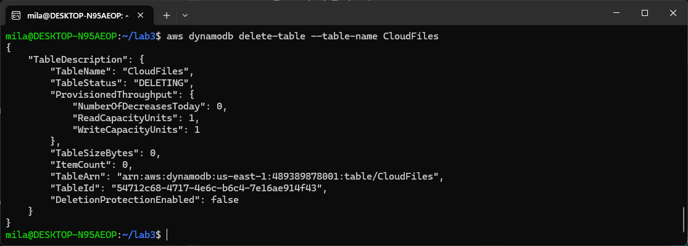


<div style="page-break-after: always;"></div>

# Lab 4

## Apply a policy to restrict permissions on bucket
I applied a policy on the S3 bucket to restrict access from other users by utilising a Python script as follows.

### [1] Write a Python script
#### Python script `apply_policy.py`
```python
import boto3
import json

# Initialise the S3 client
s3 = boto3.client('s3')

bucket_name = '22756463-cloudstorage' 
student_number = '22756463'

# Define the bucket policy
bucket_policy = {
    "Version": "2012-10-17",
    "Statement": [{
        "Sid": "AllowAllS3ActionsInUserFolderForUserOnly",
        "Effect": "Deny",
        "Principal": "*",
        "Action": "s3:*",
        "Resource": f"arn:aws:s3:::{bucket_name}/folder1/folder2/*",
        "Condition": {
            "StringNotLike": {
                "aws:username": f"{student_number}@student.uwa.edu.au"
            }
        }
    }]
}

# Convert the policy from dictionary to JSON format
bucket_policy_json = json.dumps(bucket_policy)

# Apply the policy to the S3 bucket
def apply_bucket_policy(bucket_name, bucket_policy_json):
    try:
        # Set the bucket policy
        s3.put_bucket_policy(Bucket=bucket_name, Policy=bucket_policy_json)
        print(f"Policy applied successfully to bucket {bucket_name}")
    except Exception as e:
        print(f"Error applying policy: {e}")

if __name__ == "__main__":
    # Call the function to apply the policy
    apply_bucket_policy(bucket_name, bucket_policy_json)
```

#### Results
Policy applied to the S3 bucket.

### [2] Check whether the script works
I checked the effect of the script by asking someone else to access the folder called `rootdir` in the S3 bucket I created.

#### Results

TODOTODOTODOTODOTODOTODOTODOTODOTODOTODOTODOTODOTODOTODOTODOTODOTODOTODOTODOTODOTODOTODOTODOTODOTODOTODOTODOTODOTODOTODOTODOTODOTODOTODOTODOTODOTODOTODOTODOTODOTODOTODOTODOTODOTODOTODOTODOTODOTODOTODOTODOTODOTODOTODOTODOTODOTODOTODOTODOTODOTODOTODOTODOTODOTODOTODOTODOTODOTODOTODOTODOTODOTODOTODOTODOTODOTODOTODOTODOTODOTODOTODOTODOTODOTODOTODOTODOTODOTODOTODOTODOTODOTODOTODOTODOTODO

## AES Encryption using KMS
### [1] Create a KMS key
I created a KMS key by running the following Python script.

#### Python script `create_kms.py`
```python
import boto3

# Initialise the KMS client
kms = boto3.client('kms')

student_number = '22756463'

# Create a KMS key
try:
    response = kms.create_key(
        Description="KMS key for student number",
        KeyUsage='ENCRYPT_DECRYPT',
    )
    key_id = response['KeyMetadata']['KeyId']
    print(f"KMS Key created with KeyId: {key_id}")
except Exception as e:
    print(f"Error creating KMS key: {e}")

# Create an alias for the KMS key
try:
    alias_name = f'alias/{student_number}'
    kms.create_alias(
        AliasName=alias_name,
        TargetKeyId=key_id
    )
    print(f"Alias '{alias_name}' created for KMS KeyId: {key_id}")
except Exception as e:
    print(f"Error creating alias: {e}")
```

#### Results
KMS Key created with KeyId: `b7717fc6-fe96-48a7-bc91-fb6a9d8656a3`.
Alias 'alias/22756463' created for KMS KeyId: b7717fc6-fe96-48a7-bc91-fb6a9d8656a3.

### [2] Attach a policy to the created KMS key
I updated the Python script in Step 1 and attached a policy to the KMS key created in step 1.

#### Python script `update_policy.py`
```python
import boto3
import json

# Initialise the KMS client
kms = boto3.client("kms")

# Replace with your student number and username
student_number = "22756463"
alias_name = f"alias/{student_number}"

# Create a KMS key
try:
    response = kms.create_key(
        Description="KMS key for student number",
        KeyUsage="ENCRYPT_DECRYPT",  # Key usage can be 'ENCRYPT_DECRYPT' for most cases
    )
    key_id = response["KeyMetadata"]["KeyId"]
    print(f"KMS Key created with KeyId: {key_id}")
except Exception as e:
    print(f"Error creating KMS key: {e}")

# Check if alias already exists and delete it
try:
    response = kms.list_aliases()
    for alias in response['Aliases']:
        if alias['AliasName'] == alias_name:
            # If the alias exists, delete it
            print(f"Alias {alias_name} already exists. Deleting it.")
            kms.delete_alias(AliasName=alias_name)
            break
except Exception as e:
    print(f"Error checking or deleting existing alias: {e}")

# Create an alias for the KMS key
try:
    kms.create_alias(AliasName=alias_name, TargetKeyId=key_id)
    print(f"Alias '{alias_name}' created for KMS KeyId: {key_id}")
except Exception as e:
    print(f"Error creating alias: {e}")

# Attach a policy to the KMS key
try:
    # Define the key policy
    key_policy = {
        "Version": "2012-10-17",
        "Id": "key-consolepolicy-3",
        "Statement": [
            {
                "Sid": "Enable IAM User Permissions",
                "Effect": "Allow",
                "Principal": {"AWS": "arn:aws:iam::489389878001:root"},
                "Action": "kms:*",
                "Resource": "*",
            },
            {
                "Sid": "Allow access for Key Administrators",
                "Effect": "Allow",
                "Principal": {"AWS": "arn:aws:iam::489389878001:user/22756463@student.uwa.edu.au"},
                "Action": [
                    "kms:Create*",
                    "kms:Describe*",
                    "kms:Enable*",
                    "kms:List*",
                    "kms:Put*",
                    "kms:Update*",
                    "kms:Revoke*",
                    "kms:Disable*",
                    "kms:Get*",
                    "kms:Delete*",
                    "kms:TagResource",
                    "kms:UntagResource",
                    "kms:ScheduleKeyDeletion",
                    "kms:CancelKeyDeletion",
                ],
                "Resource": "*",
            },
            {
                "Sid": "Allow use of the key",
                "Effect": "Allow",
                "Principal": {"AWS": "arn:aws:iam::489389878001:user/22756463@student.uwa.edu.au"},
                "Action": [
                    "kms:Encrypt",
                    "kms:Decrypt",
                    "kms:ReEncrypt*",
                    "kms:GenerateDataKey*",
                    "kms:DescribeKey",
                ],
                "Resource": "*",
            },
            {
                "Sid": "Allow attachment of persistent resources",
                "Effect": "Allow",
                "Principal": {"AWS": "arn:aws:iam::489389878001:user/22756463@student.uwa.edu.au"},
                "Action": ["kms:CreateGrant", "kms:ListGrants", "kms:RevokeGrant"],
                "Resource": "*",
                "Condition": {"Bool": {"kms:GrantIsForAWSResource": "true"}},
            },
        ],
    }

    # Attach the policy to the KMS key
    kms.put_key_policy(
        KeyId=key_id,
        PolicyName="default",
        Policy=json.dumps(key_policy),  # Convert the policy dictionary to a JSON string
    )
    print(f"Key policy attached to KMS KeyId: {key_id}")
except Exception as e:
    print(f"Error attaching key policy: {e}")
```

#### Results
The key policy is attached to the KMS key.

### [3] Check whether the script works
1. I logged in to the AWS console and navigated to the KMS dashboard.
2. I clicked on the Customer managed keys on the left panel.
3. I searched for my Key Alias ("alias/22756463") and clicked on the Key ID to view more details.
4. I clicked on the Key Policy tab to view the key policy. I looked for the section in the policy that has the "Allow access for Key Administrators" and "Allow use of the key".

#### Results
The script worked. My username is the key administrator and key user.
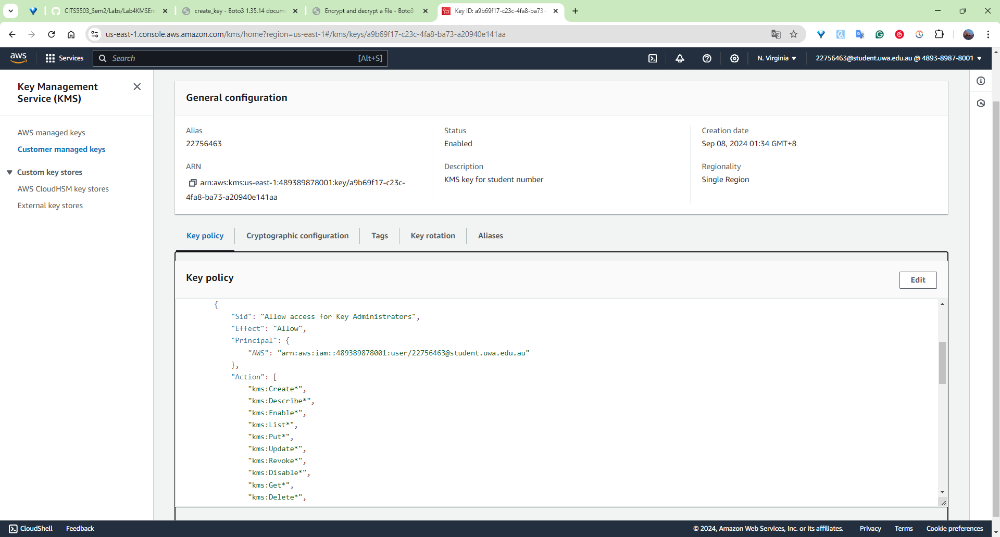
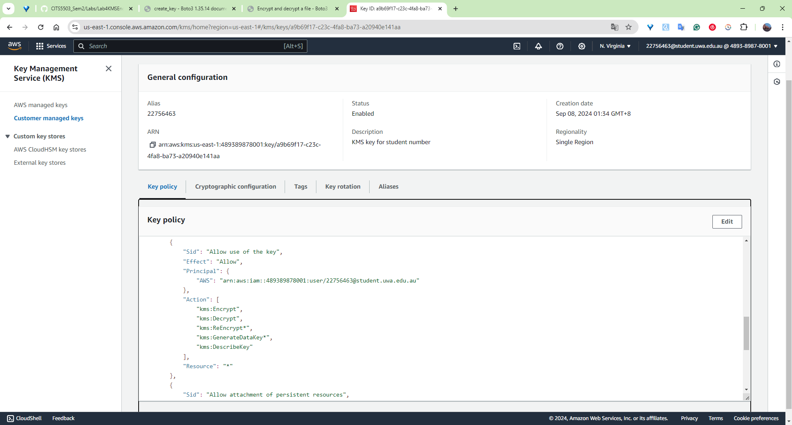

### [4] Use the created KMS key for encryption/decryption
I used the following Python script to download files from the S3 bucket, then encrypt and decrpt them. I saved the encrypted and decrypted files in the same folder as the original files.

#### Python script `encrypt.py`
```python
import boto3
import os

# Initialise the clients
kms = boto3.client('kms')
s3 = boto3.client('s3')

bucket_name = '22756463-cloudstorage'  # S3 bucket name
key_id = 'a9b69f17-c23c-4fa8-ba73-a20940e141aa'  # KMS Key ID
local_directory = './restored_files'  # Local directory to store files obtained from cloud

# Step 1: Download files from S3 bucket to local directory
def download_s3_files(bucket_name, local_directory):
    if not os.path.exists(local_directory):
        os.makedirs(local_directory)

    # List files in the S3 bucket
    objects = s3.list_objects_v2(Bucket=bucket_name)

    if 'Contents' in objects:
        for obj in objects['Contents']:
            file_key = obj['Key']
            file_path = os.path.join(local_directory, file_key)

            # Create subdirectories if necessary
            os.makedirs(os.path.dirname(file_path), exist_ok=True)

            # Download the file from S3 to local directory
            s3.download_file(bucket_name, file_key, file_path)
            print(f"Downloaded {file_key} to {file_path}")
    else:
        print("No files found in the S3 bucket.")

# Step 2: Encrypt the file using KMS
def encrypt_file(file_path, key_id):
    with open(file_path, 'rb') as file:
        file_data = file.read()

    # Encrypt the data using KMS
    encrypted_data = kms.encrypt(KeyId=key_id, Plaintext=file_data)['CiphertextBlob']

    # Write the encrypted data to a new file
    encrypted_file_path = f"{file_path}.encrypted"
    with open(encrypted_file_path, 'wb') as encrypted_file:
        encrypted_file.write(encrypted_data)

    print(f"Encrypted file written to {encrypted_file_path}")
    return encrypted_file_path

# Step 3: Decrypt the encrypted file using KMS
def decrypt_file(encrypted_file_path):
    with open(encrypted_file_path, 'rb') as encrypted_file:
        encrypted_data = encrypted_file.read()

    # Decrypt the data using KMS
    decrypted_data = kms.decrypt(CiphertextBlob=encrypted_data)['Plaintext']

    # Write the decrypted data to a new file
    decrypted_file_path = f"{encrypted_file_path}.decrypted"
    with open(decrypted_file_path, 'wb') as decrypted_file:
        decrypted_file.write(decrypted_data)

    print(f"Decrypted file written to {decrypted_file_path}")
    return decrypted_file_path


def main():
    # Download the files from the S3 bucket
    download_s3_files(bucket_name, local_directory)

    # Encrypt and decrypt the files
    for dir_name, subdir_list, file_list in os.walk(local_directory, topdown=True):
        if dir_name != local_directory:
            for fname in file_list:
                file_path = os.path.join(dir_name, fname)

                # Encrypt the file
                encrypted_file_path = encrypt_file(file_path, key_id)

                # Decrypt the encrypted file
                decrypt_file(encrypted_file_path)

if __name__ == "__main__":
    main()
```

#### Results
Files are downloaded from the S3 bucket, encrypted and decrypted using the KMS key I created (and updated the key policy) in Step 1 and 2.
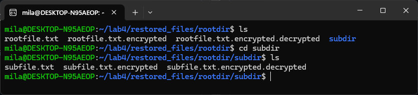
The encrypted file:
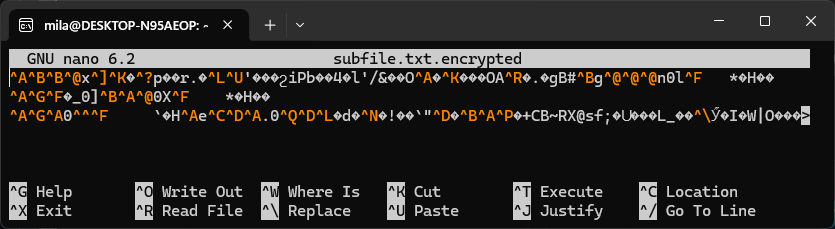
The decrypted file:
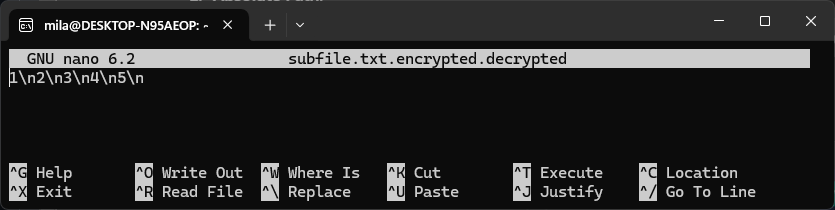

### [5] Apply pycryptodome for encryption/decryption

#### 5.1 Install `pycryptodome`
I first installed the library `pycryptodome` by using command `pip install pycryptodome`.

##### Commands
- `pip`: Pip is the Python package installer. It's used to install, update, or uninstall Python packages.
- `install`: This command tells pip to install a specific package.
- `pycryptodome`: The name of the Python package that provides cryptographic functionalities (e.g., encryption, decryption, hashing).

##### Results
```bash
Defaulting to user installation because normal site-packages is not writeable
Collecting pycryptodome
  Downloading pycryptodome-3.20.0-cp35-abi3-manylinux_2_17_x86_64.manylinux2014_x86_64.whl (2.1 MB)
     ━━━━━━━━━━━━━━━━━━━━━━━━━━━━━━━━━━━━━━━━ 2.1/2.1 MB 6.1 MB/s eta 0:00:00
Installing collected packages: pycryptodome
Successfully installed pycryptodome-3.20.0
```

#### 5.2 Encrypt and decrypt using Python script 
I adapted the Python script provided in the Lab4 instruction. I downloaded files from the S3 bucket, encrypted and decrypted them using `pycryptodome`.

##### Python script `pycryptodome.py`
```python
# Reference: https://github.com/zhangzhics/CITS5503_Sem2/blob/master/Labs/src/fileencrypt.py
import os, random, struct
from Crypto.Cipher import AES
from Crypto import Random
import boto3
import base64
import hashlib

BLOCK_SIZE = 16
CHUNK_SIZE = 64 * 1024

s3 = boto3.client('s3')

bucket_name = '22756463-cloudstorage'  # S3 bucket name
local_directory = './restored_files1'  # Local directory to store files obtained from cloud


# Download files from S3 bucket to local directory
def download_s3_files(bucket_name, local_directory):
    if not os.path.exists(local_directory):
        os.makedirs(local_directory)

    # List files in the S3 bucket
    objects = s3.list_objects_v2(Bucket=bucket_name)

    if 'Contents' in objects:
        for obj in objects['Contents']:
            file_key = obj['Key']
            file_path = os.path.join(local_directory, file_key)

            # Create subdirectories if necessary
            os.makedirs(os.path.dirname(file_path), exist_ok=True)

            # Download the file from S3 to local directory
            s3.download_file(bucket_name, file_key, file_path)
            print(f"Downloaded {file_key} to {file_path}")
    else:
        print("No files found in the S3 bucket.")


def encrypt_file(password, in_filename, out_filename):

    key = hashlib.sha256(password.encode("utf-8")).digest()

    iv = Random.new().read(AES.block_size)
    encryptor = AES.new(key, AES.MODE_CBC, iv)
    filesize = os.path.getsize(in_filename)

    with open(in_filename, 'rb') as infile:
        with open(out_filename, 'wb') as outfile:
            outfile.write(struct.pack('<Q', filesize))
            outfile.write(iv)

            while True:
                chunk = infile.read(CHUNK_SIZE)
                if len(chunk) == 0:
                    break
                elif len(chunk) % 16 != 0:
                    chunk += ' '.encode("utf-8") * (16 - len(chunk) % 16)

                outfile.write(encryptor.encrypt(chunk))


def decrypt_file(password, in_filename, out_filename):

    key = hashlib.sha256(password.encode("utf-8")).digest()

    with open(in_filename, 'rb') as infile:
        origsize = struct.unpack('<Q', infile.read(struct.calcsize('Q')))[0]
        iv = infile.read(16)
        decryptor = AES.new(key, AES.MODE_CBC, iv)

        with open(out_filename, 'wb') as outfile:
            while True:
                chunk = infile.read(CHUNK_SIZE)
                if len(chunk) == 0:
                    break
                outfile.write(decryptor.decrypt(chunk))

            outfile.truncate(origsize)


# Main program
password = 'cat is cuteee'

# Download the files from the S3 bucket
download_s3_files(bucket_name, local_directory)

# Encrypt and decrypt the files
for dir_name, subdir_list, file_list in os.walk(local_directory, topdown=True):
    if dir_name != local_directory:
        for fname in file_list:
            print(fname)
            file_path = os.path.join(dir_name, fname)

            # Encrypt the file
            encrypt_file(password, file_path, out_filename=f"{file_path}.enc")

            # Decrypt the encrypted file
            decrypt_file(password, f"{file_path}.enc", out_filename=f"{file_path}.dec")
```

##### Results
Files were downloaded from the S3 bucket, encrypted and decrypted using the `pycryptodome`.
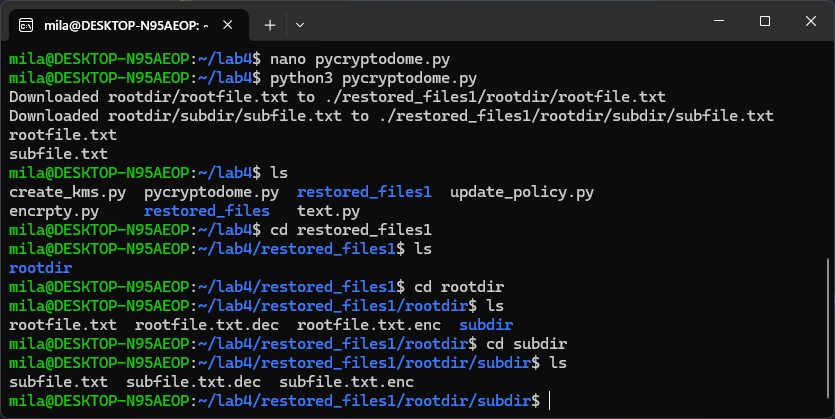
The encrypted file:
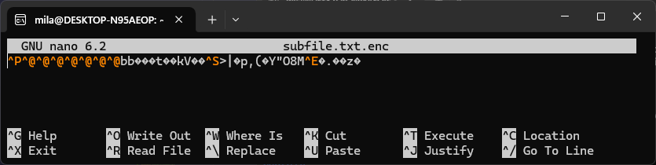
The decrypted file:
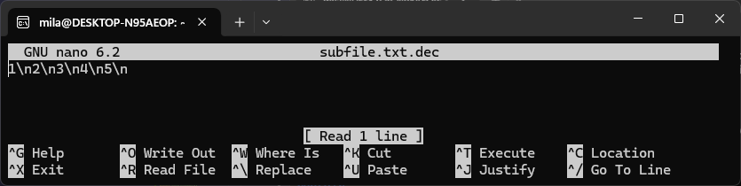

## Answer the following question

### Question:
What is the performance difference between using KMS and using the custom solution?

### Answer:


<div style="page-break-after: always;"></div>

# Lab 5

