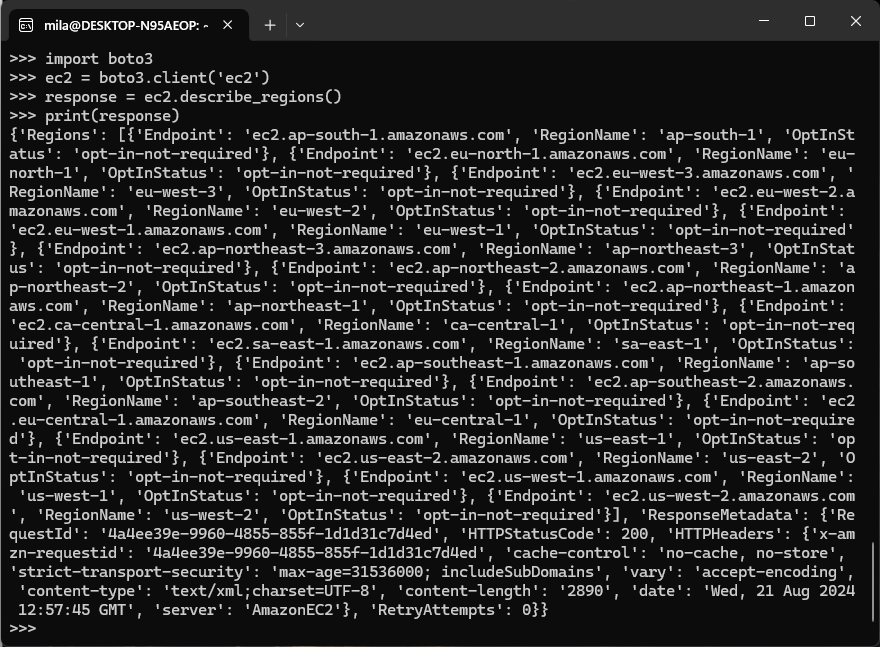

<div style="display: flex; flex-direction: column; justify-content: center; align-items: center; height: 100vh;">

  <h2>Labs 1-5</h2>
  
  <p>Student ID: 22756463</p>
  <p>Student Name: Mila (Yue) Zhang</p>

</div>

# Lab 1

## AWS Account and Log in

### [1] Log into an IAM user account
After opening the [login page](https://489389878001.signin.aws.amazon.com/console), I entered my IAM user name "22756463@student.uwa.edu.au" and the initial password provided by the Unit Coordinator. Then I changed my password after login.


### [2] Search and open Identity Access Management
After clicking my user account and selecting the Security Credentials tab, I created an access key and noted the Access Key ID and the secret access key down.


## Set up recent Linux OSes
### [1] Download Ubuntu OS 22.04.3
I downloaded Ubuntu OS 22.04.3 from the Microsoft Store as recommended by a lab facilitator.


### [2] Update WSL
Since there was an old version of WSL installed on my laptop, I used command `wsl --update` to update the WSL.


## Install Linux packages

### [1] Install Python 3.8.x and above
Since the recent Ubuntu versions such as 22.04.3 LTS have Python 3.8.x installed, I updated the packages to obtain the latest version through commands `sudo apt update` and `sudo apt -y upgrade`. After checking the latest version through command `python3 -V`, now we can see I have version `Python 3.10.12` installed. Then I installed pip3 through command `sudo apt install -y python3-pip` for future Python library management.

#### Explanation of commands:
- `sudo`: allows us to run the command with elevated (root) privileges.
- `apt`: the command-line tool used to interact with the Advanced Package Tool (APT), the package management system used by Debian-based distributions. APT manages the installation, upgrade, and removal of software packages.
- `-y`: automatically answers "yes" to any prompts that might come up during the upgrade process.

### [2] Install awscli
`awscli` stands for Amazon Web Services Command Line Interface. It's a unified tool that provides a consistent interface for interacting with all of Amazon Web Services (AWS). I installed and updated awscli through commands `sudo apt install awscli` and `pip3 install awscli --upgrade`.

#### Explanation of commands:
- `sudo`: allows us to run the command with elevated (root) privileges.
- `apt`: the command-line tool used to interact with the Advanced Package Tool (APT), the package management system used by Debian-based distributions. APT manages the installation, upgrade, and removal of software packages.
- `pip3`: package installer for Python 3 which allows us to install and manage Python packages.

#### Results:
```bash
mila@DESKTOP-N95AEOP:~$ sudo apt install awscli
[sudo] password for mila:
Reading package lists... Done
Building dependency tree... Done
Reading state information... Done
awscli is already the newest version (1.22.34-1).
0 upgraded, 0 newly installed, 0 to remove and 2 not upgraded.
------------------------------------------------------------------------------
mila@DESKTOP-N95AEOP:~$ pip3 install awscli --upgrade
Successfully installed awscli-1.34.2 botocore-1.35.2
```

### [3] Configure AWS
I set up and managed my AWS credentials and configuration settings for the AWS Command Line Interface by using command `aws configure`. I entered information of my AWS Access Key ID, AWS Secret Access Key, default region name according to my student number in the table (my student number 22756463 was allocated to region with name "us-east-1"), and the default output format.


### [4] Install boto3
I installed the "boto3" library which is the official AWS SDK (software development kit) for Python through command `pip3 install boto3`. "boto3" allows Python developers to write software that use Amazon services like S3, EC2 and so on. After installation, we can import the library in Python scripts and interact with AWS services.


## Test the installed environment

### [1] Test the AWS environment
I tested the AWS environment by retrieving a list of all available AWS regions for EC2 and display the information in a table format.

#### Commands
- `aws`: the AWS Command Line Interface. It is the tool we use to interact with AWS services directly from the command line or terminal.
- `ec2`: EC2 stands for the AWS Elastic Compute Cloud. By specifying `ec2` in this command, we tell the AWS CLI we want to perform an action associated with the EC2 service.
- `describe-regions`: the action we want to perform within the EC2 service. It lists all available AWS regions (geographical areas that have various data centres) for the EC2 service.
- `--output`: controls the format of the command's output. Some typical formats are "json", "table", "text", "yaml" and so on.
- `--output table`: this part specifies that the output should be formatted as a table.

#### Results

### [2] Test the Python environment
I tested the Python3 environment by activating the Python3 interactive shell and entered some Python code.

#### Commands
```python
python3
>>> import boto3
>>> ec2 = boto3.client('ec2')
>>> response = ec2.describe_regions()
>>> print(response)
```
- 

#### Results
```
{'Regions': [{'Endpoint': 'ec2.ap-south-1.amazonaws.com', 'RegionName': 'ap-south-1', 'OptInStatus': 'opt-in-not-required'}, {'Endpoint': 'ec2.eu-north-1.amazonaws.com', 'RegionName': 'eu-north-1', 'OptInStatus': 'opt-in-not-required'}, {'Endpoint': 'ec2.eu-west-3.amazonaws.com', 'RegionName': 'eu-west-3', 'OptInStatus': 'opt-in-not-required'}, {'Endpoint': 'ec2.eu-west-2.amazonaws.com', 'RegionName': 'eu-west-2', 'OptInStatus': 'opt-in-not-required'}, {'Endpoint': 'ec2.eu-west-1.amazonaws.com', 'RegionName': 'eu-west-1', 'OptInStatus': 'opt-in-not-required'}, {'Endpoint': 'ec2.ap-northeast-3.amazonaws.com', 'RegionName': 'ap-northeast-3', 'OptInStatus': 'opt-in-not-required'}, {'Endpoint': 'ec2.ap-northeast-2.amazonaws.com', 'RegionName': 'ap-northeast-2', 'OptInStatus': 'opt-in-not-required'}, {'Endpoint': 'ec2.ap-northeast-1.amazonaws.com', 'RegionName': 'ap-northeast-1', 'OptInStatus': 'opt-in-not-required'}, {'Endpoint': 'ec2.ca-central-1.amazonaws.com', 'RegionName': 'ca-central-1', 'OptInStatus': 'opt-in-not-required'}, {'Endpoint': 'ec2.sa-east-1.amazonaws.com', 'RegionName': 'sa-east-1', 'OptInStatus': 'opt-in-not-required'}, {'Endpoint': 'ec2.ap-southeast-1.amazonaws.com', 'RegionName': 'ap-southeast-1', 'OptInStatus': 'opt-in-not-required'}, {'Endpoint': 'ec2.ap-southeast-2.amazonaws.com', 'RegionName': 'ap-southeast-2', 'OptInStatus': 'opt-in-not-required'}, {'Endpoint': 'ec2.eu-central-1.amazonaws.com', 'RegionName': 'eu-central-1', 'OptInStatus': 'opt-in-not-required'}, {'Endpoint': 'ec2.us-east-1.amazonaws.com', 'RegionName': 'us-east-1', 'OptInStatus': 'opt-in-not-required'}, {'Endpoint': 'ec2.us-east-2.amazonaws.com', 'RegionName': 'us-east-2', 'OptInStatus': 'opt-in-not-required'}, {'Endpoint': 'ec2.us-west-1.amazonaws.com', 'RegionName': 'us-west-1', 'OptInStatus': 'opt-in-not-required'}, {'Endpoint': 'ec2.us-west-2.amazonaws.com', 'RegionName': 'us-west-2', 'OptInStatus': 'opt-in-not-required'}], 'ResponseMetadata': {'RequestId': '4a4ee39e-9960-4855-855f-1d1d31c7d4ed', 'HTTPStatusCode': 200, 'HTTPHeaders': {'x-amzn-requestid': '4a4ee39e-9960-4855-855f-1d1d31c7d4ed', 'cache-control': 'no-cache, no-store', 'strict-transport-security': 'max-age=31536000; includeSubDomains', 'vary': 'accept-encoding', 'content-type': 'text/xml;charset=UTF-8', 'content-length': '2890', 'date': 'Wed, 21 Aug 2024 12:57:45 GMT', 'server': 'AmazonEC2'}, 'RetryAttempts': 0}}
```


### [3] Write a Python script

[Refer to the marking rubrics for sufficient step-by-step description.]


<div style="page-break-after: always;"></div>

# Lab 2

<div style="page-break-after: always;"></div>

# Lab 3

<div style="page-break-after: always;"></div>

# Lab 4

<div style="page-break-after: always;"></div>

# Lab 5

