<div style="text-align: center;">

  <h1>Labs 6-9</h1>
  
  <p>Student ID: 22756463</p>
  <p>Student Name: Mila (Yue) Zhang</p>

</div>

<div style="page-break-after: always;"></div>

# Lab 6

## Set up an EC2 instance

### [1] Create an EC2 micro instance with Ubuntu and SSH into it. 

#### 1.1 Create an EC2 micro instance

##### Python script `create_ec2_instance.py`
```python
import boto3
from botocore.exceptions import ClientError

# Create a Boto3 EC2 client to interact with AWS EC2 service
ec2 = boto3.client('ec2')

# Function to create an EC2 instance
def create_instance(key_name, security_group_name, ami_id):
    try:
        # Create the EC2 instance using run_instances API call
        # https://boto3.amazonaws.com/v1/documentation/api/latest/reference/services/ec2/client/run_instances.html
        instance = ec2.run_instances(
            ImageId= ami_id,                  # AMI ID for the EC2 instance (Ubuntu or other OS)
            MinCount=1,                       # Minimum number of instances to create (1 in this case)
            MaxCount=1,                       # Maximum number of instances to create (1 in this case)
            InstanceType='t2.micro',           # Instance type (t2.micro for free tier)
            KeyName=key_name,                 # Name of the SSH key pair for access
            SecurityGroups=[security_group_name],  # Security group to associate with the instance
            TagSpecifications=[               # Adding a tag to the instance (for identification)
                    {
                        'ResourceType': 'instance',
                        'Tags': [
                            {'Key': 'Name', 'Value': f'22756463-vm'}  # Tag with a key-value pair for Name
                        ]
                    }
                ]
        )
        # Extract the instance ID from the response
        instance_id = instance['Instances'][0]['InstanceId']
        print(f"EC2 instance created with Instance ID: {instance_id}")
        return instance_id  # Return the instance ID
    except ClientError as e:
        # Print an error message if the instance creation fails
        print(f"Error creating EC2 instance: {e}")
        return None  # Return None in case of an error

# Main function to set up instance creation
def main():
    sg_name = "22756463-sg"  # Security group name
    sg_description = "security group for development environment"  # Security group description
    key_name = "22756463-key"  # SSH key pair name
    ami_id = "ami-0a0e5d9c7acc336f1"  # AMI ID for the instance (replace with appropriate AMI for your region)
    
    # Create an EC2 instance using the create_instance function
    instance_id = create_instance(key_name, sg_name, ami_id)

# Run the main function when the script is executed
if __name__ == "__main__":
    main()
```
A detailed explanation is provided as comments in the code block above.

##### Results
Created an EC2 instance with name `22756463-vm` and ID `i-01b55b25eb0b60503`.
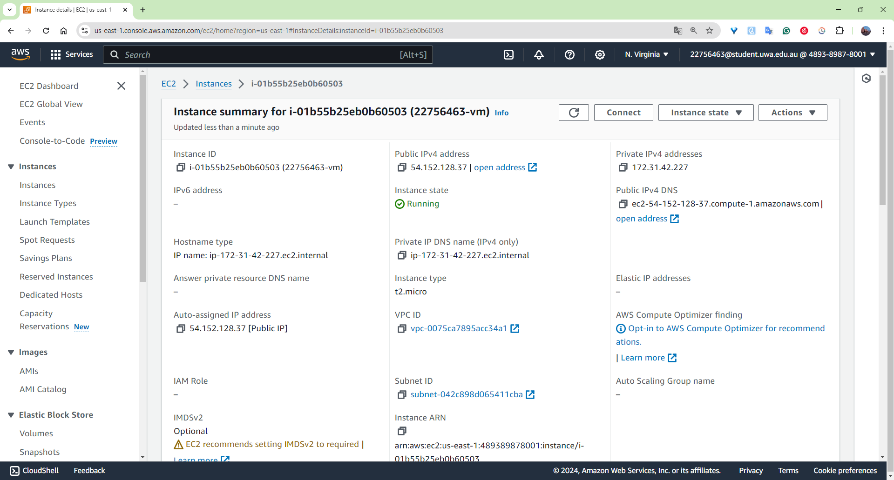

#### 1.2 SSH into the EC2 instance
I obtained the public IP address of the EC2 instances from the AWS console. The address is `54.152.128.37`. Then I ssh to the instance using command `ssh -i 22756463-key.pem ubuntu@54.152.128.37`.

##### Commands
- `ssh`: This is the command used to establish a secure connection to a remote machine. It uses an encrypted connection, providing a secure way to access remote servers over insecure networks.
- `-i 22756463-key.pem`:
    - `-i`: This option specifies the identity file (or private key) to use for authentication. SSH uses this key to log into the remote server without needing a password.
    - `22756463-key.pem`: This is the path to the private key file that I generated when creating the EC2 key pair. This file must have read-only permissions (chmod 400 22756463-key.pem) to ensure it is secure.
- `ubuntu`: This is the username used to log into the server. For Ubuntu AMIs, the default username is ubuntu.

##### Results
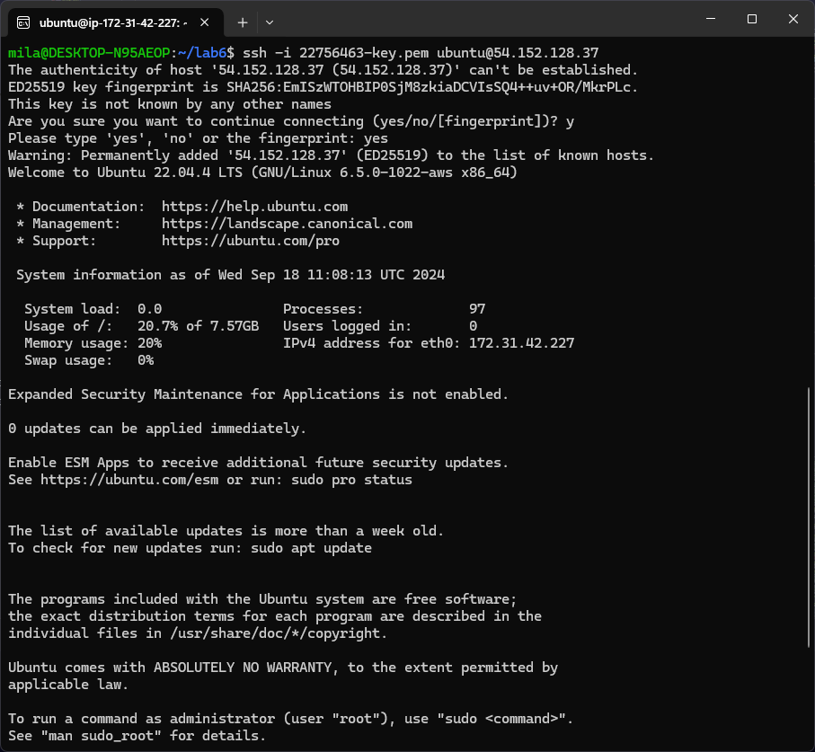

### [2] Install the Python 3 virtual environment package. 
I installed the Python3 virtual environment package by using command `sudo apt-get update`, `sudo apt-get upgrade` and `sudo apt-get install python3-venv`. Then I started a new Bash shell with root privileges.

#### Commands
- `sudo`: Run with elevated (root) privilege.
- `apt-get`: Package manager to install, update, upgrade and remove software packages.
- `update`: Update the package lists for my Ubuntu system. It ensures that the system is aware of the latest versions of available software and their dependencies.
- `upgrade`: The upgrade option installs the newest versions of all currently installed packages that have an available update.
- `install`: The install option tells apt-get to install the specified package or software.
- `python3-venv`: This is the package that provides the venv module for Python 3, allowing us to create and manage virtual environments in Python.
- `sudo bash`: Start a new Bash shell with root privileges.

#### Results
Updated the package lists, upgraded installed packages and installed the `venv` package.
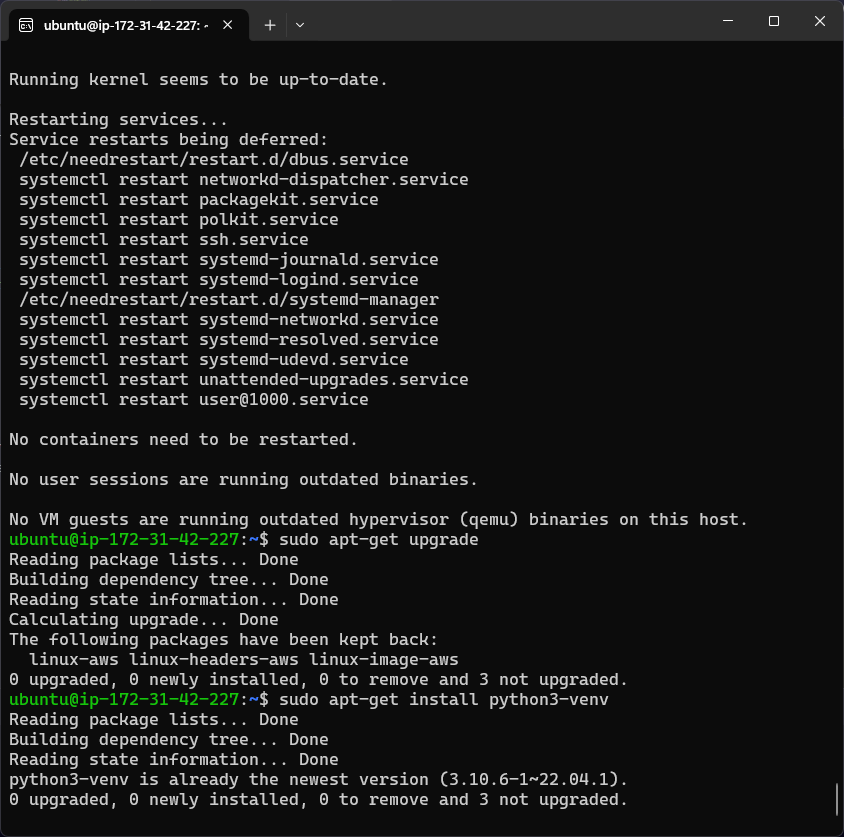

Started a new Bash shell with root privileges.
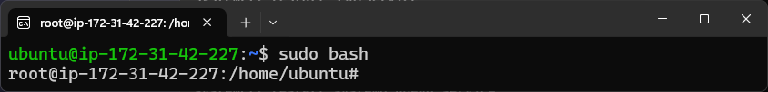

### [3] Access a directory 
I created a directory with a path `/opt/wwc/mysites` using command `mkdir -p /opt/wwc/mysites`. I changed to the new directory by using command `cd /opt/wwc/mysites`.

#### Commands
- `mkdir`: The command to create a directory.
- `-p`: This option creates parent directories as needed. In this case, it will create /opt/wwc/ if it doesn't already exist, and then create `mysites` inside it.
- `cd`: The command to navigate into it the target directory.

#### Results
Created the target directory and changed into the directory:
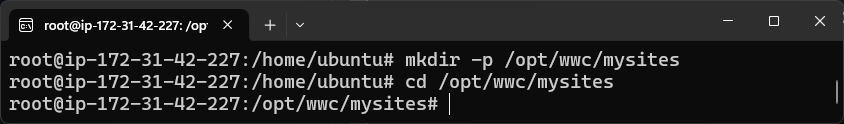

### [4] Set up a virtual environment
I created a new virtual environment by using command `python3 -m venv myvenv`.

#### Commands
- `python3`:
This invokes the Python 3 interpreter.
- `-m venv`:
    - `-m` tells Python to run the `venv` module as a script, which is used to create virtual environments.
    - `venv` is a Python module used for creating virtual environments. Virtual environments allow you to manage dependencies separately from the global Python installation, which is useful for avoiding conflicts between packages in different projects.
- `myvenv`: The name of the directory where the virtual environment will be created. Once the environment is created, this directory will contain its own bin (or Scripts on Windows) folder with Python executables and a lib folder for installed packages.

#### Results
Created a new virtual environment called `myenv`.

### [5] Activate the virtual environment

#### 5.1 Activate the virtual environment
I activated a Python virtual environment that I have created with python3 -m venv by using the command `source myvenv/bin/activate`.

##### Commands
- `source`:
This is a shell command that runs the script passed to it *in the current shell session*. It allows me to execute a script without creating a new shell process, which is necessary for setting environment variables, like those used in a virtual environment.
- `myvenv/bin/activate`:
This refers to the *activation script* located in the bin directory of my virtual environment (myvenv in this case). This script modifies my shell's environment so that it uses the Python and package installations inside the virtual environment.

##### Results
Activated the virtual environment.
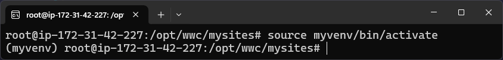

#### 5.2 Install Django
I installed Django, a popular web framework for Python, in my current activated virtual environment by using the command `pip install django`.

##### Commands
- `pip`: The Python package installer. It allows me to install Python libraries and frameworks.
- `install`: The install command tells pip to install a specific package.
- `django`: The name of the package to install. In this case, it refers to the Django framework, which includes everything needed to create web applications with Python.

##### Results
Installed Django.
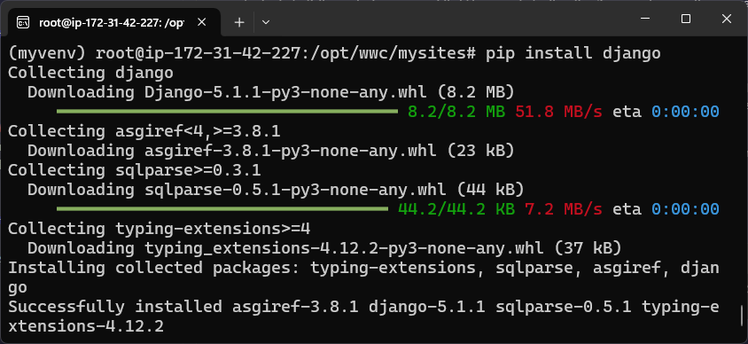

#### 5.3 Create a Django project
I created a new Django project called lab by using the command `django-admin startproject lab`. This command initializes a new Django project directory with the basic structure and files needed to get started.

##### Commands
- `django-admin`: A command-line utility provided by Django. It is used to perform various Django-related tasks, such as starting a project, running the server, creating apps, and more.
- `startproject`: This subcommand creates a new Django project. It sets up the necessary directories and files to begin development.
- `lab`:
This is the name of the project I want to create. In this case, the project will be called lab. Django will create a directory named lab containing the initial project files.

##### Results
Created a new Django project called `lab`.

#### 5.4 Change into the Django project directory
I changed my current working directory to the `lab` directory by using command `cd lab`.

##### Commands
- `cd`: This stands for "change directory". It’s a command used to navigate between directories in my terminal or command line.
- `lab`: The name of the directory I want to navigate to.

##### Results
Changed into the directory called `lab`.
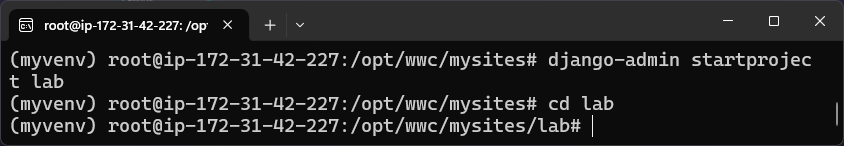

#### 5.5 Create a Django app
I created a new Django app called `polls` within my Django project by using the command `python3 manage.py startapp polls`. Django apps are components of a project that encapsulate specific functionality, making it easier to manage and reuse code.

##### Commands
- python3: This runs the Python 3 interpreter.
- `manage.py`:
This is a utility script automatically created in my Django project. It allows me to interact with my project in various ways, such as running the server, creating apps, applying migrations, and more.
- `startapp`: A Django management command used to create a new app within the project.
- `polls`: The name of the app I am creating. Django will generate a directory named polls with the necessary structure for an app.

##### Results
Created a Django app.

#### 5.6 Inspect the Django project directory structure
I looked at the files that have been created in the project direcotry by using the command `ls -R`.

##### Commands
- `ls`: This command lists the contents of the current directory.
- `-R`: It stands for recursive, meaning it will list not only the files in the current directory but also in all subdirectories.

##### Results

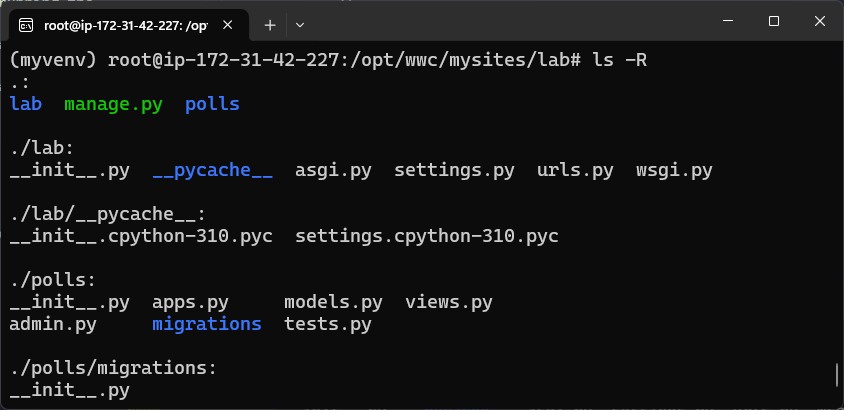
```
lab/                     # Main project directory
    manage.py            # Utility for interacting with the project
    lab/                 # Inner project directory (contains project settings)
        __init__.py      # Marks this directory as a Python package
        settings.py      # Configuration file for the project (database, apps, etc.)
        urls.py          # Project-level URL routing
        asgi.py          # ASGI configuration for asynchronous web requests
        wsgi.py          # WSGI configuration for web servers (e.g., Gunicorn)
    polls/               # Newly created app (based on 'startapp polls' command)
        __init__.py      # Marks the directory as a Python package
        admin.py         # Admin site configuration for managing models
        apps.py          # App configuration
        migrations/      # Directory for database migrations
            __init__.py
        models.py        # Define data models here (database tables)
        tests.py         # Write unit tests for the app
        views.py         # Handles the logic and request/response cycle
```

### [6] Install nginx
I installed the Nginx web server on Ubuntu by using the command `apt install nginx`. Nginx is a powerful, open-source HTTP and reverse proxy server, known for its high performance and low resource usage.

#### Commands
- `apt`: The package management command used in Ubuntu for installing, updating, and removing software.
- `install`: This option tells apt to install the specified package.
- `nginx`: The name of the package I want to install, which in this case is the Nginx web server.

#### Results
Installed Nginx.

### [7] Configure nginx
I edited the `/etc/nginx/sites-enabled/default` by using the command `nano /etc/nginx/sites-enabled/default`.

#### Commands
- `nano`: The text editor I am using.
- `/etc/nginx/sites-enabled/default`: The full path to the Nginx configuration file I want to edit.

#### Results
Replaced the file content:
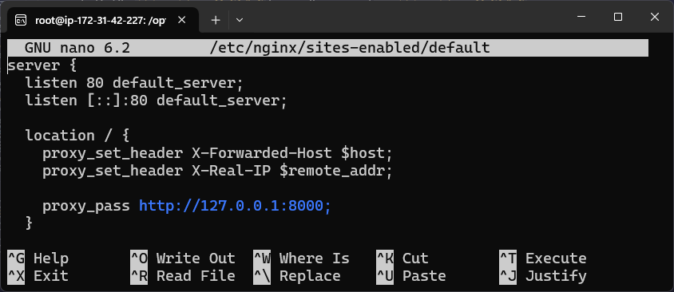


### [8] Restart nginx
I restarted the Nginx web server on my system by using the command `service nginx restart`. Restarting Nginx is necessary after making configuration changes (such as editing the /etc/nginx/sites-enabled/default file) to apply those changes.

#### Commands
- `service`: This is the command used to manage system services (like starting, stopping, or restarting services) in many Linux distributions.
- `nginx`: This is the name of the service I am interacting with, which in this case is the Nginx web server.
- `restart`: This tells the system to stop and then start the Nginx service again, applying any new configurations.

#### Results
Restarted the Nginx web server.

### [9] Access your EC2 instance
I started the Django development server on port 8000 by using the command `python3 manage.py runserver 8000`. This is typically done during development to test the Django application locally. Then I opened the browser and entered the IP address (http://54.152.128.37/) of my EC2 instance.

#### Commands
- `python3`: This runs the Python 3 interpreter.
- `manage.py`: This is a Django utility script automatically generated when creating a Django project. It is used to perform various administrative tasks for the project, such as running the development server, creating migrations, or managing the database.
- `runserver`: This is the command that starts the Django development web server. By default, Django runs the server on port 8000, but we can specify a different port if needed.
- `8000`: This specifies the port number on which the server will listen.

#### Results
The server run as follows.
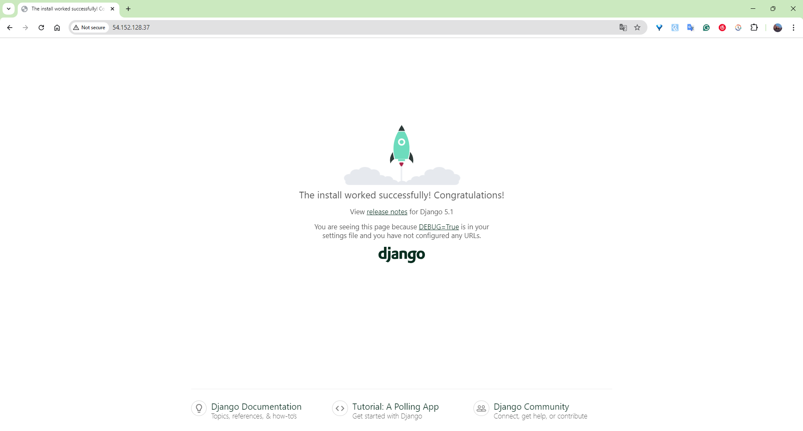

## Set up Django inside the created EC2 instance

### [1] Edit the following files (create them if not exist)
I edited files `polls/views.py`, `polls/urls.py` and `lab/urls.py` by using the command `nano`.

#### Commands
- `nano`: The text editor commonly used in Linux.

#### Results
I replaced content in those files with those provided in the lab description.
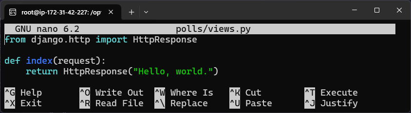
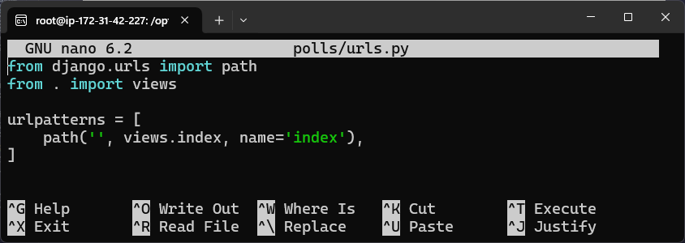
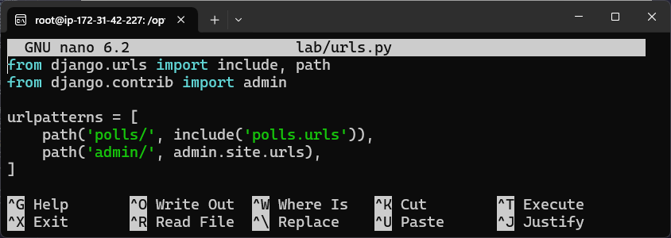

### [2] Run the web server again
I started the Django development server on port 8000 again by using the command `python3 manage.py runserver 8000`. This is typically done during development to test the Django application locally. 

#### Commands
- `python3`: This runs the Python 3 interpreter.
- `manage.py`: This is a Django utility script automatically generated when creating a Django project. It is used to perform various administrative tasks for the project, such as running the development server, creating migrations, or managing the database.
- `runserver`: This is the command that starts the Django development web server. By default, Django runs the server on port 8000, but we can specify a different port if needed.
- `8000`: This specifies the port number on which the server will listen.

#### Results
The server run as follows.


### [3] Access the EC2 instance
I accessed the EC2 instance by opening the URL `http://54.152.128.37/polls/` in a browser.

#### Results
(Zoomed in)


## Set up an ALB

### [1] Create an application load balancer
I created an application load balancer for the EC2 instance using the below Python script. I specified the region and subnet where my EC2 instance resided. Next, I created a listener for the Application Load Balancer with the default rule using Protocol: HTTP and Port 80 forwarding. I then chose the security group that allowed HTTP traffic on port 80. Finally, I added my EC2 instance as a registered target within the target group, enabling the load balancer to forward traffic to it.

#### Python script
```python
import boto3
from botocore.exceptions import ClientError

# Create a Boto3 EC2 and ELBv2 client
# ec2 client is used for interacting with EC2 instances and subnets
# elbv2 client is used for interacting with Application Load Balancer (ALB) and Target Groups
ec2 = boto3.client('ec2')
elbv2 = boto3.client('elbv2')

# Function to get available subnets in the region
def get_subnets():
    # Describe subnets in the EC2 environment
    subnets_response = ec2.describe_subnets()
    subnets = subnets_response['Subnets']
    
    # Filter subnets to only include those that are in the 'available' state
    available_subnets = [subnet for subnet in subnets if subnet['State'] == 'available']
    
    # If fewer than 2 available subnets are found, raise an exception
    if len(available_subnets) < 2:
        raise Exception('Less than 2 available subnets in this region.')
    
    return available_subnets

# Function to create an Application Load Balancer (ALB)
def create_load_balancer(sg_id, subnets):
    try:
        # Create the load balancer with the given security group and subnets
        response = elbv2.create_load_balancer(
            Name='22756463-load-balancer1',  # The name of the load balancer
            Subnets=subnets,  # Subnets where the load balancer will reside
            SecurityGroups=[sg_id],  # Security group to apply
            Scheme='internet-facing',  # Public-facing ALB
            Type='application',  # Application Load Balancer (ALB)
            IpAddressType='ipv4'  # Use IPv4
        )
        lb_arn = response['LoadBalancers'][0]['LoadBalancerArn']  # ARN (Amazon Resource Name) of the created LB
        print(f"Load Balancer created with ARN: {lb_arn}")
        return lb_arn  # Return the ARN of the load balancer
    except ClientError as e:
        print(f"Error creating load balancer: {e}")  # Catch and print errors if any
        return None

# Function to create a Target Group
def create_target_group(vpc_id):
    try:
        # Create a target group in the specified VPC
        response = elbv2.create_target_group(
            Name='22756463-target-group1',  # Name of the target group
            Protocol='HTTP',  # Protocol to use (HTTP)
            Port=80,  # Port to forward traffic (port 80)
            VpcId=vpc_id,  # VPC ID where the target group resides
            HealthCheckProtocol='HTTP',  # Health check using HTTP
            HealthCheckPort='80',  # Port to use for health checks (port 80)
            TargetType='instance'  # Target type is EC2 instances
        )
        target_group_arn = response['TargetGroups'][0]['TargetGroupArn']  # ARN of the created target group
        print(f"Target group created with ARN: {target_group_arn}")
        return target_group_arn  # Return the ARN of the target group
    except ClientError as e:
        print(f"Error creating target group: {e}")  # Catch and print errors if any
        return None

# Function to register EC2 instances with the target group
def register_targets(target_group_arn, instance_ids):
    try:
        # Prepare the list of instance IDs as target objects
        targets = [{'Id': instance_id} for instance_id in instance_ids]
        # Register the EC2 instances as targets for the target group
        elbv2.register_targets(
            TargetGroupArn=target_group_arn,  # The ARN of the target group
            Targets=targets  # EC2 instances to register
        )
        print(f"Registered instances {instance_ids} to the target group.")  # Print confirmation
    except ClientError as e:
        print(f"Error registering targets: {e}")  # Catch and print errors if any

# Function to create a listener for the load balancer
def create_listener(lb_arn, target_group_arn):
    try:
        # Create a listener for the load balancer to forward HTTP traffic to the target group
        elbv2.create_listener(
            LoadBalancerArn=lb_arn,  # ARN of the load balancer
            Protocol='HTTP',  # Protocol to use (HTTP)
            Port=80,  # Port to listen on (port 80)
            DefaultActions=[{
                'Type': 'forward',
                'TargetGroupArn': target_group_arn  # Forward traffic to the target group
            }]
        )
        print(f"Listener created for Load Balancer {lb_arn}")  # Print confirmation
    except ClientError as e:
        print(f"Error creating listener: {e}")  # Catch and print errors if any

# Main function to coordinate the creation of the ALB and associated resources
def main():
    instance_id = ['i-01b55b25eb0b60503']  # List of EC2 instance IDs to register in the target group
    sg_id = 'sg-045eebb087d4f0e9f'  # Security group ID

    # Get VPC information (first available VPC)
    vpcs = ec2.describe_vpcs()
    vpc_id = vpcs['Vpcs'][0]['VpcId']  # Extract the VPC ID
    
    # Get subnets in the VPC
    subnets = get_subnets()
    subnet_id = [subnets[0]['SubnetId'], subnets[1]['SubnetId']]  # Select two available subnets
    
    # Create the Application Load Balancer
    lb_arn = create_load_balancer(sg_id, subnet_id)

    # Create a target group within the VPC
    target_group_arn = create_target_group(vpc_id)

    # Register the EC2 instance to the target group
    register_targets(target_group_arn, instance_id)

    # Create a listener for the load balancer to forward traffic to the target group
    create_listener(lb_arn, target_group_arn)

# Entry point for the script
if __name__ == "__main__":
    main()
```
A detailed explanation is provided as comments in the code block above.

#### Results
Created an application load balancer. (I forgot to make a screenshot initially, so I created another one named "22756463-load-balancer4")
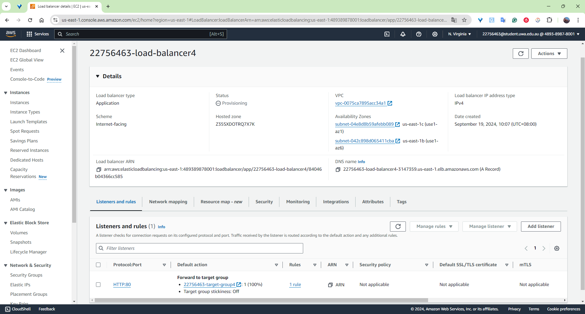

### [2] Health check
I updated the above code in Step 1 to add a health check for the target group. I specified `/polls/` as the path for the health check in the target group configuration. I then confirmed that the health check was fetching the `/polls/` page every 30 seconds as expected using AWS Console.

#### Python script 
```python
import boto3
from botocore.exceptions import ClientError

# Create a Boto3 EC2 and ELBv2 client to interact with AWS services
ec2 = boto3.client('ec2')  # EC2 client to handle EC2 and VPC-related operations
elbv2 = boto3.client('elbv2')  # ELBv2 client to manage load balancers and target groups

# Function to retrieve available subnets in the region
def get_subnets():
    # Fetch the details of all subnets in the current region
    subnets_response = ec2.describe_subnets()
    subnets = subnets_response['Subnets']
    
    # Filter only subnets that are in the 'available' state
    available_subnets = [subnet for subnet in subnets if subnet['State'] == 'available']
    
    # Ensure that there are at least 2 available subnets
    if len(available_subnets) < 2:
        raise Exception('Less than 2 available subnets in this region.')
    
    return available_subnets  # Return the list of available subnets

# Function to create a new Application Load Balancer (ALB)
def create_load_balancer(sg_id, subnets):
    try:
        # Create the load balancer with specified security groups and subnets
        response = elbv2.create_load_balancer(
            Name='22756463-load-balancer3',  # Name of the load balancer
            Subnets=subnets,  # List of subnet IDs
            SecurityGroups=[sg_id],  # Security group for the load balancer
            Scheme='internet-facing',  # Internet-facing load balancer
            Type='application',  # Type is 'application' (ALB)
            IpAddressType='ipv4'  # Use IPv4 for IP addressing
        )
        # Get the Load Balancer ARN from the response
        lb_arn = response['LoadBalancers'][0]['LoadBalancerArn']
        print(f"Load Balancer created with ARN: {lb_arn}")  # Print the ARN
        return lb_arn  # Return the ARN of the created load balancer
    except ClientError as e:
        print(f"Error creating load balancer: {e}")  # Print error message in case of failure
        return None  # Return None if creation fails

# Function to create a target group within a VPC
def create_target_group(vpc_id):
    try:
        # Create a target group for the load balancer, with HTTP health check on /polls/
        response = elbv2.create_target_group(
            Name='22756463-target-group3',  # Name of the target group
            Protocol='HTTP',  # The protocol to use (HTTP)
            Port=80,  # Port number to listen on
            VpcId=vpc_id,  # VPC ID where the target group resides
            HealthCheckProtocol='HTTP',  # Protocol for health checks
            HealthCheckPort='80',  # Port for health check (HTTP)
            HealthCheckPath='/polls/',  # Health check path (/polls/)
            HealthCheckIntervalSeconds=30,  # Health check interval set to 30 seconds
            HealthCheckTimeoutSeconds=5,  # Timeout for health check requests
            HealthyThresholdCount=2,  # Threshold for marking instance as healthy
            UnhealthyThresholdCount=2,  # Threshold for marking instance as unhealthy
            TargetType='instance'  # Target type is EC2 instances
        )
        # Get the ARN of the created target group
        target_group_arn = response['TargetGroups'][0]['TargetGroupArn']
        print(f"Target group created with ARN: {target_group_arn}")  # Print the ARN of the target group
        return target_group_arn  # Return the target group ARN
    except ClientError as e:
        print(f"Error creating target group: {e}")  # Print error message if creation fails
        return None  # Return None if creation fails

# Function to register EC2 instances with the target group
def register_targets(target_group_arn, instance_ids):
    try:
        # Prepare the list of targets (EC2 instances) to register
        targets = [{'Id': instance_id} for instance_id in instance_ids]
        # Register the targets with the specified target group
        elbv2.register_targets(
            TargetGroupArn=target_group_arn,  # Target group ARN
            Targets=targets  # List of instances to register
        )
        print(f"Registered instances {instance_ids} to the target group.")  # Print confirmation message
    except ClientError as e:
        print(f"Error registering targets: {e}")  # Print error message if registration fails

# Function to create a listener for the load balancer
def create_listener(lb_arn, target_group_arn):
    try:
        # Create an HTTP listener that forwards traffic to the target group
        elbv2.create_listener(
            LoadBalancerArn=lb_arn,  # Load Balancer ARN
            Protocol='HTTP',  # Protocol to listen for (HTTP)
            Port=80,  # Port to listen on (80)
            DefaultActions=[{
                'Type': 'forward',
                'TargetGroupArn': target_group_arn  # Forward traffic to the target group
            }]
        )
        print(f"Listener created for Load Balancer {lb_arn}")  # Print confirmation message
    except ClientError as e:
        print(f"Error creating listener: {e}")  # Print error message if creation fails

# Main function to handle the creation of load balancer, target group, and registration of instances
def main():
    instance_id = ['i-01b55b25eb0b60503']  # List of EC2 instance IDs to register in the target group
    sg_id = 'sg-045eebb087d4f0e9f'  # Security group ID for the load balancer

    # Describe VPCs and get the first available VPC ID
    vpcs = ec2.describe_vpcs()
    vpc_id = vpcs['Vpcs'][0]['VpcId']  # Extract the VPC ID
    
    # Get available subnets in the VPC
    subnets = get_subnets()
    # Select two subnets to use for the load balancer
    subnet_id = [subnets[0]['SubnetId'], subnets[1]['SubnetId']]
    
    # Create the Application Load Balancer (ALB)
    lb_arn = create_load_balancer(sg_id, subnet_id)

    # Create a target group within the VPC
    target_group_arn = create_target_group(vpc_id)

    # Register the EC2 instance with the target group
    register_targets(target_group_arn, instance_id)

    # Create a listener for the load balancer to forward traffic to the target group
    create_listener(lb_arn, target_group_arn)

# Entry point of the script
if __name__ == "__main__":
    main()  # Execute the main function
```
A detailed explanation is provided as comments in the code block above.

#### Results
After navigating to "EC2 > Target Groups" on AWS console, I confirmed that the Health check path is set to `/polls/`, and the Health check interval is set to `30 seconds`.
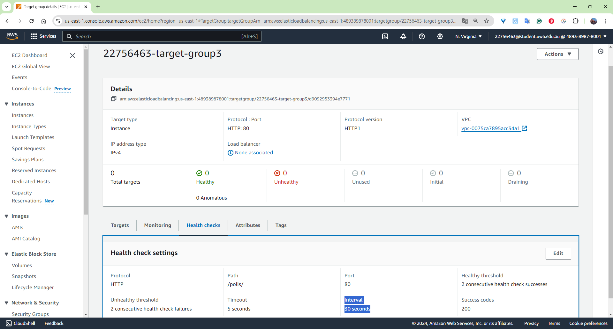


### [3] Access
I run the Django application again by using the command `python3 manage.py runserver 8000`. Then I opened the browser and and the polls page (http://54.152.128.37/polls/) of my EC2 instance.

#### Commands
- `python3`: This runs the Python 3 interpreter.
- `manage.py`: This is a Django utility script automatically generated when creating a Django project. It is used to perform various *administrative tasks* for the project, such as running the development server, creating migrations, or managing the database.
- `runserver`: This is the command that starts the Django development web server. By default, Django runs the server on port 8000, but we can specify a different port if needed.
- `8000`: This specifies the port number on which the server will listen.

#### Results
(After zoomed in)


## [Unmarked] Web interface for CloudStorage application

### [1] Create AWS DynamoDB table

#### 1.1 Create S3 bucket and upload target directory content

##### Python script `cloudstorage.py`
```python
import os
import boto3
import base64

ROOT_DIR = '.'
ROOT_S3_DIR = '22756463-cloudstorage'

s3 = boto3.client("s3")

bucket_region = 'us-east-1'

bucket_config = {'LocationConstraint': bucket_region} 


def upload_file(folder_name, file, file_name):
    print("Uploading %s" % file)

    try:
        s3.upload_file(file, ROOT_S3_DIR, folder_name+file_name)
    except Exception as error:
        print(error)
        pass

try:
    # Check if bucket exists
    s3.head_bucket(Bucket=ROOT_S3_DIR)
    print(f"Bucket {ROOT_S3_DIR} already exists.")
except Exception as error:
    # If bucket does not exist, create it
    print(f"Creating bucket {ROOT_S3_DIR}...")
    try:
        if bucket_region == 'us-east-1':
            # us-east-1 (N. Virginia) does not require LocationConstraint
            s3.create_bucket(Bucket=ROOT_S3_DIR)
        else:
            response = s3.create_bucket(
                Bucket=ROOT_S3_DIR,
                CreateBucketConfiguration=bucket_config
            )
            print(f"Bucket {ROOT_S3_DIR} created successfully.")
    except Exception as error:
        print(f"Error creating bucket: {str(error)}")
        raise


# parse directory and upload files
for dir_name, subdir_list, file_list in os.walk(ROOT_DIR, topdown=True):
    if dir_name != ROOT_DIR:
        for fname in file_list:
            # Check if the file is visible (not starting with a dot)
            if not fname.startswith('.'):
                upload_file("%s/" % dir_name[2:], "%s/%s" % (dir_name, fname), fname)

print("done")
```

##### Results
S3 bucket created with the target content:
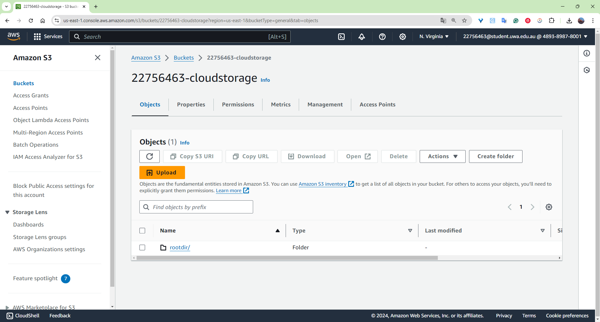


#### 1.2 Run DynamoDB local
After I changed into the `dynamodb` directory in my Ubuntu environment, I run the DynamoDB local using the command `java -Djava.library.path=./DynamoDBLocal_lib -jar DynamoDBLocal.jar –sharedDb`.

##### Commands
- `java`: This is the Java command that starts the Java runtime environment. It’s necessary because DynamoDB Local is a Java-based program.

- `-Djava.library.path=./DynamoDBLocal_lib`: This argument specifies the path where the *necessary native libraries for DynamoDB Local* are located. In this case, ./DynamoDBLocal_lib refers to a directory in the current folder that contains the required libraries.

- `-jar DynamoDBLocal.jar`: This tells Java to execute the DynamoDBLocal.jar file, which is the executable file for DynamoDB Local.

- `–sharedDb`: This option tells DynamoDB Local to use a shared database file for all the tables, rather than creating separate databases for each access pattern or client. It simulates the single, global DynamoDB environment that you would have in AWS, allowing all clients and users to access the same tables and data.

##### Results


<div style="page-break-after: always;"></div>

# Lab 7

## Create an EC2 instance
I created an EC2 instance using the following 

### Python script `create_ec2_instance.py`
```python
import boto3
from botocore.exceptions import ClientError

# Create a Boto3 EC2 client
ec2 = boto3.client('ec2')

def create_instance(key_name, security_group_name, ami_id):
    try:
        # https://boto3.amazonaws.com/v1/documentation/api/latest/reference/services/ec2/client/run_instances.html
        instance = ec2.run_instances(
            ImageId= ami_id,
            MinCount=1,
            MaxCount=1,
            InstanceType='t2.micro',
            KeyName=key_name,
            SecurityGroups=[security_group_name],
            TagSpecifications=[
                    {
                        'ResourceType': 'instance',
                        'Tags': [
                            {'Key': 'Name', 'Value': f'22756463-vm'}
                        ]
                    }
                ]
        )
        instance_id = instance['Instances'][0]['InstanceId']
        print(f"EC2 instance created with Instance ID: {instance_id}")
        return instance_id
    except ClientError as e:
        print(f"Error creating EC2 instance: {e}")
        return None
    
def main():
    sg_name = "22756463-sg"
    sg_description = "security group for development environment"
    key_name = "22756463-key"
    ami_id = "ami-0a0e5d9c7acc336f1"
    
    # Create an EC2 instance
    instance_id = create_instance(key_name, sg_name, ami_id)

if __name__ == "__main__":
    main()
```

### Results
Created an EC2 instance with ID `i-0baeaff2e48250061`.
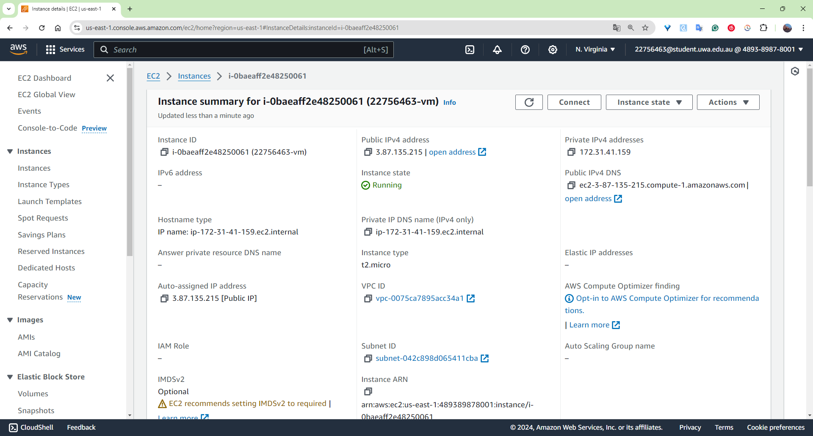

## Install and configure Fabric
### [1] Install Fabric
I used the command `pip install fabric` to install Fabric in my Linux environment. Fabric is a Python library and command-line tool for streamlining the use of SSH for application deployment or systems administration tasks.

#### Commands
- `pip`: The Python’s package installer, which allows me to install and manage software packages written in Python.
- `install`: This is the specific command telling `pip` to install a package.
- `fabric`: This is the name of the package we want to install. Fabric is a high-level Python library that simplifies tasks such as deployment, automation, and managing remote servers via SSH.

#### Results
Successfully installed Fabric.
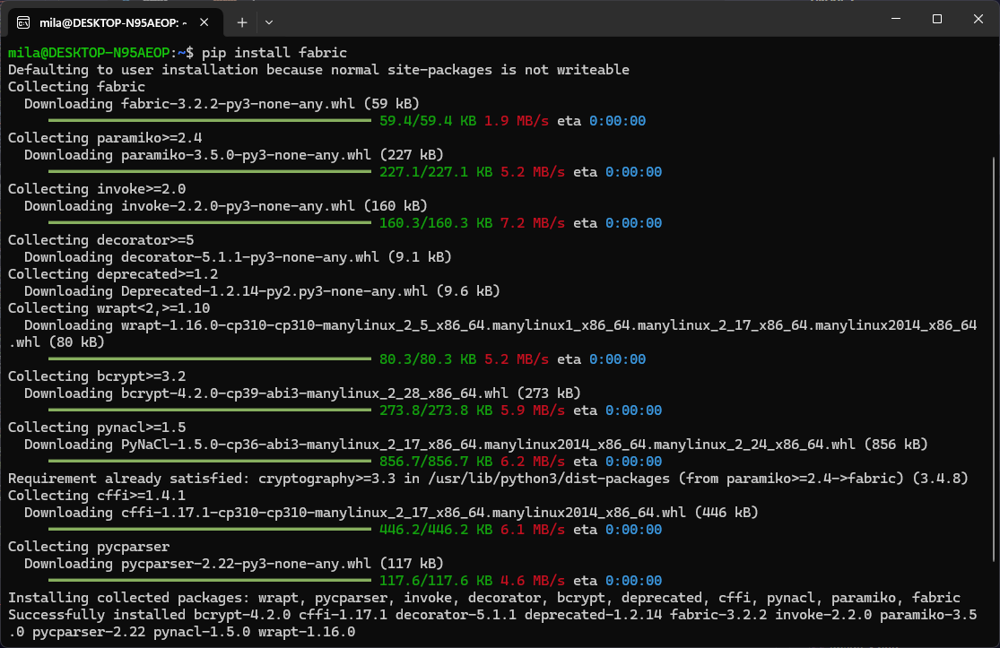

### [2] Create a config file in `~/.ssh`
I first changed into the directory by using command `cd ~/.ssh`. Then I created a config file by using the command `nano config`. 

#### Commands
- `cd`: This stands for "change directory." It is used to move into a different directory on the system.
- `~/.ssh`: The `~` symbol refers to the home directory (e.g., /home/username/ on Linux). The .ssh directory is a hidden folder in the home directory where SSH-related files, such as private/public keys and configuration files, are stored.
- `nano`: A text editor in Linux that opens files for editing in the terminal.
- `config`: The name of the file we want to edit or create. In this case, `config` is the SSH configuration file that contains your connection settings for SSH connections. If the file doesn't exist, nano will create it.

#### Content of `config`
```
Host 22756463-vm
	Hostname ec2-54-208-73-14.compute-1.amazonaws.com
	User ubuntu
	UserKnownHostsFile /dev/null
	StrictHostKeyChecking no
	PasswordAuthentication no
	IdentityFile ~/lab6/22756463-key.pem
```

#### Results
Created the file `config`:
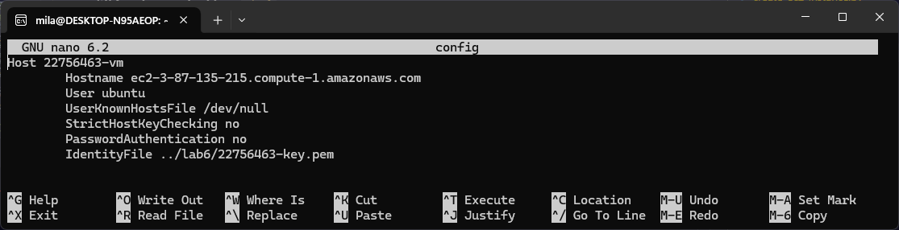

### [3] Connect to the instance
I connected to the EC2 instance by activating the Python3 environment in my Linux environment. And then paste the following Python code line by line.

#### Python script and explanation
```python
from fabric import Connection  # Import the Connection class from the fabric library for managing SSH connections
c = Connection('22756463-vm')  # Establish an SSH connection to the machine named '22756463-vm'
result = c.run('uname -s')  # Run the 'uname -s' command on the remote machine to get the operating system name
```
A detailed explanation is provided as comments above.

#### Results
Connected to the EC2 instance.
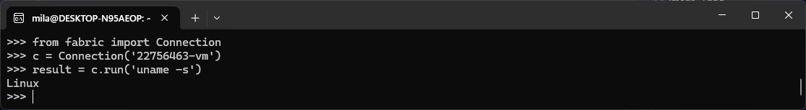

## Use Fabric for automation
I automated the setup of a Python3 virtual environment, nginx and a Django app within the EC2 instance I created in Step 1 using the below Python script.

### Python script
```python
from invoke import Responder
from fabric import Connection
import sys  # To use sys.exit for terminating the program on error

# Establish SSH connection to the EC2 instance
c = Connection('22756463-vm')

# Create a Responder to handle the sudo password prompt
sudo_pass = Responder(
    pattern=r'\[sudo\] password:',
    response='600770\n'  # Replace with your actual sudo password
)

def update_and_install():
    try:
        # Update the instance's package lists and install necessary packages
        c.sudo('apt update -y', pty=True, watchers=[sudo_pass])  # Update package list
        c.sudo('apt upgrade -y', pty=True, watchers=[sudo_pass])  # Upgrade packages
        c.sudo('apt install -y python3-venv python3-pip nginx', pty=True, watchers=[sudo_pass])  # Install Python, pip, and Nginx
        print("Packages updated and installed successfully.")
    except Exception as e:
        print(f"Error during package installation: {e}")
        sys.exit(1)  # Exit the program if there's an error


def create_project_directory():
    try:
        # Create a directory for the Django project
        c.sudo('mkdir -p ~/opt/wwc/mysites', pty=True, watchers=[sudo_pass])  # Create directory for the Django project
        # Ensure the user has ownership of the directory
        c.sudo('chown -R ubuntu:ubuntu ~/opt/wwc/mysites', pty=True, watchers=[sudo_pass])
        print("Project directory created.")
    except Exception as e:
        print(f"Error creating project directory: {e}")
        sys.exit(1)  # Exit the program if there's an error


def setup_virtualenv_and_django():
    try:
        # Create a Python virtual environment and install Django (without sudo)
        c.run('bash -c "cd ~/opt/wwc/mysites && python3 -m venv myvenv && source myvenv/bin/activate && pip install django && django-admin startproject lab && cd lab && python manage.py startapp polls"', pty=True)  # Create virtual environment
        print("Python virtual environment and Django project set up successfully.")
    except Exception as e:
        print(f"Error setting up virtual environment and Django: {e}")
        sys.exit(1)


def edit_django_files():
    try:
        # Ensure the target directories have the correct ownership
        c.sudo('chown -R ubuntu:ubuntu /home/ubuntu/opt/wwc/mysites/lab', pty=True, watchers=[sudo_pass])

        # List the directories to verify permissions and existence
        c.run('ls -lR /home/ubuntu/opt/wwc/mysites/lab', pty=True)

        # Upload files to the remote server
        result = c.put('./polls/views.py', remote='/home/ubuntu/opt/wwc/mysites/lab/polls/views.py')

        result = c.put('./polls/urls.py', remote='/home/ubuntu/opt/wwc/mysites/lab/polls/urls.py')

        result = c.put('./lab/urls.py', remote='/home/ubuntu/opt/wwc/mysites/lab/lab/urls.py')

        print("Django files uploaded successfully.")
    except Exception as e:
        print(f"Error editing Django files: {e}")
        sys.exit(1)


def configure_nginx():
    try:
        # Upload file to a directory where you have write permissions
        result = c.put('./default', remote='/home/ubuntu/default')
        print("Uploaded {0.local} to {0.remote}".format(result))

        # Move the file to /etc/nginx/sites-enabled/ with sudo
        c.sudo('mv /home/ubuntu/default /etc/nginx/sites-enabled/default', pty=True, watchers=[sudo_pass])

        # Use sudo to restart Nginx after verifying the configuration
        c.sudo('service nginx restart', pty=True, watchers=[sudo_pass])
        
        print("Nginx configured and restarted successfully.")
    
    except Exception as e:
        print(f"Error configuring Nginx: {e}")
        sys.exit(1)


def run_django():
    try:
        # Command to run the Django server in the background in the virtual environment
        commands = '''
        source ~/opt/wwc/mysites/myvenv/bin/activate && \
        cd ~/opt/wwc/mysites/lab && \
        python3 manage.py runserver 8000
        '''
        # Execute all the commands in one shell with activated virtualenv
        c.run(f'bash -c "{commands}"', pty=True)
        print('Django development server running on port 8000.')
    except Exception as e:
        print(f"Error running Django server: {e}")
        sys.exit(1)


def setup_django_on_ec2():
    try:
        update_and_install()  # Step 1: Update and install necessary packages
        create_project_directory()  # Step 2: Create a project directory
        setup_virtualenv_and_django()  # Step 3: Set up Python virtual environment and Django
        edit_django_files()  # Step 4: Edit necessary Django files (views, urls)
        configure_nginx()  # Step 5: Configure Nginx for proxying to the Django server
        run_django()  # Step 6: Run the Django server on port 8000
    except Exception as e:
        print(f"Error in setup: {e}")
        sys.exit(1)  # Exit the program if there's a failure in setup


# Execute the setup function
if __name__ == "__main__":
    setup_django_on_ec2()
```

### Results
(After zoomed in) The server is running and the `http://54.208.73.14/polls/` page shows "Hello, world."


<div style="page-break-after: always;"></div>

# Lab 8

## Install and run jupyter notebooks
I installed Jupyter Notebook in my Ubuntu environment by using the command `pip install notebook`. Then launched Jupyter Notebook by running the command ``.

### Commands
- `pip`: This is the Python package manager used to install and manage software packages written in Python.
- `install`: This tells `pip` to install a specific package.
- `notebook`: This is the name of the package we want to install. In this case, it refers to Jupyter Notebook, which is a popular *web-based interactive computing environment*.
- `jupyter`: This is the command-line tool provided by the Jupyter project. It is used to launch different Jupyter services, including Jupyter Notebook.
- `notebook`: This argument tells the jupyter command to start the *Jupyter Notebook web interface*.

### Results
Installed Jupyter Notebook.
```
Defaulting to user installation because normal site-packages is not writeable
Collecting notebook
  Downloading notebook-7.2.2-py3-none-any.whl (5.0 MB)
     ━━━━━━━━━━━━━━━━━━━━━━━━━━━━━━━━━━━━━━━━ 5.0/5.0 MB 4.4 MB/s eta 0:00:00
Collecting tornado>=6.2.0
  Downloading tornado-6.4.1-cp38-abi3-manylinux_2_5_x86_64.manylinux1_x86_64.manylinux_2_17_x86_64.manylinux2014_x86_64.whl (436 kB)
     ━━━━━━━━━━━━━━━━━━━━━━━━━━━━━━━━━━━━━━━━ 436.8/436.8 KB 5.0 MB/s eta 0:00:00
Collecting jupyterlab<4.3,>=4.2.0
  Downloading jupyterlab-4.2.5-py3-none-any.whl (11.6 MB)
     ━━━━━━━━━━━━━━━━━━━━━━━━━━━━━━━━━━━━━━━━ 11.6/11.6 MB 5.4 MB/s eta 0:00:00
Collecting jupyterlab-server<3,>=2.27.1
  Downloading jupyterlab_server-2.27.3-py3-none-any.whl (59 kB)
     ━━━━━━━━━━━━━━━━━━━━━━━━━━━━━━━━━━━━━━━━ 59.7/59.7 KB 4.2 MB/s eta 0:00:00
Collecting jupyter-server<3,>=2.4.0
  Downloading jupyter_server-2.14.2-py3-none-any.whl (383 kB)
     ━━━━━━━━━━━━━━━━━━━━━━━━━━━━━━━━━━━━━━━━ 383.6/383.6 KB 3.1 MB/s eta 0:00:00
Collecting notebook-shim<0.3,>=0.2
  Downloading notebook_shim-0.2.4-py3-none-any.whl (13 kB)
Collecting jupyter-server-terminals>=0.4.4
  Downloading jupyter_server_terminals-0.5.3-py3-none-any.whl (13 kB)
Collecting argon2-cffi>=21.1
  Downloading argon2_cffi-23.1.0-py3-none-any.whl (15 kB)
Collecting jupyter-events>=0.9.0
  Downloading jupyter_events-0.10.0-py3-none-any.whl (18 kB)
Collecting anyio>=3.1.0
  Downloading anyio-4.6.0-py3-none-any.whl (89 kB)
     ━━━━━━━━━━━━━━━━━━━━━━━━━━━━━━━━━━━━━━━━ 89.6/89.6 KB 4.1 MB/s eta 0:00:00
Collecting jinja2>=3.0.3
  Downloading jinja2-3.1.4-py3-none-any.whl (133 kB)
     ━━━━━━━━━━━━━━━━━━━━━━━━━━━━━━━━━━━━━━━━ 133.3/133.3 KB 3.1 MB/s eta 0:00:00
Collecting send2trash>=1.8.2
  Downloading Send2Trash-1.8.3-py3-none-any.whl (18 kB)
Collecting overrides>=5.0
  Downloading overrides-7.7.0-py3-none-any.whl (17 kB)
Collecting pyzmq>=24
  Downloading pyzmq-26.2.0-cp310-cp310-manylinux_2_28_x86_64.whl (868 kB)
     ━━━━━━━━━━━━━━━━━━━━━━━━━━━━━━━━━━━━━━━━ 868.8/868.8 KB 4.3 MB/s eta 0:00:00
Collecting jupyter-core!=5.0.*,>=4.12
  Downloading jupyter_core-5.7.2-py3-none-any.whl (28 kB)
Collecting packaging>=22.0
  Downloading packaging-24.1-py3-none-any.whl (53 kB)
     ━━━━━━━━━━━━━━━━━━━━━━━━━━━━━━━━━━━━━━━━ 54.0/54.0 KB 2.6 MB/s eta 0:00:00
Collecting prometheus-client>=0.9
  Downloading prometheus_client-0.21.0-py3-none-any.whl (54 kB)
     ━━━━━━━━━━━━━━━━━━━━━━━━━━━━━━━━━━━━━━━━ 54.7/54.7 KB 4.3 MB/s eta 0:00:00
Collecting terminado>=0.8.3
  Downloading terminado-0.18.1-py3-none-any.whl (14 kB)
Collecting nbconvert>=6.4.4
  Downloading nbconvert-7.16.4-py3-none-any.whl (257 kB)
     ━━━━━━━━━━━━━━━━━━━━━━━━━━━━━━━━━━━━━━━━ 257.4/257.4 KB 3.9 MB/s eta 0:00:00
Collecting websocket-client>=1.7
  Downloading websocket_client-1.8.0-py3-none-any.whl (58 kB)
     ━━━━━━━━━━━━━━━━━━━━━━━━━━━━━━━━━━━━━━━━ 58.8/58.8 KB 2.5 MB/s eta 0:00:00
Collecting jupyter-client>=7.4.4
  Downloading jupyter_client-8.6.3-py3-none-any.whl (106 kB)
     ━━━━━━━━━━━━━━━━━━━━━━━━━━━━━━━━━━━━━━━━ 106.1/106.1 KB 4.3 MB/s eta 0:00:00
Collecting nbformat>=5.3.0
  Downloading nbformat-5.10.4-py3-none-any.whl (78 kB)
     ━━━━━━━━━━━━━━━━━━━━━━━━━━━━━━━━━━━━━━━━ 78.5/78.5 KB 3.4 MB/s eta 0:00:00
Collecting traitlets>=5.6.0
  Downloading traitlets-5.14.3-py3-none-any.whl (85 kB)
     ━━━━━━━━━━━━━━━━━━━━━━━━━━━━━━━━━━━━━━━━ 85.4/85.4 KB 3.8 MB/s eta 0:00:00
Collecting async-lru>=1.0.0
  Downloading async_lru-2.0.4-py3-none-any.whl (6.1 kB)
Collecting jupyter-lsp>=2.0.0
  Downloading jupyter_lsp-2.2.5-py3-none-any.whl (69 kB)
     ━━━━━━━━━━━━━━━━━━━━━━━━━━━━━━━━━━━━━━━━ 69.1/69.1 KB 2.2 MB/s eta 0:00:00
Collecting tomli>=1.2.2
  Downloading tomli-2.0.1-py3-none-any.whl (12 kB)
Requirement already satisfied: setuptools>=40.1.0 in /usr/lib/python3/dist-packages (from jupyterlab<4.3,>=4.2.0->notebook) (59.6.0)
Collecting httpx>=0.25.0
  Downloading httpx-0.27.2-py3-none-any.whl (76 kB)
     ━━━━━━━━━━━━━━━━━━━━━━━━━━━━━━━━━━━━━━━━ 76.4/76.4 KB 4.2 MB/s eta 0:00:00
Collecting ipykernel>=6.5.0
  Downloading ipykernel-6.29.5-py3-none-any.whl (117 kB)
     ━━━━━━━━━━━━━━━━━━━━━━━━━━━━━━━━━━━━━━━━ 117.2/117.2 KB 5.7 MB/s eta 0:00:00
Collecting json5>=0.9.0
  Downloading json5-0.9.25-py3-none-any.whl (30 kB)
Collecting requests>=2.31
  Downloading requests-2.32.3-py3-none-any.whl (64 kB)
     ━━━━━━━━━━━━━━━━━━━━━━━━━━━━━━━━━━━━━━━━ 64.9/64.9 KB 3.9 MB/s eta 0:00:00
Collecting jsonschema>=4.18.0
  Downloading jsonschema-4.23.0-py3-none-any.whl (88 kB)
     ━━━━━━━━━━━━━━━━━━━━━━━━━━━━━━━━━━━━━━━━ 88.5/88.5 KB 5.3 MB/s eta 0:00:00
Collecting babel>=2.10
  Downloading babel-2.16.0-py3-none-any.whl (9.6 MB)
     ━━━━━━━━━━━━━━━━━━━━━━━━━━━━━━━━━━━━━━━━ 9.6/9.6 MB 5.9 MB/s eta 0:00:00
Collecting exceptiongroup>=1.0.2
  Downloading exceptiongroup-1.2.2-py3-none-any.whl (16 kB)
Collecting sniffio>=1.1
  Downloading sniffio-1.3.1-py3-none-any.whl (10 kB)
Requirement already satisfied: idna>=2.8 in /usr/lib/python3/dist-packages (from anyio>=3.1.0->jupyter-server<3,>=2.4.0->notebook) (3.3)
Collecting typing-extensions>=4.1
  Downloading typing_extensions-4.12.2-py3-none-any.whl (37 kB)
Collecting argon2-cffi-bindings
  Downloading argon2_cffi_bindings-21.2.0-cp36-abi3-manylinux_2_17_x86_64.manylinux2014_x86_64.whl (86 kB)
     ━━━━━━━━━━━━━━━━━━━━━━━━━━━━━━━━━━━━━━━━ 86.2/86.2 KB 2.4 MB/s eta 0:00:00
Collecting httpcore==1.*
  Downloading httpcore-1.0.5-py3-none-any.whl (77 kB)
     ━━━━━━━━━━━━━━━━━━━━━━━━━━━━━━━━━━━━━━━━ 77.9/77.9 KB 2.3 MB/s eta 0:00:00
Requirement already satisfied: certifi in /usr/lib/python3/dist-packages (from httpx>=0.25.0->jupyterlab<4.3,>=4.2.0->notebook) (2020.6.20)
Collecting h11<0.15,>=0.13
  Downloading h11-0.14.0-py3-none-any.whl (58 kB)
     ━━━━━━━━━━━━━━━━━━━━━━━━━━━━━━━━━━━━━━━━ 58.3/58.3 KB 1.6 MB/s eta 0:00:00
Collecting ipython>=7.23.1
  Downloading ipython-8.27.0-py3-none-any.whl (818 kB)
     ━━━━━━━━━━━━━━━━━━━━━━━━━━━━━━━━━━━━━━━━ 819.0/819.0 KB 2.8 MB/s eta 0:00:00
Collecting psutil
  Downloading psutil-6.0.0-cp36-abi3-manylinux_2_12_x86_64.manylinux2010_x86_64.manylinux_2_17_x86_64.manylinux2014_x86_64.whl (290 kB)
     ━━━━━━━━━━━━━━━━━━━━━━━━━━━━━━━━━━━━━━━━ 290.5/290.5 KB 2.6 MB/s eta 0:00:00
Collecting debugpy>=1.6.5
  Downloading debugpy-1.8.5-cp310-cp310-manylinux_2_17_x86_64.manylinux2014_x86_64.whl (3.0 MB)
     ━━━━━━━━━━━━━━━━━━━━━━━━━━━━━━━━━━━━━━━━ 3.0/3.0 MB 3.5 MB/s eta 0:00:00
Collecting nest-asyncio
  Downloading nest_asyncio-1.6.0-py3-none-any.whl (5.2 kB)
Collecting matplotlib-inline>=0.1
  Downloading matplotlib_inline-0.1.7-py3-none-any.whl (9.9 kB)
Collecting comm>=0.1.1
  Downloading comm-0.2.2-py3-none-any.whl (7.2 kB)
Collecting MarkupSafe>=2.0
  Downloading MarkupSafe-2.1.5-cp310-cp310-manylinux_2_17_x86_64.manylinux2014_x86_64.whl (25 kB)
Collecting referencing>=0.28.4
  Downloading referencing-0.35.1-py3-none-any.whl (26 kB)
Collecting rpds-py>=0.7.1
  Downloading rpds_py-0.20.0-cp310-cp310-manylinux_2_17_x86_64.manylinux2014_x86_64.whl (354 kB)
     ━━━━━━━━━━━━━━━━━━━━━━━━━━━━━━━━━━━━━━━━ 354.8/354.8 KB 2.9 MB/s eta 0:00:00
Collecting jsonschema-specifications>=2023.03.6
  Downloading jsonschema_specifications-2023.12.1-py3-none-any.whl (18 kB)
Collecting attrs>=22.2.0
  Downloading attrs-24.2.0-py3-none-any.whl (63 kB)
     ━━━━━━━━━━━━━━━━━━━━━━━━━━━━━━━━━━━━━━━━ 63.0/63.0 KB 5.0 MB/s eta 0:00:00
Collecting python-dateutil>=2.8.2
  Downloading python_dateutil-2.9.0.post0-py2.py3-none-any.whl (229 kB)
     ━━━━━━━━━━━━━━━━━━━━━━━━━━━━━━━━━━━━━━━━ 229.9/229.9 KB 5.2 MB/s eta 0:00:00
Collecting platformdirs>=2.5
  Downloading platformdirs-4.3.6-py3-none-any.whl (18 kB)
Collecting rfc3339-validator
  Downloading rfc3339_validator-0.1.4-py2.py3-none-any.whl (3.5 kB)
Collecting python-json-logger>=2.0.4
  Downloading python_json_logger-2.0.7-py3-none-any.whl (8.1 kB)
Requirement already satisfied: pyyaml>=5.3 in /usr/lib/python3/dist-packages (from jupyter-events>=0.9.0->jupyter-server<3,>=2.4.0->notebook) (5.4.1)
Collecting rfc3986-validator>=0.1.1
  Downloading rfc3986_validator-0.1.1-py2.py3-none-any.whl (4.2 kB)
Collecting nbclient>=0.5.0
  Downloading nbclient-0.10.0-py3-none-any.whl (25 kB)
Collecting beautifulsoup4
  Downloading beautifulsoup4-4.12.3-py3-none-any.whl (147 kB)
     ━━━━━━━━━━━━━━━━━━━━━━━━━━━━━━━━━━━━━━━━ 147.9/147.9 KB 3.6 MB/s eta 0:00:00
Collecting jupyterlab-pygments
  Downloading jupyterlab_pygments-0.3.0-py3-none-any.whl (15 kB)
Collecting mistune<4,>=2.0.3
  Downloading mistune-3.0.2-py3-none-any.whl (47 kB)
     ━━━━━━━━━━━━━━━━━━━━━━━━━━━━━━━━━━━━━━━━ 48.0/48.0 KB 2.1 MB/s eta 0:00:00
Collecting bleach!=5.0.0
  Downloading bleach-6.1.0-py3-none-any.whl (162 kB)
     ━━━━━━━━━━━━━━━━━━━━━━━━━━━━━━━━━━━━━━━━ 162.8/162.8 KB 3.2 MB/s eta 0:00:00
Collecting pandocfilters>=1.4.1
  Downloading pandocfilters-1.5.1-py2.py3-none-any.whl (8.7 kB)
Requirement already satisfied: pygments>=2.4.1 in /usr/lib/python3/dist-packages (from nbconvert>=6.4.4->jupyter-server<3,>=2.4.0->notebook) (2.11.2)
Collecting tinycss2
  Downloading tinycss2-1.3.0-py3-none-any.whl (22 kB)
Collecting defusedxml
  Downloading defusedxml-0.7.1-py2.py3-none-any.whl (25 kB)
Collecting fastjsonschema>=2.15
  Downloading fastjsonschema-2.20.0-py3-none-any.whl (23 kB)
Collecting charset-normalizer<4,>=2
  Downloading charset_normalizer-3.3.2-cp310-cp310-manylinux_2_17_x86_64.manylinux2014_x86_64.whl (142 kB)
     ━━━━━━━━━━━━━━━━━━━━━━━━━━━━━━━━━━━━━━━━ 142.1/142.1 KB 3.9 MB/s eta 0:00:00
Requirement already satisfied: urllib3<3,>=1.21.1 in /usr/lib/python3/dist-packages (from requests>=2.31->jupyterlab-server<3,>=2.27.1->notebook) (1.26.5)
Collecting ptyprocess
  Downloading ptyprocess-0.7.0-py2.py3-none-any.whl (13 kB)
Requirement already satisfied: six>=1.9.0 in /usr/lib/python3/dist-packages (from bleach!=5.0.0->nbconvert>=6.4.4->jupyter-server<3,>=2.4.0->notebook) (1.16.0)
Collecting webencodings
  Downloading webencodings-0.5.1-py2.py3-none-any.whl (11 kB)
Collecting stack-data
  Downloading stack_data-0.6.3-py3-none-any.whl (24 kB)
Requirement already satisfied: decorator in ./.local/lib/python3.10/site-packages (from ipython>=7.23.1->ipykernel>=6.5.0->jupyterlab<4.3,>=4.2.0->notebook) (5.1.1)
Collecting pexpect>4.3
  Downloading pexpect-4.9.0-py2.py3-none-any.whl (63 kB)
     ━━━━━━━━━━━━━━━━━━━━━━━━━━━━━━━━━━━━━━━━ 63.8/63.8 KB 2.5 MB/s eta 0:00:00
Collecting jedi>=0.16
  Downloading jedi-0.19.1-py2.py3-none-any.whl (1.6 MB)
     ━━━━━━━━━━━━━━━━━━━━━━━━━━━━━━━━━━━━━━━━ 1.6/1.6 MB 5.0 MB/s eta 0:00:00
Collecting prompt-toolkit<3.1.0,>=3.0.41
  Downloading prompt_toolkit-3.0.47-py3-none-any.whl (386 kB)
     ━━━━━━━━━━━━━━━━━━━━━━━━━━━━━━━━━━━━━━━━ 386.4/386.4 KB 5.1 MB/s eta 0:00:00
Collecting isoduration
  Downloading isoduration-20.11.0-py3-none-any.whl (11 kB)
Collecting jsonpointer>1.13
  Downloading jsonpointer-3.0.0-py2.py3-none-any.whl (7.6 kB)
Collecting fqdn
  Downloading fqdn-1.5.1-py3-none-any.whl (9.1 kB)
Collecting uri-template
  Downloading uri_template-1.3.0-py3-none-any.whl (11 kB)
Collecting webcolors>=24.6.0
  Downloading webcolors-24.8.0-py3-none-any.whl (15 kB)
Requirement already satisfied: cffi>=1.0.1 in ./.local/lib/python3.10/site-packages (from argon2-cffi-bindings->argon2-cffi>=21.1->jupyter-server<3,>=2.4.0->notebook) (1.17.1)
Collecting soupsieve>1.2
  Downloading soupsieve-2.6-py3-none-any.whl (36 kB)
Requirement already satisfied: pycparser in ./.local/lib/python3.10/site-packages (from cffi>=1.0.1->argon2-cffi-bindings->argon2-cffi>=21.1->jupyter-server<3,>=2.4.0->notebook) (2.22)
Collecting parso<0.9.0,>=0.8.3
  Downloading parso-0.8.4-py2.py3-none-any.whl (103 kB)
     ━━━━━━━━━━━━━━━━━━━━━━━━━━━━━━━━━━━━━━━━ 103.7/103.7 KB 4.8 MB/s eta 0:00:00
Collecting wcwidth
  Downloading wcwidth-0.2.13-py2.py3-none-any.whl (34 kB)
Collecting arrow>=0.15.0
  Downloading arrow-1.3.0-py3-none-any.whl (66 kB)
     ━━━━━━━━━━━━━━━━━━━━━━━━━━━━━━━━━━━━━━━━ 66.4/66.4 KB 2.5 MB/s eta 0:00:00
Collecting executing>=1.2.0
  Downloading executing-2.1.0-py2.py3-none-any.whl (25 kB)
Collecting asttokens>=2.1.0
  Downloading asttokens-2.4.1-py2.py3-none-any.whl (27 kB)
Collecting pure-eval
  Downloading pure_eval-0.2.3-py3-none-any.whl (11 kB)
Collecting types-python-dateutil>=2.8.10
  Downloading types_python_dateutil-2.9.0.20240906-py3-none-any.whl (9.7 kB)
Installing collected packages: webencodings, wcwidth, pure-eval, ptyprocess, fastjsonschema, websocket-client, webcolors, uri-template, typing-extensions, types-python-dateutil, traitlets, tornado, tomli, tinycss2, soupsieve, sniffio, send2trash, rpds-py, rfc3986-validator, rfc3339-validator, pyzmq, python-json-logger, python-dateutil, psutil, prompt-toolkit, prometheus-client, platformdirs, pexpect, parso, pandocfilters, packaging, overrides, nest-asyncio, mistune, MarkupSafe, jupyterlab-pygments, jsonpointer, json5, h11, fqdn, executing, exceptiongroup, defusedxml, debugpy, charset-normalizer, bleach, babel, attrs, asttokens, terminado, stack-data, requests, referencing, matplotlib-inline, jupyter-core, jinja2, jedi, httpcore, comm, beautifulsoup4, async-lru, arrow, argon2-cffi-bindings, anyio, jupyter-server-terminals, jupyter-client, jsonschema-specifications, isoduration, ipython, httpx, argon2-cffi, jsonschema, ipykernel, nbformat, nbclient, jupyter-events, nbconvert, jupyter-server, notebook-shim, jupyterlab-server, jupyter-lsp, jupyterlab, notebook
Successfully installed MarkupSafe-2.1.5 anyio-4.6.0 argon2-cffi-23.1.0 argon2-cffi-bindings-21.2.0 arrow-1.3.0 asttokens-2.4.1 async-lru-2.0.4 attrs-24.2.0 babel-2.16.0 beautifulsoup4-4.12.3 bleach-6.1.0 charset-normalizer-3.3.2 comm-0.2.2 debugpy-1.8.5 defusedxml-0.7.1 exceptiongroup-1.2.2 executing-2.1.0 fastjsonschema-2.20.0 fqdn-1.5.1 h11-0.14.0 httpcore-1.0.5 httpx-0.27.2 ipykernel-6.29.5 ipython-8.27.0 isoduration-20.11.0 jedi-0.19.1 jinja2-3.1.4 json5-0.9.25 jsonpointer-3.0.0 jsonschema-4.23.0 jsonschema-specifications-2023.12.1 jupyter-client-8.6.3 jupyter-core-5.7.2 jupyter-events-0.10.0 jupyter-lsp-2.2.5 jupyter-server-2.14.2 jupyter-server-terminals-0.5.3 jupyterlab-4.2.5 jupyterlab-pygments-0.3.0 jupyterlab-server-2.27.3 matplotlib-inline-0.1.7 mistune-3.0.2 nbclient-0.10.0 nbconvert-7.16.4 nbformat-5.10.4 nest-asyncio-1.6.0 notebook-7.2.2 notebook-shim-0.2.4 overrides-7.7.0 packaging-24.1 pandocfilters-1.5.1 parso-0.8.4 pexpect-4.9.0 platformdirs-4.3.6 prometheus-client-0.21.0 prompt-toolkit-3.0.47 psutil-6.0.0 ptyprocess-0.7.0 pure-eval-0.2.3 python-dateutil-2.9.0.post0 python-json-logger-2.0.7 pyzmq-26.2.0 referencing-0.35.1 requests-2.32.3 rfc3339-validator-0.1.4 rfc3986-validator-0.1.1 rpds-py-0.20.0 send2trash-1.8.3 sniffio-1.3.1 soupsieve-2.6 stack-data-0.6.3 terminado-0.18.1 tinycss2-1.3.0 tomli-2.0.1 tornado-6.4.1 traitlets-5.14.3 types-python-dateutil-2.9.0.20240906 typing-extensions-4.12.2 uri-template-1.3.0 wcwidth-0.2.13 webcolors-24.8.0 webencodings-0.5.1 websocket-client-1.8.0
```
Launched the server:
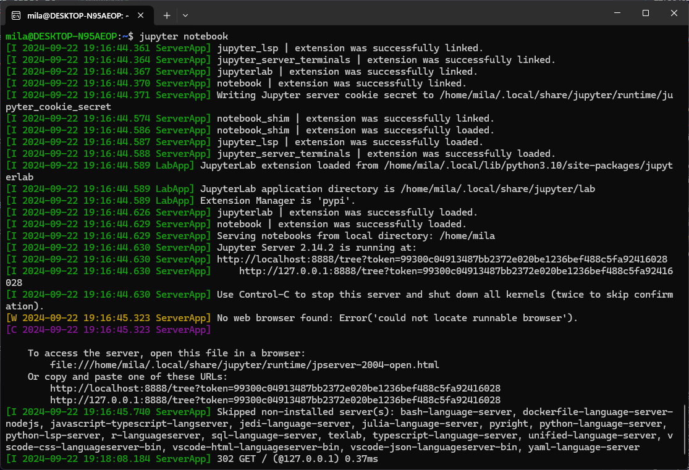
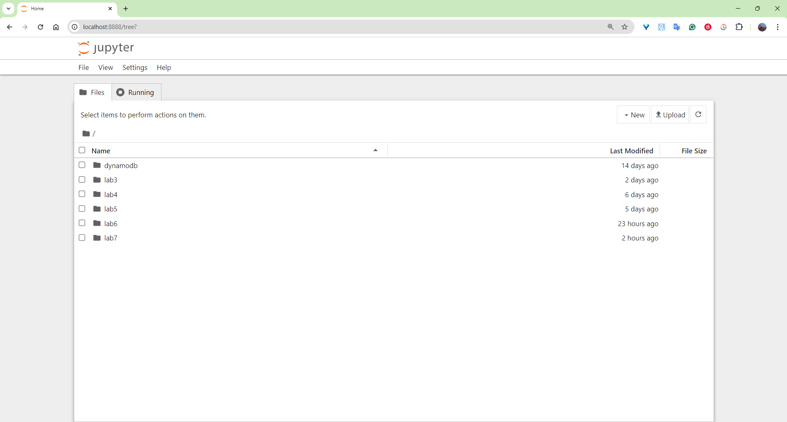

## Install ipykernel
I opened a new terminal window and installed ipykernel by using the command `pip install ipykernel`.

### Commands
- `pip`: The Python package installer.
- `install`: This tells `pip` to install a package.
- `ipykernel`: This is the package that contains the IPython kernel, which Jupyter uses to run Python code in a notebook.

### Results
Installed ipykernel.
```
Defaulting to user installation because normal site-packages is not writeable
Requirement already satisfied: ipykernel in ./.local/lib/python3.10/site-packages (6.29.5)
Requirement already satisfied: ipython>=7.23.1 in ./.local/lib/python3.10/site-packages (from ipykernel) (8.27.0)
Requirement already satisfied: tornado>=6.1 in ./.local/lib/python3.10/site-packages (from ipykernel) (6.4.1)
Requirement already satisfied: psutil in ./.local/lib/python3.10/site-packages (from ipykernel) (6.0.0)
Requirement already satisfied: nest-asyncio in ./.local/lib/python3.10/site-packages (from ipykernel) (1.6.0)
Requirement already satisfied: jupyter-client>=6.1.12 in ./.local/lib/python3.10/site-packages (from ipykernel) (8.6.3)
Requirement already satisfied: traitlets>=5.4.0 in ./.local/lib/python3.10/site-packages (from ipykernel) (5.14.3)
Requirement already satisfied: comm>=0.1.1 in ./.local/lib/python3.10/site-packages (from ipykernel) (0.2.2)
Requirement already satisfied: packaging in ./.local/lib/python3.10/site-packages (from ipykernel) (24.1)
Requirement already satisfied: pyzmq>=24 in ./.local/lib/python3.10/site-packages (from ipykernel) (26.2.0)
Requirement already satisfied: matplotlib-inline>=0.1 in ./.local/lib/python3.10/site-packages (from ipykernel) (0.1.7)
Requirement already satisfied: debugpy>=1.6.5 in ./.local/lib/python3.10/site-packages (from ipykernel) (1.8.5)
Requirement already satisfied: jupyter-core!=5.0.*,>=4.12 in ./.local/lib/python3.10/site-packages (from ipykernel) (5.7.2)
Requirement already satisfied: decorator in ./.local/lib/python3.10/site-packages (from ipython>=7.23.1->ipykernel) (5.1.1)
Requirement already satisfied: jedi>=0.16 in ./.local/lib/python3.10/site-packages (from ipython>=7.23.1->ipykernel) (0.19.1)
Requirement already satisfied: pexpect>4.3 in ./.local/lib/python3.10/site-packages (from ipython>=7.23.1->ipykernel) (4.9.0)
Requirement already satisfied: pygments>=2.4.0 in /usr/lib/python3/dist-packages (from ipython>=7.23.1->ipykernel) (2.11.2)
Requirement already satisfied: stack-data in ./.local/lib/python3.10/site-packages (from ipython>=7.23.1->ipykernel) (0.6.3)
Requirement already satisfied: exceptiongroup in ./.local/lib/python3.10/site-packages (from ipython>=7.23.1->ipykernel) (1.2.2)
Requirement already satisfied: typing-extensions>=4.6 in ./.local/lib/python3.10/site-packages (from ipython>=7.23.1->ipykernel) (4.12.2)
Requirement already satisfied: prompt-toolkit<3.1.0,>=3.0.41 in ./.local/lib/python3.10/site-packages (from ipython>=7.23.1->ipykernel) (3.0.47)
Requirement already satisfied: python-dateutil>=2.8.2 in ./.local/lib/python3.10/site-packages (from jupyter-client>=6.1.12->ipykernel) (2.9.0.post0)
Requirement already satisfied: platformdirs>=2.5 in ./.local/lib/python3.10/site-packages (from jupyter-core!=5.0.*,>=4.12->ipykernel) (4.3.6)
Requirement already satisfied: parso<0.9.0,>=0.8.3 in ./.local/lib/python3.10/site-packages (from jedi>=0.16->ipython>=7.23.1->ipykernel) (0.8.4)
Requirement already satisfied: ptyprocess>=0.5 in ./.local/lib/python3.10/site-packages (from pexpect>4.3->ipython>=7.23.1->ipykernel) (0.7.0)
Requirement already satisfied: wcwidth in ./.local/lib/python3.10/site-packages (from prompt-toolkit<3.1.0,>=3.0.41->ipython>=7.23.1->ipykernel) (0.2.13)
Requirement already satisfied: six>=1.5 in /usr/lib/python3/dist-packages (from python-dateutil>=2.8.2->jupyter-client>=6.1.12->ipykernel) (1.16.0)
Requirement already satisfied: pure-eval in ./.local/lib/python3.10/site-packages (from stack-data->ipython>=7.23.1->ipykernel) (0.2.3)
Requirement already satisfied: executing>=1.2.0 in ./.local/lib/python3.10/site-packages (from stack-data->ipython>=7.23.1->ipykernel) (2.1.0)
Requirement already satisfied: asttokens>=2.1.0 in ./.local/lib/python3.10/site-packages (from stack-data->ipython>=7.23.1->ipykernel) (2.4.1)
```

## Run hyperparameter tuning jobs

### [1] Install libraries
Installed sagemaker, pandas and numpy via jupyter notebook using commands `!pip install sagemaker`, `!pip install pandas` and `!pip install numpy`.

#### Commands
- `!`: The exclamation mark is used in Jupyter notebooks to *run shell commands directly from a code cell*. So `!pip` is used to invoke the shell's pip command from the notebook environment.
- `pip`: This is the Python package manager, used to install packages.
- `install`: Tells pip to install a specific package.
- `sagemaker`: This is the package we are installing, which is the Amazon SageMaker Python SDK. It allows us to build, train, and deploy machine learning models using AWS SageMaker from our local environment.
- `pandas`: The name of the package we want to install. It is a popular Python library for data manipulation and analysis, especially with tabular data (similar to a spreadsheet or SQL table).
- `numpy`: The name of the package to install. It is a fundamental package for scientific computing with Python. It provides support for large, multi-dimensional arrays and matrices, along with a collection of mathematical functions to operate on these arrays efficiently.

#### Results
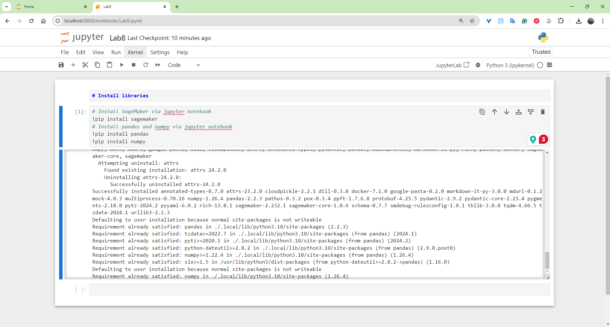

### [2] Prepare a SageMaker session

#### Python script
```
import sagemaker
import boto3

import numpy as np  # For matrix operations and numerical processing
import pandas as pd  # For munging tabular data
from time import gmtime, strftime
from botocore.exceptions import ClientError
import os

smclient = boto3.Session().client("sagemaker")
iam = boto3.client('iam')
s3 = boto3.client("s3")
sagemaker_role = iam.get_role(RoleName='SageMakerRole')['Role']['Arn']
region = 'us-east-1' # use the region you are mapped to 
student_id = "22756463" 
bucket = '22756463-lab8' # use <studentid-lab8> as your bucket name
prefix = f"sagemaker/{student_id}-hpo-xgboost-dm" 
bucket_config = {'LocationConstraint': region} 

# Create an S3 bucket using the bucket variable above. The bucket creation is done using the region variable above.
try:
    # Check if bucket exists
    s3.head_bucket(Bucket=bucket)
    print(f"Bucket {bucket} already exists.")
except Exception as error:
    # If bucket does not exist, create it
    print(f"Creating bucket {bucket}...")
    try:
        if region == 'us-east-1':
            # us-east-1 (N. Virginia) does not require LocationConstraint
            s3.create_bucket(Bucket=bucket)
            print(f"Bucket {bucket} created successfully.")
        else:
            response = s3.create_bucket(
                Bucket=bucket,
                CreateBucketConfiguration=bucket_config
            )
            print(f"Bucket {bucket} created successfully.")
    except Exception as error:
        print(f"Error creating bucket: {str(error)}")
        raise

# Create an object in the bucket. The object is a folder and its name is the prefix variable above. 
try:
    # Upload an empty object to create a "folder" in S3
    s3.put_object(Bucket=bucket, Key=(prefix + '/'))
    print(f"Folder '{prefix}' created in bucket '{bucket}'.")
except ClientError as e:
    # Handle any S3-related errors
    print(f"Error creating folder in bucket: {e.response['Error']['Message']}")
except Exception as e:
    # Handle any other unexpected errors
    print(f"An unexpected error occurred: {str(e)}")
```

#### Results
Created a S3 bucket named `22756463-lab8`. And created an empty folder `sagemaker/22756463-hpo-xgboost-dm` in the S3 bucket.
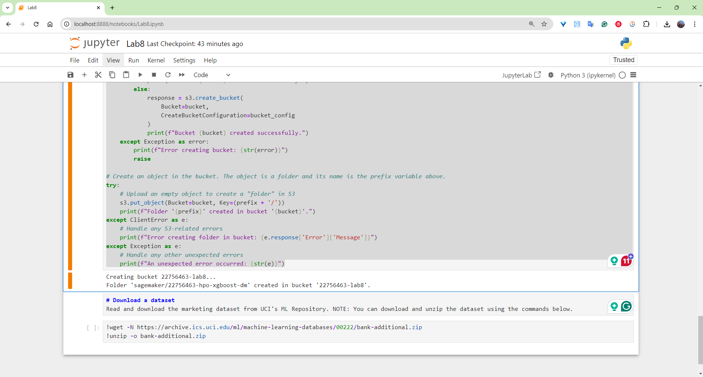
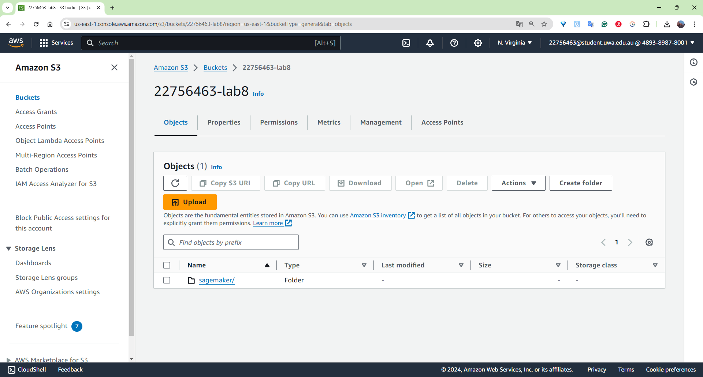
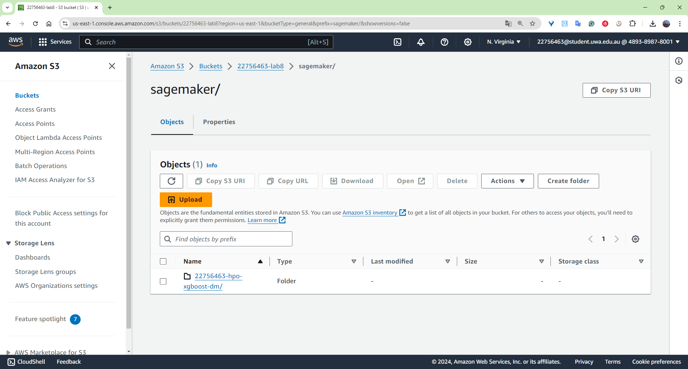

### [3] Prepare a dataset

#### 3.1 Download the dataset
I first opened a new terminal window and installed `unzip` by using the commands `sudo apt-get update` and `sudo apt-get install -y unzip`.

##### Commands
- `sudo`: Run commands with administrative or root privileges.
- `apt-get`: The package management command-line tool used in Debian-based Linux distributions (like Ubuntu) for handling software packages.
- `update`: This command updates the package lists for upgrades or new installations. It fetches the latest available versions of the software from the repositories. Essentially, it ensures that the system knows about the latest packages and versions available for installation.
- `-y`: This flag tells `apt-get` to automatically answer "yes" to any prompts during the installation process.
- `unzip`: This specifies the package we want to install. `unzip` is a utility that extracts files from .zip archives.

##### Results
Installed `unzip`. Downloaded and unzipped the dataset.
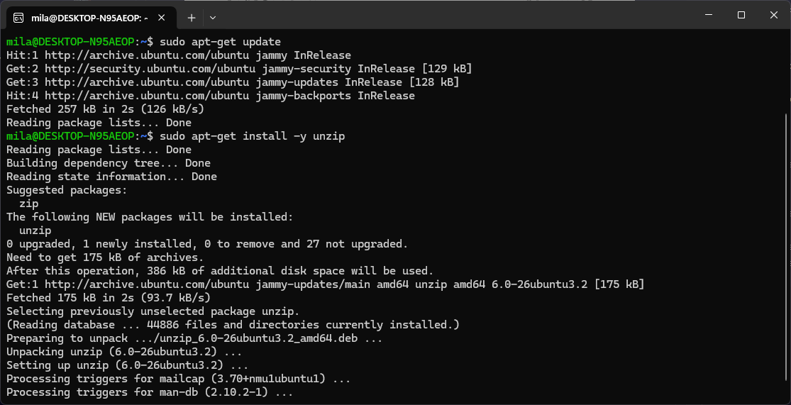
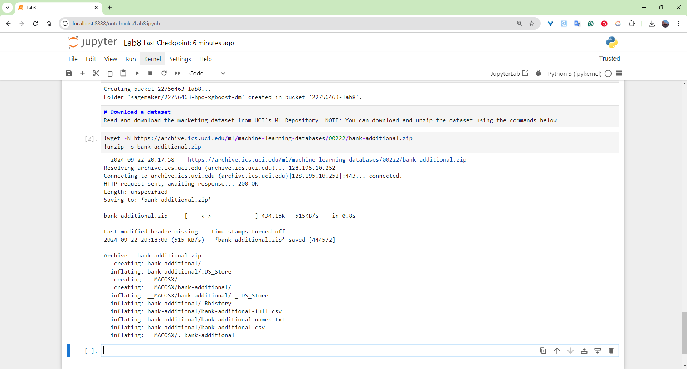

#### 3.2 Inspect the dataset
I inspected the dataset by using the Python code below and answered these two questions:
- Which variables in the dataset are categorical? Give at least four variables: job, marital, education, contact, poutcome.
- Which variables in the dataset are numerical? Give at least four variables: age, duration, campaign, pdays, previous.

##### Python code
```python
data = pd.read_csv("./bank-additional/bank-additional-full.csv", sep=";")
pd.set_option("display.max_columns", 500)  # Make sure we can see all of the columns
pd.set_option("display.max_rows", 50)  # Keep the output on one page
data
```

##### Results
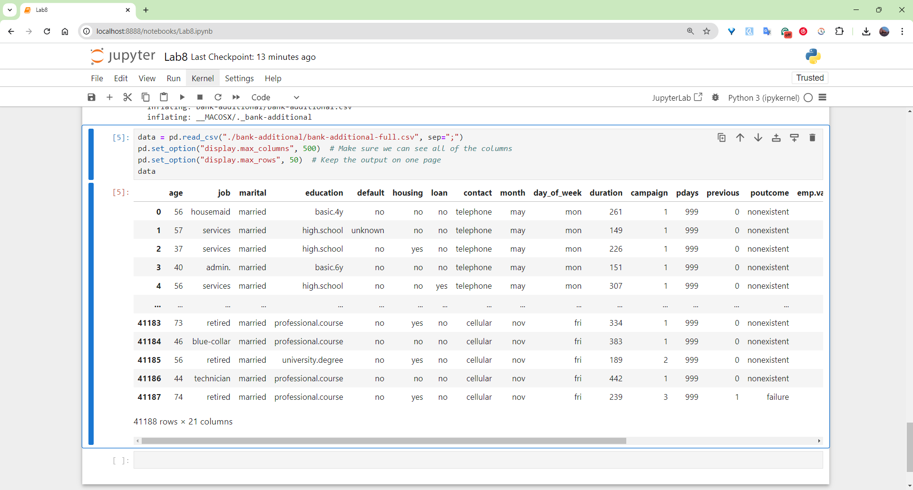

#### 3.3 Process the dataset
I created two new indicator columns to capture relevant information, then converted the categorical columns into binary dummy variables for modelling purposes. Additionally, I removed the economic features and the duration column, as these variables would require precise forecasting to be useful as inputs for future predictions.

##### Python code
```python
data["no_previous_contact"] = np.where(
    data["pdays"] == 999, 1, 0
)  # Indicator variable to capture when pdays takes a value of 999
data["not_working"] = np.where(
    np.in1d(data["job"], ["student", "retired", "unemployed"]), 1, 0
)  # Indicator for individuals not actively employed
model_data = pd.get_dummies(data)  # Convert categorical variables to sets of indicators
model_data = model_data.drop(
    ["duration", "emp.var.rate", "cons.price.idx", "cons.conf.idx", "euribor3m", "nr.employed"],
    axis=1,
)
# Ensure all Boolean columns are converted to numeric (1/0)
model_data = model_data.applymap(lambda x: 1 if x is True else (0 if x is False else x))
model_data
```
- `data["pdays"] == 999, 1, 0`: This checks if the value of pdays (the number of days since the client was last contacted) is 999. In the dataset, 999 often indicates that the client has never been contacted before. If pdays equals 999, assign a value of 1 (indicating no previous contact). Otherwise, assign a 0 (indicating the client has been contacted before).
- `np.in1d(data["job"], ["student", "retired", "unemployed"]), 1, 0`: This checks whether the values in the job column are in the list ["student", "retired", "unemployed"]. The function returns a boolean array: True if the job is one of those three and False otherwise. If the person is a student, retired, or unemployed, the value will be set to 1 (indicating they are not actively employed). Otherwise, it will be set to 0.
- `pd.get_dummies(data)`: This function converts categorical variables into dummy/indicator variables (also called one-hot encoding). It creates a new binary column for each category in the original categorical columns.
- `model_data.drop([...], axis=1)`: This drops the listed columns from the `model_data` DataFrame.
- `model_data = model_data.applymap(lambda x: 1 if x is True else (0 if x is False else x))`: This line ensures that all Boolean values are converted to 1 for True and 0 for False. This is important because XGBoost only accepts numeric input.

##### Results
Created two new indicator columns, converted categorical columns into binary dummy variables, removed the economic features and the duration column and converted all boolean values to numerical values.
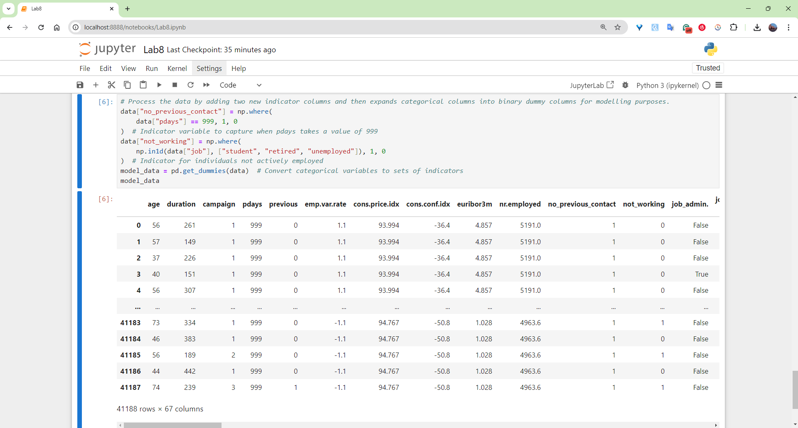
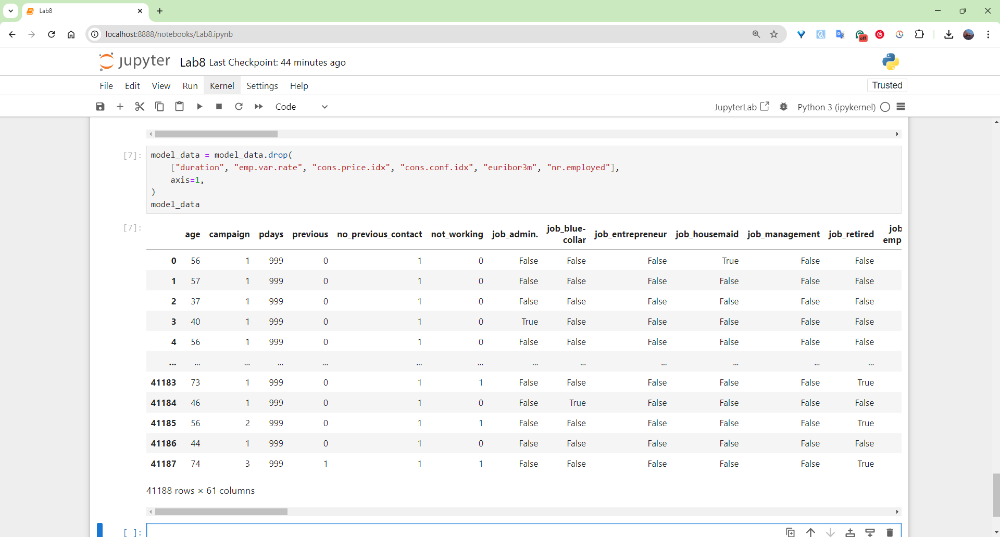
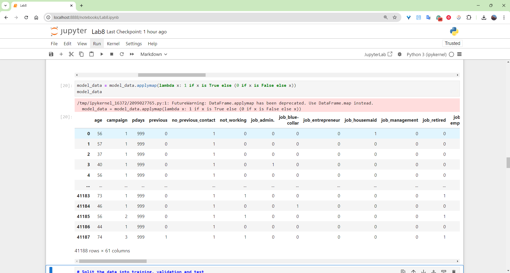

### [4] Split the data into training, validation and test
I split the dataset into training (70%), validation (20%), and test (10%) sets, then converted them to CSV format for use with Amazon SageMaker's XGBoost algorithm. The first column in each CSV file is the target variable, and the files do not include headers. The training and validation datasets will be used during the model training process, while the test dataset will be reserved for evaluating the model's performance after it has been deployed to an endpoint. Finally, I uploaded the files to the previously created S3 bucket for Amazon SageMaker to access during training.

#### Python code
```python
train_data, validation_data, test_data = np.split(
    model_data.sample(frac=1, random_state=1729),
    [int(0.7 * len(model_data)), int(0.9 * len(model_data))],
)

pd.concat([train_data["y_yes"], train_data.drop(["y_no", "y_yes"], axis=1)], axis=1).to_csv(
    "train.csv", index=False, header=False
)
pd.concat(
    [validation_data["y_yes"], validation_data.drop(["y_no", "y_yes"], axis=1)], axis=1
).to_csv("validation.csv", index=False, header=False)
pd.concat([test_data["y_yes"], test_data.drop(["y_no", "y_yes"], axis=1)], axis=1).to_csv(
    "test.csv", index=False, header=False
)

boto3.Session().resource("s3").Bucket(bucket).Object(
    os.path.join(prefix, "train/train.csv")
).upload_file("train.csv")
boto3.Session().resource("s3").Bucket(bucket).Object(
    os.path.join(prefix, "validation/validation.csv")
).upload_file("validation.csv")
```

#### Results
Split, tranformed and uploaded the dataset:
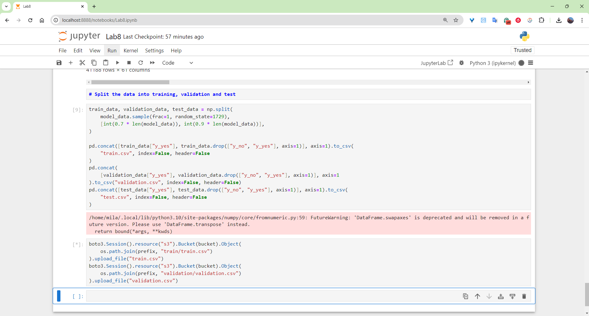
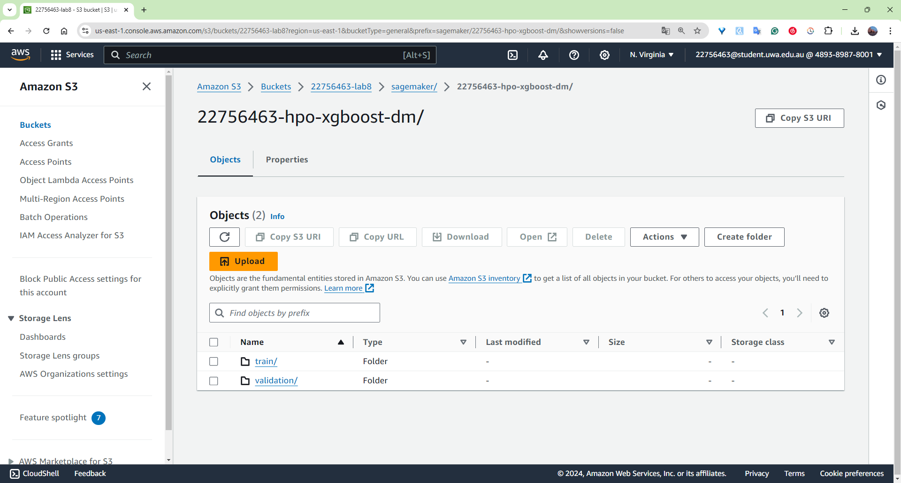


### [5] Setup hyperparameter tuning

#### 5.1 Set up the the name and configuration for the tuning job

##### Python code
```python
# Set up the the name and configuration for a hyperparameter tuning job.
from time import gmtime, strftime, sleep

# Names have to be unique. You will get an error if you reuse the same name
tuning_job_name = f"{student_id}-xgboost-tuningjob-02"

print(tuning_job_name)

tuning_job_config = {
    "ParameterRanges": {
        "CategoricalParameterRanges": [],
        "ContinuousParameterRanges": [
            {
                "MaxValue": "1",
                "MinValue": "0",
                "Name": "eta",
            },
            {
                "MaxValue": "10",
                "MinValue": "1",
                "Name": "min_child_weight",
            },
            {
                "MaxValue": "2",
                "MinValue": "0",
                "Name": "alpha",
            },
        ],
        "IntegerParameterRanges": [
            {
                "MaxValue": "10",
                "MinValue": "1",
                "Name": "max_depth",
            }
        ],
    },
    "ResourceLimits": {"MaxNumberOfTrainingJobs": 2, "MaxParallelTrainingJobs": 2},
    "Strategy": "Bayesian",
    "HyperParameterTuningJobObjective": {"MetricName": "validation:auc", "Type": "Maximize"},
}
```

#### 5.2 Specify the XGBoost algorithm for the tuning job

##### Python code
```python
# Specify the XGBoost algorithm for subsequent tuning.
from sagemaker.image_uris import retrieve
# Use XGBoost algorithm for training
training_image = retrieve(framework="xgboost", region=region, version="latest")

s3_input_train = "s3://{}/{}/train".format(bucket, prefix)
s3_input_validation = "s3://{}/{}/validation/".format(bucket, prefix)

training_job_definition = {
    "AlgorithmSpecification": {"TrainingImage": training_image, "TrainingInputMode": "File"},
    "InputDataConfig": [
        {
            "ChannelName": "train",
            "CompressionType": "None",
            "ContentType": "csv",
            "DataSource": {
                "S3DataSource": {
                    "S3DataDistributionType": "FullyReplicated",
                    "S3DataType": "S3Prefix",
                    "S3Uri": s3_input_train,
                }
            },
        },
        {
            "ChannelName": "validation",
            "CompressionType": "None",
            "ContentType": "csv",
            "DataSource": {
                "S3DataSource": {
                    "S3DataDistributionType": "FullyReplicated",
                    "S3DataType": "S3Prefix",
                    "S3Uri": s3_input_validation,
                }
            },
        },
    ],
    "OutputDataConfig": {"S3OutputPath": "s3://{}/{}/output".format(bucket, prefix)},
    "ResourceConfig": {"InstanceCount": 1, "InstanceType": "ml.m5.xlarge", "VolumeSizeInGB": 10},
    "RoleArn": sagemaker_role,
    "StaticHyperParameters": {
        "eval_metric": "auc",
        "num_round": "1",
        "objective": "binary:logistic",
        "rate_drop": "0.3",
        "tweedie_variance_power": "1.4",
    },
    "StoppingCondition": {"MaxRuntimeInSeconds": 43200},
}
```

##### Results


#### 5.3 Launch the tunign job

##### Python code
```python
#Launch Hyperparameter Tuning Job
smclient.create_hyper_parameter_tuning_job(
    HyperParameterTuningJobName=tuning_job_name,
    HyperParameterTuningJobConfig=tuning_job_config,
    TrainingJobDefinition=training_job_definition,
)
```

##### Results
Launched and completed the tuning job. The outputs are generated in the S3 bucket.
```
{'HyperParameterTuningJobArn': 'arn:aws:sagemaker:us-east-1:489389878001:hyper-parameter-tuning-job/22756463-xgboost-tuningjob-02',
 'ResponseMetadata': {'RequestId': '89680059-3538-4784-87da-ebd9cce80496',
  'HTTPStatusCode': 200,
  'HTTPHeaders': {'x-amzn-requestid': '89680059-3538-4784-87da-ebd9cce80496',
   'content-type': 'application/x-amz-json-1.1',
   'content-length': '130',
   'date': 'Sun, 22 Sep 2024 13:22:21 GMT'},
  'RetryAttempts': 0}}
```
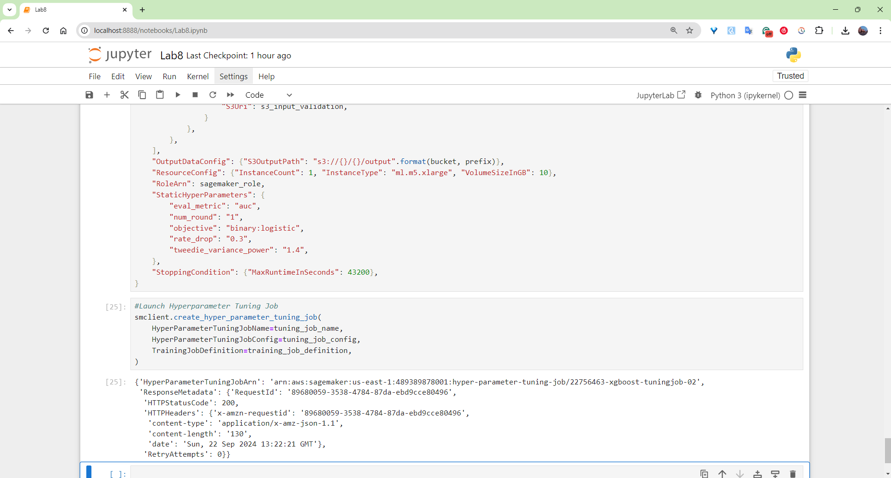

Training status for the hyperparameter tuning job `22756463-xgboost-tuningjob-02`:
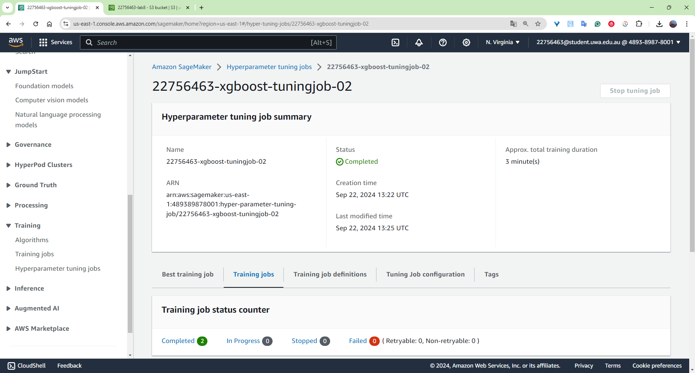

Output in the S3 bucket:
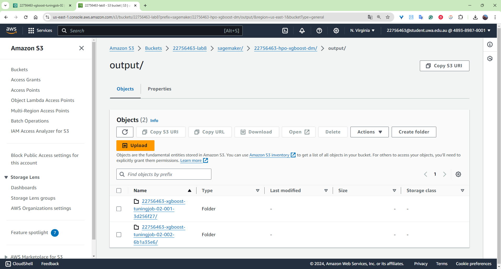

Output for `22756463-xgboost-tuningjob-02-001-3d256f27/`:
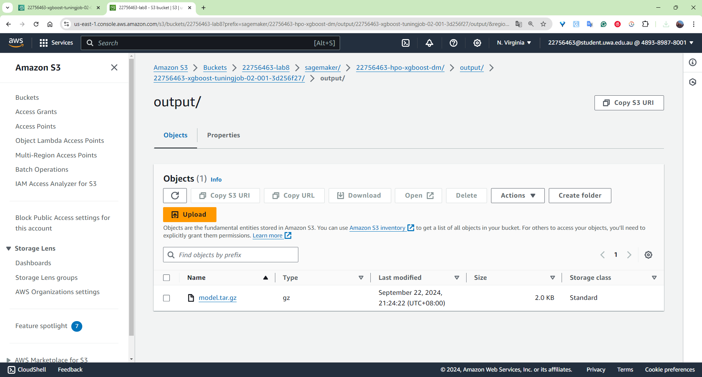

Output for `22756463-xgboost-tuningjob-02-002-6b1a35e6/`:


<div style="page-break-after: always;"></div>

# Lab 9
## AWS Comprehend
### Detect Languages from text
#### [1] Modify the code above
To map language codes to corresponding languages, I installed the package `pycountry` by using the command `pip install pycountry`. Then I modified the provided code to better display the results by using the below code.

##### Commands and Python script
- `pip`: This is the Python package installer, a tool used to download and manage Python packages from the Python Package Index (PyPI).
- `install`: This instructs `pip` to install a specified package onto the system or virtual environment.
-`pycountry`: The name of the Python package we want to install, which provides access to *country and language information*.

```python  
import boto3
import pycountry

# Create a client to interact with AWS Comprehend
client = boto3.client('comprehend')

# Function to get the language name from the ISO 639-1 code using pycountry
def get_language_name(language_code):
    try:
        # Look up the language by its ISO 639-1 code
        language = pycountry.languages.get(alpha_2=language_code)
        return language.name if language else 'Unknown Language'  # Return language name or 'Unknown Language'
    except KeyError:
        return 'Unknown Language'  # Handle the case where the code is not found

# Function to detect the dominant language in a given text
def detect_language(text):
    # Call AWS Comprehend to detect dominant languages in the text
    response = client.detect_dominant_language(Text=text)
    # Loop through each detected language in the response
    for language in response['Languages']:
        language_code = language['LanguageCode']  # Extract the language code
        confidence = math.floor(language['Score']*100)  # Multiply the score by 100 to convert it to a percentage, then floor it to ensure it rounds down to the nearest whole number
        language = get_language_name(language_code)  # Get the full language name using the language code
        # Print the language and confidence score
        print(f'{language} detected with {confidence:.0f}% confidence')
    return  # Return nothing as this is a printing function

# Main function to test the language detection
def main():
    text = "The French Revolution was a period of social and political upheaval in France and its colonies beginning in 1789 and ending in 1799."  # Sample text
    detect_language(text)  # Call the function to detect language

# Execute the main function if this script is run directly
if __name__ == "__main__":
    main()
```
A detailed explanation is provided as comments in the above code block.


##### Results
Installed `pycountry`.
```
Defaulting to user installation because normal site-packages is not writeable
Collecting pycountry
  Downloading pycountry-24.6.1-py3-none-any.whl (6.3 MB)
     ━━━━━━━━━━━━━━━━━━━━━━━━━━━━━━━━━━━━━━━━ 6.3/6.3 MB 2.8 MB/s eta 0:00:00
Installing collected packages: pycountry
Successfully installed pycountry-24.6.1
```
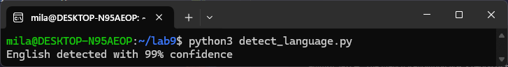

#### [2] Test the code with other languages
I tested the code for the language detection task by including other texts in the `main()` function as follows.

##### Python code
```
def main():
    print("Detecting language of the text1:")
    english_text = "The French Revolution was a period of social and political upheaval in France and its colonies beginning in 1789 and ending in 1799."
    detect_language(english_text) 

    print("Detecting language of the text2:")
    spanish_text = "El Quijote es la obra más conocida de Miguel de Cervantes Saavedra. Publicada su primera parte con el título de El ingenioso hidalgo don Quijote de la Mancha a comienzos de 1605, es una de las obras más destacadas de la literatura española y la literatura universal, y una de las más traducidas. En 1615 aparecería la segunda parte del Quijote de Cervantes con el título de El ingenioso caballero don Quijote de la Mancha."
    detect_language(spanish_text)

    print("Detecting language of the text3:")
    french_text = "Moi je n'étais rien Et voilà qu'aujourd'hui Je suis le gardien Du sommeil de ses nuits Je l'aime à mourir Vous pouvez détruire Tout ce qu'il vous plaira Elle n'a qu'à ouvrir L'espace de ses bras Pour tout reconstruire Pour tout reconstruire Je l'aime à mourir"
    detect_language(french_text)

    print("Detecting language of the text4:")
    italian_text = "L'amor che move il sole e l'altre stelle."
    detect_language(italian_text)

if __name__ == "__main__":
    main()
```

##### Results
Detected different languages of other texts.
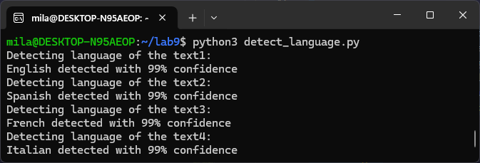


### Analyze sentiment
I used the below Python script for sentiment analysis and tested the code on the previous 4 texts.

#### Python script `detect_sentiment.py`
```python
import boto3

# Create a client to interact with AWS Comprehend
client = boto3.client('comprehend')

# Function to detect the sentiment of a given text in a specific language
def detect_sentiment(text, language_code):
    # Call AWS Comprehend to detect sentiment in the provided text and language
    response = client.detect_sentiment(Text=text, LanguageCode=language_code)
    
    # Extract sentiment label (Positive, Negative, Neutral, or Mixed)
    sentiment = response['Sentiment']
    
    # Extract the sentiment scores (confidence scores for Positive, Negative, Neutral, and Mixed)
    sentiment_score = response['SentimentScore']
    
    # Print the first 60 characters of the text to provide context in the output
    print(f"Text: {text[:60]}...")  # Show only the first 60 characters
    
    # Print the detected sentiment (e.g., Positive, Neutral)
    print(f"Sentiment: {sentiment}")
    
    # Print the sentiment score details
    print(f"Sentiment Scores: {sentiment_score}")
    
    # Print a separator line for better readability of the output
    print('-' * 60)
    
    # Return the response, which includes all sentiment details
    return response

def main():
    # Sample texts in different languages, each with an associated language code
    texts = [
        {"text": "The French Revolution was a period of social and political upheaval in France and its colonies beginning in 1789 and ending in 1799.", "language": "en"},
        {"text": "El Quijote es la obra más conocida de Miguel de Cervantes Saavedra. Publicada su primera parte con el título de El ingenioso hidalgo don Quijote de la Mancha a comienzos de 1605, es una de las obras más destacadas de la literatura española y la literatura universal, y una de las más traducidas. En 1615 aparecería la segunda parte del Quijote de Cervantes con el título de El ingenioso caballero don Quijote de la Mancha.", "language": "es"},
        {"text": "Moi je n'étais rien Et voilà qu'aujourd'hui Je suis le gardien Du sommeil de ses nuits Je l'aime à mourir Vous pouvez détruire Tout ce qu'il vous plaira Elle n'a qu'à ouvrir L'espace de ses bras Pour tout reconstruire Pour tout reconstruire Je l'aime à mourir", "language": "fr"},
        {"text": "L'amor che move il sole e l'altre stelle.", "language": "it"}
    ]

    # Loop through each text and detect its sentiment by calling the detect_sentiment function
    for instance in texts:
        detect_sentiment(instance["text"], instance["language"])

# Execute the main function if this script is run directly
if __name__ == "__main__": 
    main()  # Call the main function to process the texts
```
A detailed explanaiton is provided as comments in the above code block.

#### Results
Detected sentiment for the previous 4 texts.
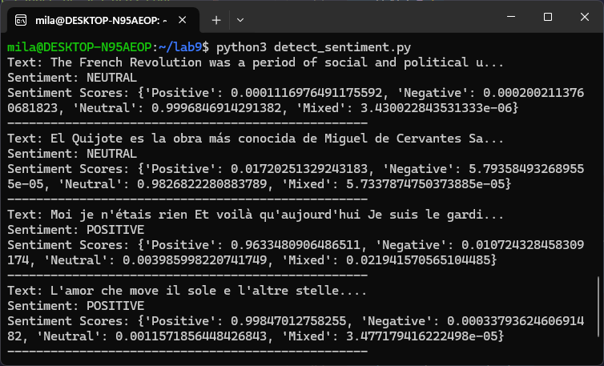


### Detect entities
I used the below python script to detect entities for the previous four texts.

**Answer this question** - describe what entities are in your own words:
Entities are pieces of information extracted from texts. They are objects, concepts, or categories such as places, organisations, names, dates, and quantities.


#### Python script `detect_entities.py`
```python
import boto3

# Create a client to interact with AWS Comprehend
client = boto3.client('comprehend')

# Function to detect entities in a given text in a specific language
def detect_entities(text, language_code):
    response = client.detect_entities(Text=text, LanguageCode=language_code)
    entities = response['Entities']
    
    # Print the first 60 characters of the text to provide context in the output
    print(f"Text: {text[:60]}...")
    
    # Print each entity detected in the text
    for entity in entities:
        print(f"Entity: {entity['Text']}, Type: {entity['Type']}, Confidence: {entity['Score']:.2f}")
    
    print('-' * 60)
    return response

def main():
    # Sample texts in different languages, each with an associated language code
    texts = [
        {"text": "The French Revolution was a period of social and political upheaval in France and its colonies beginning in 1789 and ending in 1799.", "language": "en"},
        {"text": "El Quijote es la obra más conocida de Miguel de Cervantes Saavedra. Publicada su primera parte con el título de El ingenioso hidalgo don Quijote de la Mancha a comienzos de 1605, es una de las obras más destacadas de la literatura española y la literatura universal, y una de las más traducidas. En 1615 aparecería la segunda parte del Quijote de Cervantes con el título de El ingenioso caballero don Quijote de la Mancha.", "language": "es"},
        {"text": "Moi je n'étais rien Et voilà qu'aujourd'hui Je suis le gardien Du sommeil de ses nuits Je l'aime à mourir Vous pouvez détruire Tout ce qu'il vous plaira Elle n'a qu'à ouvrir L'espace de ses bras Pour tout reconstruire Pour tout reconstruire Je l'aime à mourir", "language": "fr"},
        {"text": "L'amor che move il sole e l'altre stelle.", "language": "it"}
    ]

    # Loop through each text and detect its entities
    for instance in texts:
        detect_entities(instance["text"], instance["language"])

if __name__ == "__main__":
    main()
```
A detailed explanations is provided in the code block as comments.


#### Results
Detected entities as follows:
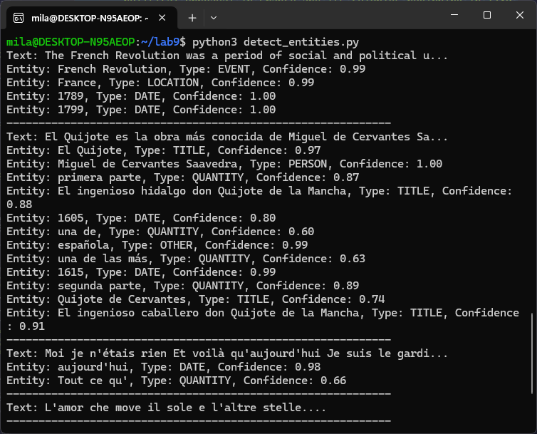