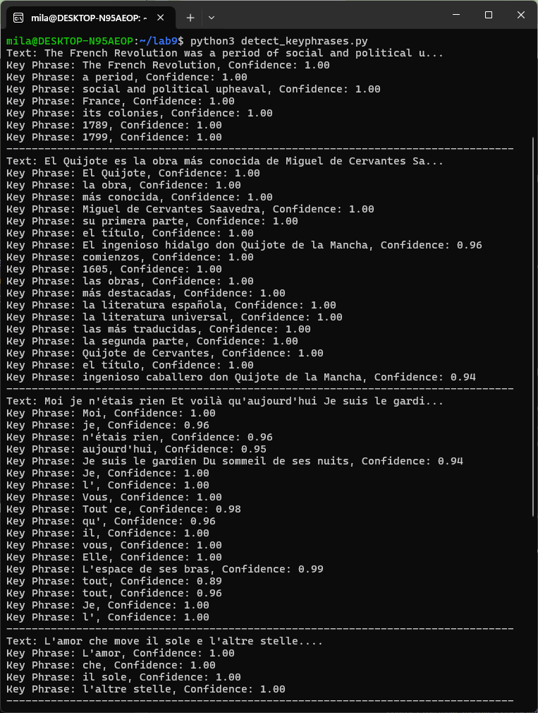
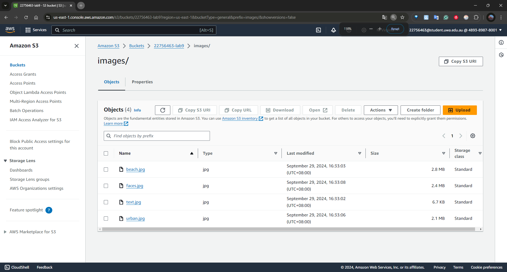

# IAM + ALB + Networking (Lab 5)

## Application Load Balancer

### [1] Create 2 EC2 instances

### [2] Create an Application Load Balancer
I created 2 EC2 instances in two different availability zones in my allocated region(us-east-1) using the Python script below. I also created a security group to authorise inbound traffic for HTTP and SSH before creating the instances.

#### Python script `create_alb.py`

```python
import boto3
from botocore.exceptions import ClientError

# Create a Boto3 EC2 and ELBv2 client
ec2 = boto3.client('ec2')
elbv2 = boto3.client('elbv2')

# Step 1: Create a security group
def create_security_group(group_name, description):
    try:
        response = ec2.create_security_group(
            GroupName=group_name,
            Description=description,
        )
        security_group_id = response['GroupId']
        print(f'Security Group {group_name} created with ID: {security_group_id}')
        return security_group_id
    except ClientError as e:
        print(f"Error creating security group: {e}")
        return None

# Step 2: Authorise inbound traffic for SSH and HTTP
def authorize_security_group_ingress(group_name):
    '''
    Adds inbound rules to the security group, allowing traffic for SSH (port 22) and HTTP (port 80) from all IP addresses (0.0.0.0/0).
    '''
    try:
        ec2.authorize_security_group_ingress(
            GroupName= group_name,
            IpPermissions=[
                {
                    'IpProtocol': 'tcp',
                    'FromPort': 22, # SSH
                    'ToPort': 22,
                    'IpRanges': [{'CidrIp': '0.0.0.0/0'}]
                },
                {
                    'IpProtocol': 'tcp',
                    'FromPort': 80,  # HTTP
                    'ToPort': 80,
                    'IpRanges': [{'CidrIp': '0.0.0.0/0'}]
                }
            ]
        )
        print(f"SSH and HTTP rule added to Security Group: {group_name}")
    except ClientError as e:
        print(f"Error adding rules to security group: {e}")

# Step 3: Get the available zones in your region
def get_availability_zones():
    availability_zones = ec2.describe_availability_zones()['AvailabilityZones']

    if len(availability_zones) < 2:
        raise Exception('Less than 2 availability zones available in this region.')
  
    return availability_zones

# Step 4: Create a key pair
def create_key_pair(key_name):
    try:
        key_pair = ec2.create_key_pair(KeyName=key_name)
        private_key = key_pair['KeyMaterial']
        with open(f"{key_name}.pem", "w") as key_file:
            key_file.write(private_key)
        print(f"Key pair {key_name} created and saved as {key_name}.pem")
    except ClientError as e:
        print(f"Error creating key pair: {e}")

# Step 5: Create two instances in different availability zones
def create_instances(key_name, security_group_name, ami_id, availability_zones, student_number):
    instance_ids = []
    for i in range(2):
        try:
            instances = ec2.run_instances(
                ImageId= ami_id,
                MinCount=1,
                MaxCount=1,
                InstanceType='t2.micro',
                KeyName=key_name,
                SecurityGroups=[security_group_name],
                Placement={
                    'AvailabilityZone': availability_zones[i]['ZoneName']
                },
                TagSpecifications=[
                    {
                        'ResourceType': 'instance',
                        'Tags': [
                            {'Key': 'Name', 'Value': f'{student_number}-vm{i+1}'}
                        ]
                    }
                ]
            )
            instance_id = instances['Instances'][0]['InstanceId']
            instance_ids.append(instance_id)
            print(f"EC2 instance created with Instance ID: {instance_id}")
        except ClientError as e:
            print(f"Error creating EC2 instance: {e}")
    return instance_ids

# Step 6: Get the available subnets in your region
def get_subnets():
    subnets_response = ec2.describe_subnets()
    subnets = subnets_response['Subnets']
  
    # Filter subnets to only include those that are in available state
    available_subnets = [subnet for subnet in subnets if subnet['State'] == 'available']
  
    if len(available_subnets) < 2:
        raise Exception('Less than 2 available subnets in this region.')
  
    return available_subnets

# Step 7: Create the network load balancer
def create_load_balancer(sg_id, subnets):
    try:
        response = elbv2.create_load_balancer(
            Name='22756463-load-balancer',
            Subnets=subnets,
            SecurityGroups=[sg_id],
            Scheme='internet-facing',
            Type='application',
            IpAddressType='ipv4'
        )
        lb_arn = response['LoadBalancers'][0]['LoadBalancerArn']
        print(f"Load Balancer created with ARN: {lb_arn}")
        return lb_arn
    except ClientError as e:
        print(f"Error creating load balancer: {e}")
        return None

# Step 8: Create a target group
def create_target_group(vpc_id):
    try:
        response = elbv2.create_target_group(
            Name='22756463-target-group',
            Protocol='HTTP',
            Port=80,
            VpcId=vpc_id,
            HealthCheckProtocol='HTTP',
            HealthCheckPort='80',
            TargetType='instance'
        )
        target_group_arn = response['TargetGroups'][0]['TargetGroupArn']
        print(f"Target group created with ARN: {target_group_arn}")
        return target_group_arn
    except ClientError as e:
        print(f"Error creating target group: {e}")
        return None

# Step 9: Register targets (EC2 instances) to the target group
def register_targets(target_group_arn, instance_ids):
    try:
        targets = [{'Id': instance_id} for instance_id in instance_ids]
        elbv2.register_targets(
            TargetGroupArn=target_group_arn,
            Targets=targets
        )
        print(f"Registered instances {instance_ids} to the target group.")
    except ClientError as e:
        print(f"Error registering targets: {e}")

# Step 10: Create a listener to forward traffic to the target group
def create_listener(lb_arn, target_group_arn):
    try:
        elbv2.create_listener(
            LoadBalancerArn=lb_arn,
            Protocol='HTTP',
            Port=80,
            DefaultActions=[{
                'Type': 'forward',
                'TargetGroupArn': target_group_arn
            }]
        )
        print(f"Listener created for Load Balancer {lb_arn}")
    except ClientError as e:
        print(f"Error creating listener: {e}")

def main():
    sg_name = "22756463-sg"
    sg_description = "security group for development environment"
    student_number = '22756463'
    ami_id = 'ami-0a0e5d9c7acc336f1'
    key_name = "22756463-key"

    # Step 1: Create a security group
    sg_id = create_security_group(sg_name, sg_description)

    # Step 2: Authorise inbound traffic for SSH and HTTP
    authorize_security_group_ingress(sg_name)

    # Step 3: Get the available zones in your region
    availability_zones = get_availability_zones()

    # Step 4: Create a key pair
    create_key_pair(key_name)

    # Step 5: Create two instances in different availability zones
    instance_ids = create_instances(key_name, sg_name, ami_id, availability_zones, student_number)

    # Step 6: Get VPC ID
    vpcs = ec2.describe_vpcs()
    vpc_id = vpcs['Vpcs'][0]['VpcId']
  
    # Step 7: Create an Application Load Balancer (ALB)
    subnets = get_subnets()
    subnet_ids = [subnets[0]['SubnetId'], subnets[1]['SubnetId']]
    lb_arn = create_load_balancer(sg_id, subnet_ids)

    # Step 8: Create a target group in the same VPC
    target_group_arn = create_target_group(vpc_id)

    # Step 9: Register EC2 instances as targets
    register_targets(target_group_arn, instance_ids)

    # Step 10: Create a listener to forward HTTP requests to targets
    create_listener(lb_arn, target_group_arn)

if __name__ == "__main__":
    main()
```

- `elbv2.create_load_balancer()`: Creates a new Network Load Balancer, which distributes traffic across multiple targets (EC2 instances and IP addresses).
- `elbv2.create_target_group()`: Creates a target group, which is a logical grouping of EC2 instances or IP addresses to which the load balancer directs traffic.
- `ec2.create_security_group()`: Creates a security group that acts as a virtual firewall for the instances, controlling inbound and outbound traffic.
- `ec2.authorize_security_group_ingress()`: Adds inbound rules to the security group, allowing traffic for SSH (port 22) and HTTP (port 80) from all IP addresses (0.0.0.0/0).
- `ec2.describe_availability_zones()`: Retrieves a list of available availability zones in the region, ensuring that instances are created in different zones for fault tolerance.
- `ec2.create_key_pair()`: Creates a key pair for SSH access to the EC2 instances. The private key is saved locally, and the public key is associated with the instances.
- `ec2.run_instances()`: Launches EC2 instances in different availability zones, assigning them to the previously created security group and key pair.
- `elbv2.register_targets()`: Registers the EC2 instances to the target group so that the load balancer can send traffic to them.
- `elbv2.create_listener()`: Creates a listener for the load balancer that listens for HTTP traffic on port 80 and forwards the requests to the target group.

#### Results

Created a security group, authorised inbound traffic (SSH and HTTP), retrieved availability zones, created a key pair for SSH access, launched two EC2 instances with ID `i-0d275177fc9f9ac28` and `i-04cdb45522154b089`, retrieved available subnets, created an ALB with the retrieved subnets, created a target group, registered the EC2 instances with the target group, and set up a listener on the ALB to forward HTTP traffic.

### [3] Test the Application Load Balancer

#### 3.1 SSH to each of the two instances

I obtained the public IP address of each EC2 instances from the AWS console. They are `98.81.236.110` and `34.204.0.107`. Then I ssh to each of the two instances using commands `ssh -i 22756463-key.pem ubuntu@98.81.236.110` and `ssh -i 22756463-key.pem ubuntu@34.204.0.107`.

##### Commands

- `ssh`: This is the command to initiate an SSH (Secure Shell) connection, which allows you to remotely connect to another machine securely over the internet.
- `-i`: The -i option specifies the identity file (in this case, 22756463-key.pem). This is the private key file that corresponds to the public key stored on my EC2 instance.
- `ubuntu`: This is the username for my EC2 instance. Since my instance is running Ubuntu, the default username is ubuntu.


#### 3.2 Update each instance

I updated each instance using command `sudo apt-get update` to prepare the system to install or upgrade packages based on the latest information from the repositories.

##### Commands

- `sudo`: Run the command with elevated (root) permissions. Installing software or making changes to system-wide configurations requires superuser privileges, so sudo is necessary for this command.
- `apt-get`: managing packages on Linux. It performs low-level operations, including installing, upgrading, and removing software packages, as well as updating the local package index.
- `update`: update the package index. It retrieves the latest list of available packages, versions, and their dependencies from the package repositories configured in the system.
`sudo apt-get update` updates the local list of available software packages and their versions from the repositories but does not install or upgrade any software.

#### 3.3 Install apache2 in each instance

I installed apache2 by using command `sudo apt install apache2`.

##### Commands
- `apt`: The Advanced Package Tool, which is the *package manager for Ubuntu*. It retrieves the software packages from the distribution's software repositories.
- `install`: The operation to install the specified package.
- `apache2`: The name of the package I want to install. Apache 2 is a popular *web server software*. Apache 2 is used to *host websites and serve webpages over the HTTP/HTTPS protocols*.

#### 3.4 Edit HTML tags

I edited the `<title>` and `</title>` tags by using command `sudo nano /var/www/html/index.html`.

##### Commands
- `/var/www/html/index.html`: The file path to the `index.html` file I want to edit. `/var/www/html/` is the *default directory where Apache web server stores website files*. The `index.html` file is typically the default web page served when someone accesses the website hosted on the server.

#### 3.5 Access instances by IP addresses

I accessed each instance by their IP addresses in the Chrome browser. Their instance names were shown as the webpage title in the top left corner. I also inspected the `<title>` tags to see the instance names.


# AI/SageMaker (Lab 8) 
Steps for using SageMaker:
- install libraries for running jupyter notebooks and trining
  - install and run jupyter notebooks
  - install ipykernel for jupyter to run python code
  - install libraries for training: sagemaker, pandas, numpy
- prepare a sagemaker session:
   - get the SageMaker execution role ARN
   - create a S3 bucket for holding input and output
- prepare dataset:
   - download, inspect, preprocess (transform, create categorical variables, convert categorical variables to dummy variables, drop columns, convert boolean columns to numeric)
   - split into training, validation and test dataset
   - upload train and validation datasets to S3 bucket
- set up name and configuration (hyperparameters ranges, tuning strategy, total number of training jobs, max number of parallel jobs, metrics used for tuning) for the tuning job
- specify the machine learning algorithm used for tuning job (retrieve training image, specify S3 paths for datasets, define input data for training and validation channels, specify output location, define compute resources, specify IAM role, static hyperparameters for the algorithm, stopping condition)
- launch the tuning job 

## Install and run jupyter notebooks

I installed Jupyter Notebook in my Ubuntu environment by using the command `pip install notebook`. Then launched Jupyter Notebook by running the command `jupyter notebook`.

### Commands

-   `pip`: This is the Python package manager used to install and manage software packages written in Python.
-   `install`: This tells `pip` to install a specific package.
-   `notebook`: This is the name of the package we want to install. In this case, it refers to Jupyter Notebook, which is a popular *web-based interactive computing environment*.
-   `jupyter`: This is the command-line tool provided by the Jupyter project. It is used to launch different Jupyter services, including Jupyter Notebook.
-   `notebook`: This argument tells the jupyter command to start the *Jupyter Notebook web interface*.


## Install ipykernel

I opened a new terminal window and installed ipykernel by using the command `pip install ipykernel`.

### Commands

-   `pip`: The Python package installer.
-   `install`: This tells `pip` to install a package.
-   `ipykernel`: This is the package that contains the IPython kernel, which Jupyter uses to run Python code in a notebook.

## Run hyperparameter tuning jobs

### [1] Install libraries

Installed sagemaker, pandas and numpy via jupyter notebook using commands `!pip install sagemaker`, `!pip install pandas` and `!pip install numpy`.

#### Commands

-   `!`: The exclamation mark is used in Jupyter notebooks to _run shell commands directly from a code cell_. So `!pip` is used to invoke the shell's pip command from the notebook environment.
-   `pip`: This is the *Python package manager*, used to install packages.
-   `install`: Tells pip to install a specific package.
-   `sagemaker`: This is the package we are installing, which is the Amazon SageMaker Python SDK. It allows us to build, train, and deploy machine learning models using AWS SageMaker from our local environment.

### [2] Prepare a SageMaker session

#### Python script

```python
import sagemaker
import boto3

import numpy as np  # For matrix operations and numerical processing
import pandas as pd  # For munging tabular data
from time import gmtime, strftime
from botocore.exceptions import ClientError
import os

# Create Boto3 clients for interacting with SageMaker, IAM, and S3 services
smclient = boto3.Session().client("sagemaker")
iam = boto3.client('iam')
s3 = boto3.client("s3")

# Get the SageMaker execution role ARN
sagemaker_role = iam.get_role(RoleName='SageMakerRole')['Role']['Arn']

# Define the AWS region and student-specific details
region = 'us-east-1'  # The AWS region I am mapped to
student_id = "22756463"  # My student ID for creating unique resources
bucket = '22756463-lab8'  # My S3 bucket name
prefix = f"sagemaker/{student_id}-hpo-xgboost-dm"  # Prefix for storing SageMaker-related objects in S3
bucket_config = {'LocationConstraint': region}  # Configuration for the bucket (region-based)

# Try to create an S3 bucket using the bucket name and region defined above
try:
    # Check if the bucket already exists in S3
    s3.head_bucket(Bucket=bucket)
    print(f"Bucket {bucket} already exists.")
except Exception as error:
    # If the bucket does not exist, attempt to create it
    print(f"Creating bucket {bucket}...")
    try:
        # Special case for the 'us-east-1' region, which does not require the LocationConstraint parameter
        if region == 'us-east-1':
            # Create the bucket without specifying the region
            s3.create_bucket(Bucket=bucket)
            print(f"Bucket {bucket} created successfully.")
        else:
            # For other regions, specify the region using the CreateBucketConfiguration parameter
            response = s3.create_bucket(
                Bucket=bucket,
                CreateBucketConfiguration=bucket_config
            )
            print(f"Bucket {bucket} created successfully.")
    except Exception as error:
        # Handle any errors during bucket creation
        print(f"Error creating bucket: {str(error)}")
        raise

# Try to create a folder in the S3 bucket using the prefix variable
try:
    # Upload an empty object to create a "folder" in S3 (S3 treats folders as objects with '/' in their name)
    s3.put_object(Bucket=bucket, Key=(prefix + '/'))
    print(f"Folder '{prefix}' created in bucket '{bucket}'.")
except ClientError as e:
    # Handle any S3-related errors (e.g., permissions issues, bucket not found)
    print(f"Error creating folder in bucket: {e.response['Error']['Message']}")
except Exception as e:
    # Handle any other unexpected errors that may occur
    print(f"An unexpected error occurred: {str(e)}")
```

#### Results

Created a S3 bucket named `22756463-lab8`. And created an empty folder `sagemaker/22756463-hpo-xgboost-dm` in the S3 bucket.

### [3] Prepare a dataset

#### 3.1 Download the dataset

I first opened a new terminal window and installed `unzip` by using the commands `sudo apt-get update` and `sudo apt-get install -y unzip`.

##### Commands

-   `apt-get`: The package management command-line tool used in Debian-based Linux distributions (like Ubuntu) for handling software packages.
-   `update`: This command updates the package lists for upgrades or new installations. It ensures that the system knows about the latest packages and versions.
-   `-y`: This flag tells `apt-get` to automatically answer "yes" to any prompts.
-   `unzip`: This specifies the package we want to install. `unzip` is a utility that extracts files from .zip archives.

##### Results

Installed `unzip`. Downloaded and unzipped the dataset.


#### 3.2 Inspect the dataset

I inspected the dataset by using the Python code below and answered these two questions:

-   Which variables in the dataset are categorical? Give at least four variables: job, marital, education, contact, poutcome.
-   Which variables in the dataset are numerical? Give at least four variables: age, duration, campaign, pdays, previous.

##### Python code

```python
data = pd.read_csv("./bank-additional/bank-additional-full.csv", sep=";")
pd.set_option("display.max_columns", 500)  # Make sure we can see all of the columns
pd.set_option("display.max_rows", 50)  # Keep the output on one page
data
```

#### 3.3 Preprocess the dataset

I created two new indicator columns to capture relevant information, then converted the categorical columns into binary dummy variables for modelling purposes. Additionally, I removed the economic features and the duration column, as these variables would require precise forecasting to be useful as inputs for future predictions.

##### Python code

```python
data["no_previous_contact"] = np.where(
    data["pdays"] == 999, 1, 0
)  # Indicator variable to capture when pdays takes a value of 999
data["not_working"] = np.where(
    np.in1d(data["job"], ["student", "retired", "unemployed"]), 1, 0
)  # Indicator for individuals not actively employed
model_data = pd.get_dummies(data)  # Convert categorical variables to sets of indicators
model_data = model_data.drop(
    ["duration", "emp.var.rate", "cons.price.idx", "cons.conf.idx", "euribor3m", "nr.employed"],
    axis=1,
)
# Ensure all Boolean columns are converted to numeric (1/0)
model_data = model_data.applymap(lambda x: 1 if x is True else (0 if x is False else x))
model_data
```

-   `data["pdays"] == 999, 1, 0`: This checks if the value of pdays (the number of days since the client was last contacted) is 999. In the dataset, 999 often indicates that the client has never been contacted before. If pdays equals 999, assign a value of 1 (indicating no previous contact). Otherwise, assign a 0 (indicating the client has been contacted before).
-   `np.in1d(data["job"], ["student", "retired", "unemployed"]), 1, 0`: This checks whether the values in the job column are in the list ["student", "retired", "unemployed"]. The function returns a boolean array: True if the job is one of those three and False otherwise. If the person is a student, retired, or unemployed, the value will be set to 1 (indicating they are not actively employed). Otherwise, it will be set to 0.
-   `pd.get_dummies(data)`: This function converts categorical variables into dummy/indicator variables (also called one-hot encoding). It creates a new binary column for each category in the original categorical columns.
-   `model_data.drop([...], axis=1)`: This drops the listed columns from the `model_data` DataFrame.
-   `model_data = model_data.applymap(lambda x: 1 if x is True else (0 if x is False else x))`: This line ensures that all Boolean values are converted to 1 for True and 0 for False. This is important because XGBoost only accepts numeric input.

##### Results

Created two new indicator columns, converted categorical columns into binary dummy variables, removed the economic features and the duration column and converted all boolean values to numerical values.


### [4] Split the data into training, validation and test

I split the dataset into training (70%), validation (20%), and test (10%) sets, then converted them to CSV format for use with Amazon SageMaker's XGBoost algorithm. The first column in each CSV file is the target variable, and the files do not include headers. The training and validation datasets will be used during the model training process, while the test dataset will be reserved for evaluating the model's performance after it has been deployed to an endpoint. Finally, I uploaded the files to the previously created S3 bucket for Amazon SageMaker to access during training.

#### Python code

```python
# Split the data into training, validation, and test sets
# Randomly shuffle the data (using random_state for reproducibility) and split it
train_data, validation_data, test_data = np.split(
    model_data.sample(frac=1, random_state=1729),
    [int(0.7 * len(model_data)), int(0.9 * len(model_data))],
)

# Reorders train_data by placing the y_yes column first, followed by the feature columns
pd.concat([train_data["y_yes"], train_data.drop(["y_no", "y_yes"], axis=1)], axis=1).to_csv(
    "train.csv", index=False, header=False  # Save as CSV without header and index
)

# Prepare the validation data CSV in the same manner as the training data
pd.concat(
    [validation_data["y_yes"], validation_data.drop(["y_no", "y_yes"], axis=1)], axis=1
).to_csv("validation.csv", index=False, header=False)

# Prepare the test data CSV in the same manner as the training and validation data
pd.concat([test_data["y_yes"], test_data.drop(["y_no", "y_yes"], axis=1)], axis=1).to_csv(
    "test.csv", index=False, header=False
)

# Upload the prepared training data CSV to the designated S3 bucket
boto3.Session().resource("s3").Bucket(bucket).Object(
    os.path.join(prefix, "train/train.csv")  # Specify the S3 path for the training data
).upload_file("train.csv")  # Upload the 'train.csv' file to S3

# Upload the prepared validation data CSV to the designated S3 bucket
boto3.Session().resource("s3").Bucket(bucket).Object(
    os.path.join(prefix, "validation/validation.csv")  # Specify the S3 path for the validation data
).upload_file("validation.csv")  # Upload the 'validation.csv' file to S3
```

#### Results

Split, tranformed and uploaded the dataset:


### [5] Setup hyperparameter tuning

#### 5.1 Set up the the name and configuration for the tuning job

I set up the name and configuration for a hyperparameter tuning job using SageMaker by running the below Python code.

##### Python code

```python
from time import gmtime, strftime, sleep

# Create a unique name for the hyperparameter tuning job
# This name includes the student's ID and a label indicating the tuning job
tuning_job_name = f"{student_id}-xgboost-tuningjob-02"

# Print the generated tuning job name
print(tuning_job_name)

# Define the configuration for the hyperparameter tuning job
tuning_job_config = {
    "ParameterRanges": {
        # List of categorical hyperparameters and their possible values (empty in this case)
        "CategoricalParameterRanges": [],
        # List of continuous hyperparameters and their ranges (min and max values)
        "ContinuousParameterRanges": [
            {
                "MaxValue": "1",  # Upper bound for the 'eta' parameter
                "MinValue": "0",  # Lower bound for the 'eta' parameter
                "Name": "eta",    # Learning rate parameter for the XGBoost model
            },
            {
                "MaxValue": "10",  # Upper bound for 'min_child_weight'
                "MinValue": "1",   # Lower bound for 'min_child_weight'
                "Name": "min_child_weight",  # Minimum sum of instance weight needed in a child
            },
            {
                "MaxValue": "2",  # Upper bound for 'alpha'
                "MinValue": "0",  # Lower bound for 'alpha'
                "Name": "alpha",  # L1 regularization term on weights
            },
        ],
        # List of integer hyperparameters and their ranges (min and max values)
        "IntegerParameterRanges": [
            {
                "MaxValue": "10",  # Upper bound for 'max_depth'
                "MinValue": "1",   # Lower bound for 'max_depth'
                "Name": "max_depth",  # Maximum depth of a tree in the XGBoost model
            }
        ],
    },
    # Define the resource limits for the tuning job
    # MaxNumberOfTrainingJobs: the total number of training jobs to launch
    # MaxParallelTrainingJobs: the maximum number of parallel jobs to run at the same time
    "ResourceLimits": {"MaxNumberOfTrainingJobs": 2, "MaxParallelTrainingJobs": 2},
    # Set the tuning strategy to Bayesian optimization (for exploring the hyperparameter space efficiently)
    "Strategy": "Bayesian",
    # Set the objective of the hyperparameter tuning job
    # Maximize the 'validation:auc' metric, which is the area under the ROC curve on the validation set
    "HyperParameterTuningJobObjective": {"MetricName": "validation:auc", "Type": "Maximize"},
}
```
**ROC/AUC**: True positive rate versus false positive rate

#### 5.2 Specify the XGBoost algorithm for the tuning job

I specified the XGBoost algorithm for subsequent hyperparameter tuning by using the below Python code.

##### Python code

```python
from sagemaker.image_uris import retrieve

# Retrieve the XGBoost training image from AWS SageMaker based on the region and latest version
training_image = retrieve(framework="xgboost", region=region, version="latest")

# Define the S3 paths for the training and validation datasets
s3_input_train = "s3://{}/{}/train".format(bucket, prefix)  # Path to the training data in S3
s3_input_validation = "s3://{}/{}/validation/".format(bucket, prefix)  # Path to the validation data in S3

# Define the configuration for the training job using XGBoost
training_job_definition = {
    # Specify the algorithm and how input data will be provided (in this case, as a file from S3)
    "AlgorithmSpecification": {"TrainingImage": training_image, "TrainingInputMode": "File"},

    # Define the input data for the training and validation channels
    "InputDataConfig": [
        {
            "ChannelName": "train",  # The channel for training data
            "CompressionType": "None",  # No compression for the input data
            "ContentType": "csv",  # Input data format is CSV
            "DataSource": {
                "S3DataSource": {
                    "S3DataDistributionType": "FullyReplicated",  # Distribute the data fully across instances
                    "S3DataType": "S3Prefix",  # Data is stored in S3 under a prefix
                    "S3Uri": s3_input_train,  # S3 URI for training data
                }
            },
        },
        {
            "ChannelName": "validation",  # The channel for validation data
            "CompressionType": "None",  # No compression for the input data
            "ContentType": "csv",  # Input data format is CSV
            "DataSource": {
                "S3DataSource": {
                    "S3DataDistributionType": "FullyReplicated",  # Distribute the data fully across instances
                    "S3DataType": "S3Prefix",  # Data is stored in S3 under a prefix
                    "S3Uri": s3_input_validation,  # S3 URI for validation data
                }
            },
        },
    ],

    # Specify the output location for the trained model in S3
    "OutputDataConfig": {"S3OutputPath": "s3://{}/{}/output".format(bucket, prefix)},

    # Define the compute resources for the training job
    "ResourceConfig": {
        "InstanceCount": 1,  # Number of instances to use for training
        "InstanceType": "ml.m5.xlarge",  # The instance type to use
        "VolumeSizeInGB": 10,  # Size of the disk volume (in GB)
    },

    # Specify the IAM role that SageMaker will assume for access to resources
    "RoleArn": sagemaker_role,

    # Static hyperparameters for the XGBoost training job
    "StaticHyperParameters": {
        "eval_metric": "auc",  # Evaluation metric to be AUC
        "num_round": "1",  # Number of boosting rounds
        "objective": "binary:logistic",  # Objective function for binary classification
        "rate_drop": "0.3",  # Dropout rate for boosting
        "tweedie_variance_power": "1.4",  # Tweedie variance power (for Tweedie regression objective)
    },
    
    # Stopping condition for the training job (maximum runtime)
    "StoppingCondition": {"MaxRuntimeInSeconds": 43200},  # 12 hours max runtime
}
```

#### 5.3 Launch the tuning job

I launched the hyperparameter tuning job in SageMaker by using below Python code.

##### Python code

```python
smclient.create_hyper_parameter_tuning_job(
    # Specify the unique name for the hyperparameter tuning job
    HyperParameterTuningJobName=tuning_job_name,

    # Pass the configuration settings for the tuning job, including the parameter ranges, resource limits, and objective
    HyperParameterTuningJobConfig=tuning_job_config,

    # Define the training job configuration, including algorithm, input/output paths, resources, and hyperparameters
    TrainingJobDefinition=training_job_definition,
)
```

##### Results

Launched and completed the tuning job. The outputs are generated in the S3 bucket.


<div style="page-break-after: always;"></div>

# AI (Lab 9)

## AWS Comprehend

### Detect Languages from text

#### [1] Modify the code above

To map language codes to corresponding languages, I installed the package `pycountry` by using the command `pip install pycountry`. Then I modified the provided code to better display the results by using the below code.

##### Commands and Python script

-   `pip`: This is the Python package installer, a tool used to download and manage Python packages from the Python Package Index (PyPI).
-   `install`: This instructs `pip` to install a specified package onto the system or virtual environment. -`pycountry`: The name of the Python package we want to install, which provides access to _country and language information_.

```python
import boto3
import pycountry

# Create a client to interact with AWS Comprehend
client = boto3.client('comprehend')

# Function to get the language name from the ISO 639-1 code using pycountry
def get_language_name(language_code):
    try:
        # Look up the language by its ISO 639-1 code
        language = pycountry.languages.get(alpha_2=language_code)
        return language.name if language else 'Unknown Language'  # Return language name or 'Unknown Language'
    except KeyError:
        return 'Unknown Language'  # Handle the case where the code is not found

# Function to detect the dominant language in a given text
def detect_language(text):
    # Call AWS Comprehend to detect dominant languages in the text
    response = client.detect_dominant_language(Text=text)
    # Loop through each detected language in the response
    for language in response['Languages']:
        language_code = language['LanguageCode']  # Extract the language code
        confidence = math.floor(language['Score']*100)  # Multiply the score by 100 to convert it to a percentage, then floor it to ensure it rounds down to the nearest whole number
        language = get_language_name(language_code)  # Get the full language name using the language code
        # Print the language and confidence score
        print(f'{language} detected with {confidence:.0f}% confidence')
    return  # Return nothing as this is a printing function

# Main function to test the language detection
def main():
    text = "The French Revolution was a period of social and political upheaval in France and its colonies beginning in 1789 and ending in 1799."  # Sample text
    detect_language(text)  # Call the function to detect language

# Execute the main function if this script is run directly
if __name__ == "__main__":
    main()
```

A detailed explanation is provided as comments in the above code block.

##### Results

Installed `pycountry`.

```
Defaulting to user installation because normal site-packages is not writeable
Collecting pycountry
  Downloading pycountry-24.6.1-py3-none-any.whl (6.3 MB)
     ━━━━━━━━━━━━━━━━━━━━━━━━━━━━━━━━━━━━━━━━ 6.3/6.3 MB 2.8 MB/s eta 0:00:00
Installing collected packages: pycountry
Successfully installed pycountry-24.6.1
```


#### [2] Test the code with other languages

I tested the code for the language detection task by including other texts in the `main()` function as follows.

##### Python code

```python
# Main function that detects the language of several text samples
def main():
    # Detect and print the language of the first text (in English)
    print("Detecting language of the text1:")
    english_text = "The French Revolution was a period of social and political upheaval in France and its colonies beginning in 1789 and ending in 1799."
    detect_language(english_text)  # Call a function to detect the language of the English text

    # Detect and print the language of the second text (in Spanish)
    print("Detecting language of the text2:")
    spanish_text = "El Quijote es la obra más conocida de Miguel de Cervantes Saavedra. Publicada su primera parte con el título de El ingenioso hidalgo don Quijote de la Mancha a comienzos de 1605, es una de las obras más destacadas de la literatura española y la literatura universal, y una de las más traducidas. En 1615 aparecería la segunda parte del Quijote de Cervantes con el título de El ingenioso caballero don Quijote de la Mancha."
    detect_language(spanish_text)  # Call a function to detect the language of the Spanish text

    # Detect and print the language of the third text (in French)
    print("Detecting language of the text3:")
    french_text = "Moi je n'étais rien Et voilà qu'aujourd'hui Je suis le gardien Du sommeil de ses nuits Je l'aime à mourir Vous pouvez détruire Tout ce qu'il vous plaira Elle n'a qu'à ouvrir L'espace de ses bras Pour tout reconstruire Pour tout reconstruire Je l'aime à mourir"
    detect_language(french_text)  # Call a function to detect the language of the French text

    # Detect and print the language of the fourth text (in Italian)
    print("Detecting language of the text4:")
    italian_text = "L'amor che move il sole e l'altre stelle."
    detect_language(italian_text)  # Call a function to detect the language of the Italian text
```

##### Results

Detected different languages of other texts.


### Analyze sentiment

I used the below Python script for sentiment analysis and tested the code on the previous 4 texts.

#### Python script `detect_sentiment.py`

```python
import boto3

# Create a client to interact with AWS Comprehend
client = boto3.client('comprehend')

# Function to detect the sentiment of a given text in a specific language
def detect_sentiment(text, language_code):
    # Call AWS Comprehend to detect sentiment in the provided text and language
    response = client.detect_sentiment(Text=text, LanguageCode=language_code)

    # Extract sentiment label (Positive, Negative, Neutral, or Mixed)
    sentiment = response['Sentiment']

    # Extract the sentiment scores (confidence scores for Positive, Negative, Neutral, and Mixed)
    sentiment_score = response['SentimentScore']

    # Print the first 60 characters of the text to provide context in the output
    print(f"Text: {text[:60]}...")  # Show only the first 60 characters

    # Print the detected sentiment (e.g., Positive, Neutral)
    print(f"Sentiment: {sentiment}")

    # Print the sentiment score details
    print(f"Sentiment Scores: {sentiment_score}")

    # Print a separator line for better readability of the output
    print('-' * 60)

    # Return the response, which includes all sentiment details
    return response

def main():
    # Sample texts in different languages, each with an associated language code
    texts = [
        {"text": "The French Revolution was a period of social and political upheaval in France and its colonies beginning in 1789 and ending in 1799.", "language": "en"},
        {"text": "El Quijote es la obra más conocida de Miguel de Cervantes Saavedra. Publicada su primera parte con el título de El ingenioso hidalgo don Quijote de la Mancha a comienzos de 1605, es una de las obras más destacadas de la literatura española y la literatura universal, y una de las más traducidas. En 1615 aparecería la segunda parte del Quijote de Cervantes con el título de El ingenioso caballero don Quijote de la Mancha.", "language": "es"},
        {"text": "Moi je n'étais rien Et voilà qu'aujourd'hui Je suis le gardien Du sommeil de ses nuits Je l'aime à mourir Vous pouvez détruire Tout ce qu'il vous plaira Elle n'a qu'à ouvrir L'espace de ses bras Pour tout reconstruire Pour tout reconstruire Je l'aime à mourir", "language": "fr"},
        {"text": "L'amor che move il sole e l'altre stelle.", "language": "it"}
    ]

    # Loop through each text and detect its sentiment by calling the detect_sentiment function
    for instance in texts:
        detect_sentiment(instance["text"], instance["language"])

# Execute the main function if this script is run directly
if __name__ == "__main__":
    main()  # Call the main function to process the texts
```

A detailed explanaiton is provided as comments in the above code block.

#### Results

Detected sentiment for the previous 4 texts.


### Detect entities

I used the below python script to detect entities for the previous four texts.

**Answer this question** - describe what entities are:
Entities are pieces of information extracted from texts. They are _objects, concepts, or categories_ such as places, organisations, names, dates, and quantities. For example, "Sam was born in France," "Sam" is a person, "France" is location. These are entities in this sentence.

#### Python script `detect_entities.py`

```python
import boto3

# Create a client to interact with AWS Comprehend
client = boto3.client('comprehend')

# Function to detect entities in a given text in a specific language
def detect_entities(text, language_code):
    response = client.detect_entities(Text=text, LanguageCode=language_code)
    entities = response['Entities']

    # Print the first 60 characters of the text to provide context in the output
    print(f"Text: {text[:60]}...")

    # Print each entity detected in the text
    for entity in entities:
        print(f"Entity: {entity['Text']}, Type: {entity['Type']}, Confidence: {entity['Score']:.2f}")

    print('-' * 60)
    return response

def main():
    # Sample texts in different languages, each with an associated language code
    texts = [
        {"text": "The French Revolution was a period of social and political upheaval in France and its colonies beginning in 1789 and ending in 1799.", "language": "en"},
        {"text": "El Quijote es la obra más conocida de Miguel de Cervantes Saavedra. Publicada su primera parte con el título de El ingenioso hidalgo don Quijote de la Mancha a comienzos de 1605, es una de las obras más destacadas de la literatura española y la literatura universal, y una de las más traducidas. En 1615 aparecería la segunda parte del Quijote de Cervantes con el título de El ingenioso caballero don Quijote de la Mancha.", "language": "es"},
        {"text": "Moi je n'étais rien Et voilà qu'aujourd'hui Je suis le gardien Du sommeil de ses nuits Je l'aime à mourir Vous pouvez détruire Tout ce qu'il vous plaira Elle n'a qu'à ouvrir L'espace de ses bras Pour tout reconstruire Pour tout reconstruire Je l'aime à mourir", "language": "fr"},
        {"text": "L'amor che move il sole e l'altre stelle.", "language": "it"}
    ]

    # Loop through each text and detect its entities
    for instance in texts:
        detect_entities(instance["text"], instance["language"])

if __name__ == "__main__":
    main()
```

A detailed explanations is provided in the code block as comments.

#### Results

Detected entities as follows:


### Detect keyphrases

I detected the key phrases found in the four texts using the following Python script.

**Answer this question** - describe what keyphrases are:
Key phrases are meaningful pieces of text that capture the main ideas of a paragraph or article. They are generally nouns, verbs or phrases that summarise key concepts or central topics in the text. For example, in a sentence about cats' daily routine, the key phrases might be "cat", "sleep", "eat", "play" and "grooming".

#### Python script `detect_keyphrases.py`

```python
import boto3

# Create a client to interact with AWS Comprehend
client = boto3.client('comprehend')

# Function to detect key phrases in a given text in a specific language
def detect_key_phrases(text, language_code):
    response = client.detect_key_phrases(Text=text, LanguageCode=language_code)
    key_phrases = response['KeyPhrases']

    # Print the first 60 characters of the text to provide context in the output
    print(f"Text: {text[:60]}...")

    # Print each key phrase detected in the text
    for phrase in key_phrases:
        print(f"Key Phrase: {phrase['Text']}, Confidence: {phrase['Score']:.2f}")

    print('-' * 80)
    return response

def main():
    # Sample texts in different languages, each with an associated language code
    texts = [
        {"text": "The French Revolution was a period of social and political upheaval in France and its colonies beginning in 1789 and ending in 1799.", "language": "en"},
        {"text": "El Quijote es la obra más conocida de Miguel de Cervantes Saavedra. Publicada su primera parte con el título de El ingenioso hidalgo don Quijote de la Mancha a comienzos de 1605, es una de las obras más destacadas de la literatura española y la literatura universal, y una de las más traducidas. En 1615 aparecería la segunda parte del Quijote de Cervantes con el título de El ingenioso caballero don Quijote de la Mancha.", "language": "es"},
        {"text": "Moi je n'étais rien Et voilà qu'aujourd'hui Je suis le gardien Du sommeil de ses nuits Je l'aime à mourir Vous pouvez détruire Tout ce qu'il vous plaira Elle n'a qu'à ouvrir L'espace de ses bras Pour tout reconstruire Pour tout reconstruire Je l'aime à mourir", "language": "fr"},
        {"text": "L'amor che move il sole e l'altre stelle.", "language": "it"}
    ]

    # Loop through each text and detect its key phrases
    for instance in texts:
        detect_key_phrases(instance["text"], instance["language"])

if __name__ == "__main__":
    main()
```

The explanation of the code is provided as comments above.

#### Results

Detected key noun phrases:


### Detect syntaxes

I used the below Python script to detect syntaxes of the previous four texts.

**Answer this question** - describe what syntaxes are:
Syntaxes are the rules of how words are arranged to form sentences. It is about the structure of sentences and determines how different parts of speech, e.g. nouns, verbs and adjectives combine to convey clear messages. For example, in the sentence "The cat is cute", "cat" is the subject, "is" is the verb, "cute" is the adjective. This sentence follows the basic structure "subject + linking verb + predicate adjective".

#### Python script `detect_syntaxes.py`

```python
import boto3

# Create a client to interact with AWS Comprehend
client = boto3.client('comprehend')

# Function to detect syntaxes in a given text in a specific language
def detect_syntaxes(text, language_code):
    response = client.detect_syntax(Text=text, LanguageCode=language_code)
    syntaxes = response['SyntaxTokens']

    # Print the first 60 characters of the text to provide context in the output
    print(f"Text: {text[:60]}...")

    # Print each syntax token detected in the text
    for syntax in syntaxes:
        print(f"Token: {syntax['Text']}, Part of Speech: {syntax['PartOfSpeech']['Tag']}, Confidence: {syntax['PartOfSpeech']['Score']:.2f}")

    print('-' * 80)
    return response

def main():
    # Sample texts in different languages, each with an associated language code
    texts = [
        {"text": "The French Revolution was a period of social and political upheaval in France and its colonies beginning in 1789 and ending in 1799.", "language": "en"},
        {"text": "El Quijote es la obra más conocida de Miguel de Cervantes Saavedra. Publicada su primera parte con el título de El ingenioso hidalgo don Quijote de la Mancha a comienzos de 1605, es una de las obras más destacadas de la literatura española y la literatura universal, y una de las más traducidas. En 1615 aparecería la segunda parte del Quijote de Cervantes con el título de El ingenioso caballero don Quijote de la Mancha.", "language": "es"},
        {"text": "Moi je n'étais rien Et voilà qu'aujourd'hui Je suis le gardien Du sommeil de ses nuits Je l'aime à mourir Vous pouvez détruire Tout ce qu'il vous plaira Elle n'a qu'à ouvrir L'espace de ses bras Pour tout reconstruire Pour tout reconstruire Je l'aime à mourir", "language": "fr"},
        {"text": "L'amor che move il sole e l'altre stelle.", "language": "it"}
    ]

    # Loop through each text and detect its key phrases
    for instance in texts:
        detect_syntaxes(instance["text"], instance["language"])

if __name__ == "__main__":
    main()
```

-   `client.detect_syntax()`: This function is part of the AWS Comprehend service and is used to analyse text and identify its syntactic structure. Specifically, it detects and categorises the parts of speech (POS) in the input text, such as nouns, verbs, adjectives, etc., for each word or token in the provided text. This function helps in understanding the grammatical relationships between words in sentences.
-   A detailed explanation of the code is provided as comments above.

#### Results

Detected syntaxes for the texts.

```
Text: The French Revolution was a period of social and political u...
Token: The, Part of Speech: DET, Confidence: 1.00
Token: French, Part of Speech: PROPN, Confidence: 1.00
Token: Revolution, Part of Speech: PROPN, Confidence: 1.00
Token: was, Part of Speech: VERB, Confidence: 1.00
Token: a, Part of Speech: DET, Confidence: 1.00
Token: period, Part of Speech: NOUN, Confidence: 1.00
Token: of, Part of Speech: ADP, Confidence: 1.00
Token: social, Part of Speech: ADJ, Confidence: 1.00
Token: and, Part of Speech: CCONJ, Confidence: 1.00
Token: political, Part of Speech: ADJ, Confidence: 1.00
Token: upheaval, Part of Speech: NOUN, Confidence: 1.00
Token: in, Part of Speech: ADP, Confidence: 1.00
Token: France, Part of Speech: PROPN, Confidence: 1.00
Token: and, Part of Speech: CCONJ, Confidence: 1.00
Token: its, Part of Speech: PRON, Confidence: 1.00
Token: colonies, Part of Speech: NOUN, Confidence: 1.00
Token: beginning, Part of Speech: VERB, Confidence: 1.00
Token: in, Part of Speech: ADP, Confidence: 1.00
Token: 1789, Part of Speech: NUM, Confidence: 1.00
Token: and, Part of Speech: CCONJ, Confidence: 1.00
Token: ending, Part of Speech: VERB, Confidence: 1.00
Token: in, Part of Speech: ADP, Confidence: 1.00
Token: 1799, Part of Speech: NUM, Confidence: 1.00
Token: ., Part of Speech: PUNCT, Confidence: 1.00
--------------------------------------------------------------------------------
Text: El Quijote es la obra más conocida de Miguel de Cervantes Sa...
Token: El, Part of Speech: DET, Confidence: 1.00
Token: Quijote, Part of Speech: PROPN, Confidence: 1.00
Token: es, Part of Speech: VERB, Confidence: 1.00
Token: la, Part of Speech: DET, Confidence: 1.00
Token: obra, Part of Speech: NOUN, Confidence: 1.00
Token: más, Part of Speech: ADV, Confidence: 1.00
Token: conocida, Part of Speech: ADJ, Confidence: 0.69
Token: de, Part of Speech: ADP, Confidence: 1.00
Token: Miguel, Part of Speech: PROPN, Confidence: 1.00
Token: de, Part of Speech: ADP, Confidence: 1.00
Token: Cervantes, Part of Speech: PROPN, Confidence: 1.00
Token: Saavedra, Part of Speech: PROPN, Confidence: 1.00
Token: ., Part of Speech: PUNCT, Confidence: 1.00
Token: Publicada, Part of Speech: VERB, Confidence: 1.00
Token: su, Part of Speech: DET, Confidence: 1.00
Token: primera, Part of Speech: ADJ, Confidence: 1.00
Token: parte, Part of Speech: NOUN, Confidence: 1.00
Token: con, Part of Speech: ADP, Confidence: 1.00
Token: el, Part of Speech: DET, Confidence: 1.00
Token: título, Part of Speech: NOUN, Confidence: 1.00
Token: de, Part of Speech: ADP, Confidence: 1.00
Token: El, Part of Speech: DET, Confidence: 1.00
Token: ingenioso, Part of Speech: PROPN, Confidence: 1.00
Token: hidalgo, Part of Speech: PROPN, Confidence: 1.00
Token: don, Part of Speech: PROPN, Confidence: 1.00
Token: Quijote, Part of Speech: PROPN, Confidence: 1.00
Token: de, Part of Speech: ADP, Confidence: 1.00
Token: la, Part of Speech: DET, Confidence: 1.00
Token: Mancha, Part of Speech: PROPN, Confidence: 1.00
Token: a, Part of Speech: ADP, Confidence: 1.00
Token: comienzos, Part of Speech: NOUN, Confidence: 1.00
Token: de, Part of Speech: ADP, Confidence: 1.00
Token: 1605, Part of Speech: NUM, Confidence: 1.00
Token: ,, Part of Speech: PUNCT, Confidence: 1.00
Token: es, Part of Speech: VERB, Confidence: 1.00
Token: una, Part of Speech: PRON, Confidence: 1.00
Token: de, Part of Speech: ADP, Confidence: 1.00
Token: las, Part of Speech: DET, Confidence: 1.00
Token: obras, Part of Speech: NOUN, Confidence: 1.00
Token: más, Part of Speech: ADV, Confidence: 1.00
Token: destacadas, Part of Speech: ADJ, Confidence: 1.00
Token: de, Part of Speech: ADP, Confidence: 1.00
Token: la, Part of Speech: DET, Confidence: 1.00
Token: literatura, Part of Speech: NOUN, Confidence: 1.00
Token: española, Part of Speech: ADJ, Confidence: 1.00
Token: y, Part of Speech: CCONJ, Confidence: 1.00
Token: la, Part of Speech: DET, Confidence: 1.00
Token: literatura, Part of Speech: NOUN, Confidence: 1.00
Token: universal, Part of Speech: ADJ, Confidence: 1.00
Token: ,, Part of Speech: PUNCT, Confidence: 1.00
Token: y, Part of Speech: CCONJ, Confidence: 1.00
Token: una, Part of Speech: PRON, Confidence: 1.00
Token: de, Part of Speech: ADP, Confidence: 1.00
Token: las, Part of Speech: DET, Confidence: 0.96
Token: más, Part of Speech: ADV, Confidence: 1.00
Token: traducidas, Part of Speech: VERB, Confidence: 0.58
Token: ., Part of Speech: PUNCT, Confidence: 1.00
Token: En, Part of Speech: ADP, Confidence: 1.00
Token: 1615, Part of Speech: NUM, Confidence: 1.00
Token: aparecería, Part of Speech: VERB, Confidence: 1.00
Token: la, Part of Speech: DET, Confidence: 1.00
Token: segunda, Part of Speech: ADJ, Confidence: 1.00
Token: parte, Part of Speech: NOUN, Confidence: 1.00
Token: del, Part of Speech: ADP, Confidence: 1.00
Token: Quijote, Part of Speech: PROPN, Confidence: 1.00
Token: de, Part of Speech: ADP, Confidence: 1.00
Token: Cervantes, Part of Speech: PROPN, Confidence: 1.00
Token: con, Part of Speech: ADP, Confidence: 1.00
Token: el, Part of Speech: DET, Confidence: 1.00
Token: título, Part of Speech: NOUN, Confidence: 1.00
Token: de, Part of Speech: ADP, Confidence: 1.00
Token: El, Part of Speech: DET, Confidence: 1.00
Token: ingenioso, Part of Speech: PROPN, Confidence: 0.98
Token: caballero, Part of Speech: PROPN, Confidence: 1.00
Token: don, Part of Speech: PROPN, Confidence: 1.00
Token: Quijote, Part of Speech: PROPN, Confidence: 1.00
Token: de, Part of Speech: ADP, Confidence: 1.00
Token: la, Part of Speech: DET, Confidence: 1.00
Token: Mancha, Part of Speech: PROPN, Confidence: 1.00
Token: ., Part of Speech: PUNCT, Confidence: 1.00
--------------------------------------------------------------------------------
Text: Moi je n'étais rien Et voilà qu'aujourd'hui Je suis le gardi...
Token: Moi, Part of Speech: PRON, Confidence: 1.00
Token: je, Part of Speech: PRON, Confidence: 1.00
Token: n', Part of Speech: ADV, Confidence: 1.00
Token: étais, Part of Speech: AUX, Confidence: 1.00
Token: rien, Part of Speech: PRON, Confidence: 1.00
Token: Et, Part of Speech: CCONJ, Confidence: 1.00
Token: voilà, Part of Speech: VERB, Confidence: 1.00
Token: qu', Part of Speech: SCONJ, Confidence: 1.00
Token: aujourd'hui, Part of Speech: NOUN, Confidence: 1.00
Token: Je, Part of Speech: PRON, Confidence: 1.00
Token: suis, Part of Speech: AUX, Confidence: 1.00
Token: le, Part of Speech: DET, Confidence: 1.00
Token: gardien, Part of Speech: NOUN, Confidence: 1.00
Token: Du, Part of Speech: ADP, Confidence: 1.00
Token: sommeil, Part of Speech: NOUN, Confidence: 1.00
Token: de, Part of Speech: ADP, Confidence: 1.00
Token: ses, Part of Speech: DET, Confidence: 0.99
Token: nuits, Part of Speech: NOUN, Confidence: 1.00
Token: Je, Part of Speech: PRON, Confidence: 1.00
Token: l', Part of Speech: PRON, Confidence: 1.00
Token: aime, Part of Speech: VERB, Confidence: 1.00
Token: à, Part of Speech: ADP, Confidence: 1.00
Token: mourir, Part of Speech: VERB, Confidence: 1.00
Token: Vous, Part of Speech: PRON, Confidence: 1.00
Token: pouvez, Part of Speech: VERB, Confidence: 1.00
Token: détruire, Part of Speech: VERB, Confidence: 1.00
Token: Tout, Part of Speech: DET, Confidence: 0.92
Token: ce, Part of Speech: PRON, Confidence: 0.99
Token: qu', Part of Speech: PRON, Confidence: 1.00
Token: il, Part of Speech: PRON, Confidence: 1.00
Token: vous, Part of Speech: PRON, Confidence: 1.00
Token: plaira, Part of Speech: VERB, Confidence: 1.00
Token: Elle, Part of Speech: PRON, Confidence: 1.00
Token: n', Part of Speech: ADV, Confidence: 1.00
Token: a, Part of Speech: VERB, Confidence: 1.00
Token: qu', Part of Speech: SCONJ, Confidence: 0.71
Token: à, Part of Speech: ADP, Confidence: 1.00
Token: ouvrir, Part of Speech: VERB, Confidence: 1.00
Token: L', Part of Speech: DET, Confidence: 1.00
Token: espace, Part of Speech: NOUN, Confidence: 1.00
Token: de, Part of Speech: ADP, Confidence: 1.00
Token: ses, Part of Speech: DET, Confidence: 0.99
Token: bras, Part of Speech: NOUN, Confidence: 1.00
Token: Pour, Part of Speech: ADP, Confidence: 1.00
Token: tout, Part of Speech: PRON, Confidence: 1.00
Token: reconstruire, Part of Speech: VERB, Confidence: 1.00
Token: Pour, Part of Speech: ADP, Confidence: 1.00
Token: tout, Part of Speech: PRON, Confidence: 1.00
Token: reconstruire, Part of Speech: VERB, Confidence: 1.00
Token: Je, Part of Speech: PRON, Confidence: 1.00
Token: l', Part of Speech: PRON, Confidence: 1.00
Token: aime, Part of Speech: VERB, Confidence: 1.00
Token: à, Part of Speech: ADP, Confidence: 1.00
Token: mourir, Part of Speech: VERB, Confidence: 1.00
--------------------------------------------------------------------------------
Text: L'amor che move il sole e l'altre stelle....
Token: L', Part of Speech: DET, Confidence: 1.00
Token: amor, Part of Speech: NOUN, Confidence: 1.00
Token: che, Part of Speech: PRON, Confidence: 1.00
Token: move, Part of Speech: VERB, Confidence: 1.00
Token: il, Part of Speech: DET, Confidence: 1.00
Token: sole, Part of Speech: NOUN, Confidence: 1.00
Token: e, Part of Speech: CCONJ, Confidence: 1.00
Token: l', Part of Speech: DET, Confidence: 1.00
Token: altre, Part of Speech: ADJ, Confidence: 1.00
Token: stelle, Part of Speech: NOUN, Confidence: 1.00
Token: ., Part of Speech: PUNCT, Confidence: 1.00
--------------------------------------------------------------------------------
```

## AWS Rekognition

### Add images

I created a new S3 bucket named `22756463-lab9` and uploaded four images in a folder called `images` to the S3 bucket using the below Python script.

#### Python script `create_bucket.py`

```python
import os
import boto3

# Define the root directory of the local files and the S3 bucket name
ROOT_DIR = '.'
ROOT_S3_DIR = '22756463-lab9'

# Create an S3 client using boto3
s3 = boto3.client("s3")

# Define the region where the S3 bucket will be created
bucket_region = 'us-east-1'

# Define the bucket configuration with the location constraint (for regions other than us-east-1)
bucket_config = {'LocationConstraint': bucket_region}


# Function to upload a file to the S3 bucket
def upload_file(folder_name, file, file_name):
    print("Uploading %s" % file)  # Print a message indicating which file is being uploaded

    try:
        # Attempt to upload the file to the S3 bucket under the specified folder
        s3.upload_file(file, ROOT_S3_DIR, folder_name+file_name)
    except Exception as error:
        # If there's an error during upload, print the error message
        print(error)
        pass

# Main function that handles the bucket creation and file upload
def main():
    try:
        # Check if the bucket already exists by attempting to retrieve its metadata
        s3.head_bucket(Bucket=ROOT_S3_DIR)
        print(f"Bucket {ROOT_S3_DIR} already exists.")  # If it exists, print a message
    except Exception as error:
        # If the bucket does not exist, create it
        print(f"Creating bucket {ROOT_S3_DIR}...")  # Print a message indicating bucket creation
        try:
            if bucket_region == 'us-east-1':
                # us-east-1 (N. Virginia) does not require a LocationConstraint when creating a bucket
                s3.create_bucket(Bucket=ROOT_S3_DIR)
                print(f"Bucket {ROOT_S3_DIR} created successfully.")  # Success message for bucket creation
            else:
                # For other regions, use the LocationConstraint
                response = s3.create_bucket(
                    Bucket=ROOT_S3_DIR,
                    CreateBucketConfiguration=bucket_config
                )
                print(f"Bucket {ROOT_S3_DIR} created successfully.")  # Success message for other regions
        except Exception as error:
            # If there's an error while creating the bucket, print the error and raise it
            print(f"Error creating bucket: {str(error)}")
            raise

    # Traverse the local directory structure and upload all files to S3
    for dir_name, subdir_list, file_list in os.walk(ROOT_DIR, topdown=True):
        if dir_name != ROOT_DIR:  # Skip the root directory itself
            for fname in file_list:
                # Upload each file in the folder
                upload_file("%s/" % dir_name[2:], "%s/%s" % (dir_name, fname), fname)

    print("done")  # Indicate that the process is complete

# Entry point for the script execution
if __name__ == "__main__":
    main()
```

A detailed breakdown is provided as comments in the code block above.

#### Results

Created a S3 bucket named `22756463-lab9` and uploaded images to it.


### Test AWS rekognition

I tested label recognition, image moderation, facial analysis and text extraction from images by using the below Python script.

#### Python script `test_rekognition.py`

```python
import boto3

# Create boto3 clients for S3 and Rekognition
s3 = boto3.client('s3')
rekognition = boto3.client('rekognition')

# Define the S3 bucket and images
bucket_name = '22756463-lab9'
images = ['images/urban.jpg', 'images/beach.jpg', 'images/faces.jpg', 'images/text.jpg']

# Function to analyze labels in the image
def detect_labels(image):
    response = rekognition.detect_labels(
        Image={'S3Object': {'Bucket': bucket_name, 'Name': image}},
        MaxLabels=10
    )
    print(f"\nLabels detected in {image}:")
    for label in response['Labels']:
        print(f"{label['Name']} - {label['Confidence']:.2f}%")

# Function to check for inappropriate content in the image (moderation)
def detect_moderation_labels(image):
    response = rekognition.detect_moderation_labels(
        Image={'S3Object': {'Bucket': bucket_name, 'Name': image}}
    )
    print(f"\nModeration labels detected in {image}:")
    if not response['ModerationLabels']:
        print("No inappropriate content detected.")
    for label in response['ModerationLabels']:
        print(f"{label['Name']} - {label['Confidence']:.2f}%")

# Function to perform facial analysis (e.g., emotion detection, gender, etc.)
def detect_faces(image):
    response = rekognition.detect_faces(
        Image={'S3Object': {'Bucket': bucket_name, 'Name': image}},
        Attributes=['ALL']
    )
    print(f"\nFacial analysis for {image}:")
    if not response['FaceDetails']:
        print("No faces detected.")
    for face in response['FaceDetails']:
        emotions = ', '.join([emotion['Type'] for emotion in face['Emotions'] if emotion['Confidence'] > 90])
        print(f"Face detected with emotions: {emotions}")
        print(f"Gender: {face['Gender']['Value']}")
        print(f"Age range: {face['AgeRange']['Low']} - {face['AgeRange']['High']}")
        print(f"Glasses: {face['Eyeglasses']['Value']}")
        print(f"Smile: {face['Smile']['Value']}")
        print(f"Beard: {face['Beard']['Value']}")

# Function to detect and extract text from the image
def detect_text(image):
    response = rekognition.detect_text(
        Image={'S3Object': {'Bucket': bucket_name, 'Name': image}}
    )
    print(f"\nText detected in {image}:")
    if not response['TextDetections']:
        print("No text detected.")
    for text in response['TextDetections']:
        if text['Type'] == 'LINE':
            print(f"Detected text: {text['DetectedText']}")

# Run analyses for each image
for image_name in images:
    print(f"\n--- Analyzing {image_name} ---")

    detect_labels(image_name)

    detect_moderation_labels(image_name)

    if 'faces' in image_name:
        detect_faces(image_name)  # Use facial analysis for the faces.jpg image

    if 'text' in image_name:
        detect_text(image_name)  # Use text extraction for the text.jpg image
```

A detailed explanation is provided as comments in the code block above.

1. rekognition.detect_labels()

-   Purpose: This function is used to detect objects, scenes, and concepts in an image. AWS Rekognition applies machine learning models to recognise and label entities such as animals, vehicles, buildings, people, or landscapes.

-   How it works: It sends the image (stored in S3) to Rekognition for analysis.
    Rekognition returns a list of labels (e.g., "Dog", "Car", "Tree") along with confidence scores (a percentage indicating how confident Rekognition is about each label).

-   Parameters:
    -   Image: This specifies the S3 bucket and the name of the image file that we want to analyze.
    -   MaxLabels: The maximum number of labels we want to return (in this case, 10).

2. rekognition.detect_moderation_labels()

-   Purpose: This function is used to detect inappropriate or unsafe content in an image, such as nudity, violence, or other sensitive material. AWS Rekognition uses predefined moderation labels to help filter out potentially unsafe or inappropriate images.
-   How it works:
    The image is sent to AWS Rekognition, and it checks whether the image contains any content that might be considered inappropriate or unsuitable for certain audiences.
    It returns a list of moderation labels (e.g., "Explicit Nudity", "Violence", etc.) along with confidence scores for each label.

-   Parameters:
    -   Image: Specifies the S3 bucket and the name of the image file for moderation analysis.

3. rekognition.detect_faces()

-   Purpose: This function is used for facial analysis. It detects faces in an image and provides information about detected faces, such as age range, gender, emotions (e.g., happy, sad), and facial features (e.g., smile, glasses).

-   How it works:
    It processes the image to find all the faces present.
    For each detected face, Rekognition provides details about facial characteristics and emotions, along with confidence scores.

-   Parameters:
    -   Image: Specifies the S3 bucket and the name of the image file for facial analysis.
    -   Attributes: By setting Attributes=['ALL'], the function will return detailed information, including emotions, age range, gender, and other features.

4. rekognition.detect_text()

-   Purpose: This function detects and extracts text from images. AWS Rekognition is capable of detecting printed and handwritten text in images and can return it in both line and word formats.

-   How it works:
    It analyzes the image to find any text and returns the text along with its position in the image.
    It can extract both large amounts of text (like paragraphs) or individual characters and words.

-   Parameters:
    -   Image: Specifies the S3 bucket and the name of the image file for text detection.

#### Results

Tested label recognition, image moderation, facial analysis and text extraction.

```
mila@DESKTOP-N95AEOP:~/lab9$ python3 test_rekognition.py

--- Analyzing images/urban.jpg ---

Labels detected in images/urban.jpg:
City - 100.00%
Building - 100.00%
Office Building - 100.00%
Urban - 100.00%
High Rise - 99.69%
Cityscape - 98.27%
Tower - 96.64%
Metropolis - 86.41%
Skyscraper - 62.49%
Condo - 56.29%

Moderation labels detected in images/urban.jpg:
No inappropriate content detected.

--- Analyzing images/beach.jpg ---

Labels detected in images/beach.jpg:
Person - 99.15%
Footprint - 96.84%
Walking - 74.87%
Clothing - 60.30%
Shorts - 60.30%
Beach - 57.08%
Sea - 57.08%
Shoreline - 57.08%
Water - 57.08%
Soil - 56.54%

Moderation labels detected in images/beach.jpg:
No inappropriate content detected.

--- Analyzing images/faces.jpg ---

Labels detected in images/faces.jpg:
Finger - 100.00%
Person - 100.00%
Face - 99.99%
Head - 99.99%
Smile - 99.99%
People - 99.68%
Adult - 99.45%
Female - 99.45%
Woman - 99.45%
Glasses - 99.42%

Moderation labels detected in images/faces.jpg:
No inappropriate content detected.

Facial analysis for images/faces.jpg:
Face detected with emotions: HAPPY
Gender: Male
Age range: 52 - 58
Glasses: False
Smile: True
Beard: False
Face detected with emotions: HAPPY
Gender: Female
Age range: 44 - 52
Glasses: True
Smile: True
Beard: False
Face detected with emotions: HAPPY
Gender: Male
Age range: 21 - 27
Glasses: False
Smile: True
Beard: True

--- Analyzing images/text.jpg ---

Labels detected in images/text.jpg:
Text - 95.60%
City - 77.19%
Outdoors - 63.17%
Alphabet - 60.03%
People - 57.83%
Symbol - 57.63%
Snow - 57.33%
Number - 57.00%
Logo - 56.17%
Ampersand - 55.94%

Moderation labels detected in images/text.jpg:
No inappropriate content detected.

Text detected in images/text.jpg:
Detected text: This is a test image.
```
